# Business Model — hound-dock Internal Agent Workspace

Status: Draft
Version: 0.3
As-of: 2026-10-18
Owner: Docs Agent (dormant; v0.2 authored by the Tech Lead under CHG-007; v0.3 Appendix B authored by the data architect under CHG-012)
Decision owner: Product Owner (user)
Refs: SRC-001, SRC-002, SRC-003, SRC-004, SRC-005, SRC-006; TBD-BIZ-003, TBD-BIZ-004, TBD-BIZ-005, TBD-BIZ-006, TBD-BIZ-007, TBD-BIZ-008, TBD-BIZ-009, TBD-BIZ-010, TBD-BIZ-011, TBD-BIZ-012, TBD-BIZ-013, TBD-BIZ-014, TBD-BIZ-015; TBD-INFRA-001, TBD-INFRA-002, TBD-INFRA-003, TBD-INFRA-004, TBD-INFRA-005, TBD-INFRA-007, TBD-INFRA-009, TBD-INFRA-010, TBD-INFRA-011; CONFLICT-001, CONFLICT-002; CHG-001, CHG-005, CHG-006, CHG-007, CHG-012

**v0.3 amendment:** Appendix B records the enterprise-internal baseline decisions of 2026-10-18 under `CHG-012`. Where Appendix B conflicts with an earlier section, Appendix B wins.

## 1. Document metadata

| Field | Value | Tag |
|---|---|---|
| Document | `docs/01_product/business_model.md` — business specification for the hound-dock internal agent workspace | `[SRC: SRC-006 §④]` |
| Version | 0.3 (revises v0.2; Appendix B records the enterprise-internal baseline) | `[DERIVED: CHG-012 records the revision]` |
| Status | `Draft`. `Reviewed` is not claimed while CONFLICT-002 is `Open`; the Gate 1 scope boundary is accepted (`TBD-BIZ-012` Resolved, `CHG-021`). | `[TBD-BIZ-012]` |
| As-of date | 2026-10-18 | `[SRC: CHG-007]` |
| Owner | Docs Agent (dormant); authored by the Tech Lead under the CHG-007 handoff | `[SRC: CHG-007#Task Brief]` |
| Decision owner | Product Owner (user) for every `TBD-BIZ`, `CONFLICT`, permission grant, MVP trade-off, and numeric target | `[SRC: SRC-006 §⑧]` |
| Originating stage | Stage 5 — Business Model, per the Stage 5 task contract. The repository stage map calls Stage 5 "Data Design" under `docs/04_data/`; the disagreement is CONFLICT-002 and is not resolved here. | `[SRC: open_items.md#CONFLICT-002]` |
| Review state | Independent Verifier review required by RULE-005; record path `docs/12_reviews/CHG-007-review.md` | `[SRC: project_rules.md#RULE-005]` |
| Supersedes | v0.1 (Draft, uncommitted working-tree draft). The v0.1 content is summarized in CHG-006 and the CHG-006 review; this revision replaces the working-tree file. | `[SRC: CHG-007#Plan]` |
| Change summary | Objectives reduced from five to three; MVP fixed at five CAPs with acceptance criteria; 31 out-of-scope CAPs and 18 required-topic adjudications; six flows redrawn as `flowchart LR` with `[HUMAN]`/`[SYSTEM]` labels and step time limits; one ER diagram plus a unique-key/classification/PII entity table; a roles-by-entity-operation matrix with no blank cells; six `stateDiagram-v2` models with guard conditions and failure destinations; eight business rules with decision expressions and violation consequences; twelve NFRs with measurement points and time windows. v0.3 adds Appendix B: Internal/Sensitive classification, 90/180/365-day retention, admin-only skill/task publication, audit, STATE-003/STATE-005 effective, PostgreSQL, and an internal model gateway. | `[SRC: SRC-006 §②]` `[DERIVED: CHG-012]` |
| Open items | `TBD-BIZ`: 9 Open / 6 Resolved. `TBD-INFRA`: 8 Open / 3 Resolved. `CONFLICT`: 1 Open / 1 Resolved. `BR`: 8 Active / 0 Blocked. `NFR`: 12 (9 with a proposed numeric target, 3 with a TBD target plus a suggested baseline). `CAP`: 6 in MVP, 30 out. | `[SRC: open_items.md#Summary]` |
| Downstream consumers | `docs/02_architecture/` (CAP, FLOW, ENT, NFR scope); `docs/04_data/` (ENT, STATE, retention per Appendix B); `docs/05_api/` (roles, permissions, BR outcomes); `docs/03_design/` (FLOW, matrix, state surfaces); `docs/07_testing/` (BR expressions, NFR methods); `docs/08_security/` (BR-001, BR-007, NFR-006/007/008); `docs/09_deployment/` (BR-007, NFR-012); `docs/10_operations/` (NFR-010); `docs/11_quality/` (OBJ, NFR, traceability) | `[DERIVED: section ownership in SRC-006 §④]` |

### 1.1 Source register (SRC)

| SRC | Input | Location, version, status | Confirmed by | Date | Eligibility | Tag |
|---|---|---|---|---|---|---|
| SRC-001 | Confirmed product-owner decisions: internal agent workspace with four capabilities; MVP "Chat + registries + manual tasks"; deployment "Self-hosted + local accounts for MVP" | `docs/00_setup/open_items.md` TBD-BIZ-001 and TBD-BIZ-002, both `Resolved`; `docs/13_changes/CHG-001-stage-2-prd.md` Task Brief and Decision log | Product Owner | 2026-10-18 | **P1 — direct source for OBJ, CAP, BR** | `[SRC: open_items.md#TBD-BIZ-001]` `[SRC: open_items.md#TBD-BIZ-002]` |
| SRC-002 | PRD — hound-dock Internal Agent Workspace | `docs/01_product/prd.md` v0.1, `Status: Draft` | Not accepted; §19 acceptance criteria unrecorded | 2026-10-18 | **P4 Draft — `CAND` / `TBD-BIZ` only; never a direct BR source** | `[SRC: prd.md#§19]` |
| SRC-003 | Clickable UI prototype | `docs/03_design/prototype/index.html`, `app.js`, `README.md`, `Status: Draft`; CHG-005 | Tech Lead, design artifact | 2026-10-18 | **P5 — `CAND` / `CHL` only; synthetic mock data** | `[SRC: prototype/README.md#Boundaries]` |
| SRC-004 | Design system reference | `docs/03_design/design_system.md`, `Status: Draft`; CHG-005 | Tech Lead, design artifact | 2026-10-18 | **P5 — `CAND` / `CHL` only; does not select a stack** | `[SRC: design_system.md#1]` |
| SRC-005 | Open-item registry | `docs/00_setup/open_items.md`, `Status: Draft` | Tech Lead (registry) | 2026-10-18 | Registry authority for `TBD` and `CONFLICT`; not a business-rule source | `[SRC: project_rules.md#RULE-014]` |
| SRC-006 | Stage 5 business-architect acceptance contract, v0.2 | Product owner request of 2026-10-18, sections ①–⑨ and the self-check; no repository path | Product Owner | 2026-10-18 | **P2 — acceptance requirements for this stage**; path substitution is noted in CONFLICT-002 | `[SRC: SRC-006 §②]` |
| — | Legal, platform, or contractual hard constraints | **Missing.** No P3 file, clause, or URL was supplied | — | — | **P3 absent** — no compliance BR and no compliance conclusion; TBD-BIZ-014 records the gap and affects §9 NFR-008 and §12 | `[TBD-BIZ-014]` |

**Quoted P1 evidence:**

- `open_items.md` TBD-BIZ-001 Resolution source: "User request of 2026-10-18 defining the internal agent workspace and its four capabilities; recorded in `docs/01_product/prd.md` v0.1." `[SRC: open_items.md#TBD-BIZ-001]`
- `open_items.md` TBD-BIZ-002 Resolution source: "User selected MVP "Chat + registries + manual tasks" and deployment "Self-hosted + local accounts for MVP" on 2026-10-18; recorded in `docs/01_product/prd.md` v0.1. Team size, roles, and publication policy split to TBD-BIZ-004." `[SRC: open_items.md#TBD-BIZ-002]`
- `CHG-001` Decision log records the user's request for an internal product with chat, skill registry, MCP registry, and task definitions, after three reference screens were supplied (豆包工作, DeepSeek, WorkBuddy). The original sentence used a non-quantified comparison term; it is not repeated here. `[SRC: CHG-001#Decision log]`
- `CHG-001` Task Brief: user selections — MVP "chat + registries + manual tasks", deployment "self-hosted + local accounts", stack "decide after the PRD". `[SRC: CHG-001#Task Brief]`

### 1.2 Classification key and tag legend

| Label | Meaning | May source | Tag |
|---|---|---|---|
| **Confirmed** | Explicit product-owner decision of 2026-10-18 recorded in SRC-001 | `OBJ`, `CAP`, `BR` | `[SRC: ...]` |
| **Proposed** | Stated in the Draft PRD or the prototype; not accepted by the product owner | `CAND`, proposed `NFR`, `CHL` | `[SRC: prd.md#...]` or `[SRC: prototype/...]` |
| **Candidate** | Unconfirmed proposal with a named promotion path (`CAND`) | Nothing until confirmed | `[TBD-BIZ-nn]` |
| **TBD** | Open decision registered in `open_items.md` | Blocks promotion; never a settled fact | `[TBD-BIZ-nn]` |
| **CONFLICT** | Two inputs disagree; neither side chosen | Blocks affected IDs | `[CONFLICT-nnn]` |
| **Active** | Business rule sourced from SRC-001 and decidable now | `BR` | `[SRC: ...]` |
| **Blocked** | Business rule that cannot be decided; excluded from completion accounting | `BR` (none in v0.2) | `[TBD-BIZ-nn]` |

**Tag format.** `[SRC: file#section]` is direct evidence and names the location. `[DERIVED: reasoning chain]` is a logical entailment of named evidence. `[TBD-BIZ-nn]` is an open decision; it is never used as a settled fact. `[CONFLICT-nnn]` is an unresolved disagreement. Business rules use `[SRC: ...]` and `[DERIVED: ...]` only, as required by SRC-006 §⑧. `[DERIVED: SRC-006 §⑧]`

**Table convention.** Every table that states a conclusion carries a `Tag` column or a tagged caption. A table cell shares the row tag unless the cell names a narrower tag. Headings, column labels, and IDs are labels, not assertions. `[DERIVED: SRC-006 §⑧]`

### 1.3 Reading order

1. §2 and §3 for the three objectives, the v0.2 MVP capability set, and the 31 v0.2 exclusions; v0.3 Appendix B updates the set to six CAPs and 30 exclusions. `[DERIVED: SRC-006 §②]`
2. §4 and §8 for the buildable flows and the eight decidable rules. `[DERIVED: SRC-006 §②]`
3. §5, §6, and §7 for the entity, permission, and state contracts that QA needs. `[DERIVED: SRC-006 §②]`
4. §9 for measurable quality, §11 and §12 for the decisions that block acceptance, and Appendix A for the unconfirmed proposal pool. `[DERIVED: SRC-006 §⑧]`
5. Appendix B first for the v0.3 enterprise-internal baseline, its classification/retention/role/audit decisions, and the superseded-statement map. `[DERIVED: CHG-012]`

## 2. Business objectives

Exactly three objectives are effective. Each has a metric, a baseline, a target, a time window, and a measurement method. No numeric target is invented: every unconfirmed value is `TBD-BIZ-006`, and the PRD §14 number appears only as a labelled suggestion. `[SRC: SRC-006 §②]` `[SRC: prd.md#§14]` `[TBD-BIZ-006]`

| OBJ | Outcome | Metric | Baseline | Target with unit | Time window | Measurement method and frequency | Guardrail metric | Tag |
|---|---|---|---|---|---|---|---|---|
| **OBJ-001** | A signed-in member can get an AI answer in a workspace conversation | Weekly share of signed-in members with at least one assistant response | Not measured — no workspace is deployed | `TBD-BIZ-006`; suggested ≥ 60% of members by week 4 (not a commitment) | `TBD-BIZ-006`; suggested 4 weeks after go-live (not a commitment) | Conversation records; count distinct accounts with at least one assistant message divided by accounts with a session; weekly | 0 secret values in responses or logs; 0 external data-boundary breaches (`TBD-BIZ-003`) | `[SRC: open_items.md#TBD-BIZ-001]` `[TBD-BIZ-006]` |
| **OBJ-002** | Team know-how and governed tools are recorded once and reused from the workspace | Recorded skills and recorded MCP servers, plus weekly selections or invocations per recorded entry | 0 recorded entries — no registry exists | `TBD-BIZ-006`; suggested ≥ 5 recorded skills and ≥ 2 recorded servers by week 4, with ≥ 1 selection or invocation per recorded entry per week (not a commitment) | `TBD-BIZ-006`; suggested 4 weeks after go-live (not a commitment) | Registry records joined to selection or invocation records; count distinct entries used; weekly | 0 skills offered outside the registry; 0 credential values exposed; 0 non-allowlisted tool calls (`TBD-BIZ-004`, `TBD-BIZ-007`) | `[SRC: open_items.md#TBD-BIZ-001]` `[TBD-BIZ-006]` |
| **OBJ-003** | Recurring work is defined once and run manually with an observable outcome | Manual runs per week and task success rate excluding input errors | 0 runs — no task definitions exist | `TBD-BIZ-006`; suggested ≥ 20 runs per week and ≥ 90% success rate by week 4 (not a commitment) | `TBD-BIZ-006`; suggested 4 weeks after go-live (not a commitment) | Run records; count terminal runs; success = every step succeeded; weekly | 0 runs without an initiating account (BR-006); 0 scheduled or externally triggered runs | `[SRC: open_items.md#TBD-BIZ-002]` `[TBD-BIZ-006]` |

**Objective consolidation.** v0.1 OBJ-004 is absorbed into OBJ-003 because both measure manual task runs. v0.1 OBJ-005 is a deployment constraint, not a product outcome: it is carried by BR-001, BR-007, and CAP-005. Neither retired ID is reused; §10.4 records the mapping. `[DERIVED: OBJ-004 and OBJ-003 both measure the manual-run outcome; OBJ-005 states a deployment condition]`

**Testability limit.** OBJ-001 cannot be measured below a deployed workspace. OBJ-002 cannot be measured below a first registry entry, and its reuse half depends on skill or tool invocation, which is CAP-036 and outside the confirmed MVP; until that boundary changes, only the count of recorded entries is measurable. OBJ-003 cannot be measured below a first task definition. TBD-BIZ-005 supplies the first integrations and tasks, so it is a measurement dependency and not only an integration choice. `[TBD-BIZ-005]` `[TBD-BIZ-007]` `[TBD-BIZ-011]`

## 3. MVP and out of scope

The confirmed MVP is exactly CAP-001 through CAP-005. CAP-006 through CAP-036 are excluded until their named re-entry trigger is met. Every exclusion answers which MVP item it would displace in the same effort budget. `[SRC: open_items.md#TBD-BIZ-002]` `[SRC: SRC-006 §③]`

### 3.1 MVP capabilities (5)

| CAP | Name | Boundary and scope | Acceptance criteria | Covers BR | Tag |
|---|---|---|---|---|---|
| **CAP-001** | Chat | A signed-in member can start or continue a conversation and receive an assistant message on a successful model response. Skill invocation, tool calls, search, citations, file context, model choice, and chat history actions are outside this CAP. | Given a signed-in local account and a reachable model, when the member sends a non-empty message, then the message is stored and exactly one assistant message is appended on success; on model failure no assistant message is appended and an error is shown; no external identity-provider session exists. | BR-002; BR-001 for access | `[SRC: open_items.md#TBD-BIZ-001]` `[TBD-BIZ-007]` |
| **CAP-002** | Skill registry | A governed list of recorded skills is visible; an unrecorded skill is neither listed nor resolvable. Creating, editing, publishing, deprecating, and invoking a skill are outside the confirmed scope. | Given a recorded skill, when a signed-in member opens the registry, then the skill appears; given an unrecorded skill reference, when it is resolved, then it is rejected and no invocation occurs; a create or publish action is denied. | BR-003 | `[SRC: open_items.md#TBD-BIZ-001]` `[TBD-BIZ-004]` |
| **CAP-003** | MCP registry | A governed list of recorded MCP servers with recorded health is visible; a tool call to an unrecorded server is denied. Registration, allowlisting, connection tests, and tool invocation are outside the confirmed scope. | Given a recorded server, when a signed-in member opens the registry, then the server appears with its recorded health; given an unrecorded server, when a tool call targets it, then the call is denied and no tool is invoked; a register or allowlist action is denied. | BR-004 | `[SRC: open_items.md#TBD-BIZ-001]` `[TBD-BIZ-004]` `[TBD-BIZ-007]` |
| **CAP-004** | Task definitions and manual runs | A recorded task definition can be run manually by a signed-in member. The run has one initiator and one recorded task version. A failed step produces a failed, visible run. Scheduling, approval, branching, retries, and task authoring are outside the confirmed scope. | Given a recorded task definition and valid inputs, when a signed-in member submits a run, then one run is created with that account and the recorded version; given a step failure, when the run finalizes, then the run is `Failed`, the failed step is `Failed`, remaining steps are `Skipped`, and the initiator sees the failed step; given no signed-in initiator, no run is created. | BR-005; BR-006; BR-008 | `[SRC: open_items.md#TBD-BIZ-001]` `[SRC: open_items.md#TBD-BIZ-002]` `[TBD-BIZ-007]` |
| **CAP-005** | Self-hosted deployment with local accounts | The workspace runs on team-controlled infrastructure and authenticates only local accounts. No vendor-hosted multi-tenant control plane is required. SSO, invitations, account recovery, and account administration are outside the confirmed scope. | Given the MVP deployment, when any sign-in occurs, then 100% of sign-ins use a local account and no external identity-provider session is created; the deployment inventory contains only team-controlled infrastructure and no vendor control-plane tenant is required. | BR-001; BR-007 | `[SRC: open_items.md#TBD-BIZ-002]` `[TBD-INFRA-010]` |

### 3.2 Out-of-scope capability register (31)

Every row is excluded from the confirmed MVP. `Boundary` is the reason; `Displaces` names the MVP item that the excluded capability would replace in the same effort budget. `[SRC: SRC-006 §③]`

| CAP | Topic | What is excluded | Rationale | Displaces | Re-entry trigger | Tag |
|---|---|---|---|---|---|---|
| **CAP-006** | Automation | Scheduled, cron, webhook, and event-triggered runs | No human initiator; contradicts "manual tasks" | CAP-004 (manual initiation) | Product owner adds a trigger model and resolves TBD-BIZ-007 | `[SRC: open_items.md#TBD-BIZ-002]` `[TBD-BIZ-007]` |
| **CAP-007** | SSO | SSO/OIDC login and external identity providers | Contradicts "local accounts for MVP" | CAP-005 (local-account authentication) | Post-MVP rollout and TBD-INFRA-010 resolution | `[SRC: open_items.md#TBD-BIZ-002]` `[TBD-INFRA-010]` |
| **CAP-008** | Search | Search with citations and a search-provider configuration | P1 does not name search as a separate capability | CAP-001 (chat answer) | TBD-BIZ-011 confirms inclusion and TBD-INFRA-011 selects the provider | `[SRC: prd.md#§8]` `[TBD-BIZ-011]` `[TBD-INFRA-011]` |
| **CAP-009** | Audit log | Run history, audit history, filters, and export | Audit is not one of the four confirmed capabilities | CAP-004 (run outcome view) | TBD-BIZ-009 defines the obligation and TBD-BIZ-011 confirms inclusion | `[SRC: prd.md#§8]` `[TBD-BIZ-009]` |
| **CAP-010** | Model configuration | Model-provider configuration, model selection, and connection test | Provider, gateway, and residency are unconfirmed | CAP-001 (one configured model is assumed) | TBD-INFRA-009 selects the provider and TBD-BIZ-011 confirms the surface | `[SRC: prd.md#US-09]` `[TBD-INFRA-009]` |
| **CAP-011** | File context | File attachment and `@` references | No data boundary is confirmed | CAP-001 (text-only chat) | TBD-BIZ-003 confirms the data boundary and TBD-BIZ-011 confirms inclusion | `[SRC: prd.md#FR-006]` `[TBD-BIZ-003]` |
| **CAP-012** | Workflow builder | Visual workflow builder, branching, and loops | Proposed non-goal; execution model is open | CAP-004 (linear manual run) | TBD-BIZ-007 selects branching or loops and a later PRD version includes them | `[SRC: prd.md#§5]` `[TBD-BIZ-007]` |
| **CAP-013** | Code execution | Code-execution skills and sandboxed scripting | Proposed non-goal; security model is open | CAP-002 (instruction-only skill) | TBD-BIZ-007 selects code execution and a security review records a sandbox requirement | `[SRC: prd.md#§5]` `[TBD-BIZ-007]` |
| **CAP-014** | Approvals | Approval workflows and write-capable tool calls | Proposed non-goal; write-tool policy is open | CAP-004 (read-only run steps) | TBD-BIZ-004 and TBD-BIZ-007 close with an approval and write-tool policy | `[SRC: prd.md#§5]` `[TBD-BIZ-004]` |
| **CAP-015** | Delegated publication | Non-admin drafts and delegated publication | Publication policy is unconfirmed | CAP-002 (skill authoring authority) and CAP-004 | TBD-BIZ-004 closes with a publication policy | `[SRC: prd.md#§6]` `[TBD-BIZ-004]` |
| **CAP-016** | Cost tracking | Per-run token and cost tracking, budget meter, and alert | No commercial or quota policy is confirmed | CAP-004 (run outcome without charge data) | TBD-BIZ-010 defines cost visibility and budget policy | `[SRC: prd.md#FR-042]` `[TBD-BIZ-010]` |
| **CAP-017** | Usage dashboard | Usage KPI cards, activity chart, and most-run tasks | Depends on unconfirmed metrics and cost policy | CAP-004 (single run outcome) | TBD-BIZ-006 defines metrics and TBD-BIZ-010 defines cost display | `[SRC: prototype/README.md#What to review]` `[TBD-BIZ-006]` |
| **CAP-018** | Chat history actions | Pin, rename, delete, and history search | Retention and deletion are unconfirmed | CAP-001 (create and continue only) | TBD-BIZ-011 includes the actions and TBD-BIZ-003 defines retention and deletion | `[SRC: prototype/README.md#What to review]` `[TBD-BIZ-003]` |
| **CAP-019** | Projects | Grouping conversations and tasks into projects | Could requirement; not required for the MVP | CAP-001 (single conversation list) | TBD-BIZ-011 includes projects in the MVP boundary | `[SRC: prd.md#FR-009]` `[TBD-BIZ-011]` |
| **CAP-020** | Task templates | Predefined task templates | Should requirement; not required for the MVP | CAP-004 (blank task definition) | TBD-BIZ-011 includes task templates in the MVP boundary | `[SRC: prd.md#FR-036]` `[TBD-BIZ-011]` |
| **CAP-021** | Account administration | Invite, disable, reset, and role management | Account administration authority is unconfirmed | CAP-005 (sign-in only) | TBD-BIZ-004 defines account administration and TBD-BIZ-013 defines offboarding | `[SRC: prd.md#US-08]` `[TBD-BIZ-004]` |
| **CAP-022** | Mobile and local control | Local-computer control, cloud-drive sync, and mobile apps | Proposed non-goals; not required for the MVP | CAP-001 (browser chat) | Product owner adds the capability to a new PRD version and confirms it at a later gate | `[SRC: prd.md#§5]` `[TBD-BIZ-011]` |
| **CAP-023** | Multi-tenant SaaS | Multi-tenant SaaS, public marketplace, billing, payments, and partner ecosystem | Proposed non-goals; commercial policy is a product-owner decision | CAP-005 (single self-hosted workspace) | Product owner records a commercial-model decision in a new PRD version | `[SRC: prd.md#§5]` `[TBD-BIZ-011]` |
| **CAP-024** | Notifications | Email, chat, or push notifications for runs and registry events | No notification policy or channel is confirmed | CAP-004 (pull-based outcome view) | TBD-BIZ-011 confirms inclusion and a channel policy | `[SRC: SRC-006 §③]` `[TBD-BIZ-011]` |
| **CAP-025** | Import/export | Bulk import or export of registry entries and run data | No format, boundary, or ownership is confirmed | CAP-002 (manual authoring) | TBD-BIZ-011 confirms inclusion and a data boundary | `[SRC: prd.md#FR-019]` `[TBD-BIZ-011]` |
| **CAP-026** | Admin console | A separate administrative console for accounts, roles, and policy | Account and role authority is unconfirmed; CAP-005 covers operation only | CAP-005 (account operation) | TBD-BIZ-004 defines account and role authority and TBD-BIZ-011 confirms a console | `[SRC: SRC-006 §③]` `[TBD-BIZ-004]` |
| **CAP-027** | Offline mode | Offline reading or queuing of messages and runs | No offline data policy or local store is confirmed | CAP-001 (online chat) | TBD-BIZ-011 confirms inclusion and TBD-INFRA-003 selects a store | `[SRC: SRC-006 §③]` `[TBD-INFRA-003]` |
| **CAP-028** | Internationalization (i18n) | Multiple interface languages and locale formatting | No locale requirement is confirmed | CAP-001 (single interface language) | TBD-BIZ-011 confirms a locale requirement | `[SRC: SRC-006 §③]` `[TBD-BIZ-011]` |
| **CAP-029** | Generic integrations | Integrations other than the governed MCP registry | The confirmed integration path is the MCP registry | CAP-003 (governed MCP only) | TBD-BIZ-005 names a first integration and TBD-BIZ-011 confirms a second path | `[SRC: SRC-006 §③]` `[TBD-BIZ-005]` |
| **CAP-030** | Additional AI | Autonomous agents, model-authored skills, and generative media | No execution or safety policy is confirmed; generative media is a PRD §5 non-goal | CAP-001 (assistant answer) | TBD-BIZ-007 and TBD-BIZ-011 close with an execution and safety policy | `[SRC: SRC-006 §③]` `[TBD-BIZ-007]` |
| **CAP-031** | Fine-grained permissions | Per-object and per-field permissions beyond the confirmed base role | Only ROLE-001 has confirmed actions | CAP-004 (single base role) | TBD-BIZ-004 defines additional roles and grants | `[SRC: open_items.md#TBD-BIZ-004]` `[TBD-BIZ-004]` |
| **CAP-032** | Collaboration | Shared conversations, comments, mentions, and presence | Conversations are single-owner in the confirmed scope | CAP-001 (single-owner conversation) | TBD-BIZ-003, TBD-BIZ-004, and TBD-BIZ-011 close with a sharing policy | `[SRC: SRC-006 §③]` `[TBD-BIZ-004]` |
| **CAP-033** | OpenAPI | A published OpenAPI contract or public API | No API surface is confirmed; the stack is undecided | CAP-005 (internal deployment surface) | TBD-BIZ-011 confirms an API and TBD-INFRA-001/002 are resolved | `[SRC: prd.md#§17]` `[TBD-INFRA-002]` |
| **CAP-034** | Backup | Automated backup, restore, and disaster recovery | No store, schedule, or recovery objective is confirmed | CAP-005 (operate without a backup contract) | TBD-INFRA-003 and TBD-INFRA-004 close with a store and a baseline | `[SRC: prd.md#FR-049]` `[TBD-INFRA-003]` |
| **CAP-035** | Content moderation | Moderation of user or model content | No moderation policy or legal constraint is confirmed | CAP-001 (unmoderated chat) | TBD-BIZ-003 and TBD-BIZ-014 close with a content policy | `[SRC: SRC-006 §③]` `[TBD-BIZ-014]` |
| **CAP-036** | Skill invocation and tool-call visibility | Invoking a published skill from chat and showing skill or tool receipts in the conversation | BR-002 excludes skill selection and tool calls; the execution model and registry authority are open | CAP-001 (plain chat) | TBD-BIZ-007 selects the execution model and TBD-BIZ-004 assigns publication authority | `[SRC: prd.md#US-01]` `[TBD-BIZ-007]` `[TBD-BIZ-004]` |

### 3.3 Required-topic adjudication (18 of 18)

Every topic named by the acceptance contract has one disposition. All 18 are excluded from the confirmed MVP; each names the MVP item it displaces. `[SRC: SRC-006 §③]`

| # | Topic | Decision | CAP | Displaces (MVP item) | Tag |
|---|---|---|---|---|---|
| 1 | Multi-tenancy | Out of MVP — single self-hosted workspace only | CAP-023 | CAP-005 | `[SRC: prd.md#§5]` `[TBD-BIZ-011]` |
| 2 | SSO | Out of MVP — local accounts only | CAP-007 | CAP-005 | `[SRC: open_items.md#TBD-BIZ-002]` `[TBD-INFRA-010]` |
| 3 | Payments | Out of MVP — no billing or charging | CAP-023 | CAP-005 | `[SRC: prd.md#§5]` `[TBD-BIZ-011]` |
| 4 | Notifications | Out of MVP — no notification channel | CAP-024 | CAP-004 | `[SRC: SRC-006 §③]` `[TBD-BIZ-011]` |
| 5 | Import/export | Out of MVP — no bulk data movement | CAP-025 | CAP-002 | `[SRC: prd.md#FR-019]` `[TBD-BIZ-011]` |
| 6 | Admin console | Out of MVP — no separate administrative console | CAP-026 | CAP-005 | `[SRC: SRC-006 §③]` `[TBD-BIZ-004]` |
| 7 | Mobile | Out of MVP — no mobile application | CAP-022 | CAP-001 | `[SRC: prd.md#§5]` `[TBD-BIZ-011]` |
| 8 | Offline | Out of MVP — online operation only | CAP-027 | CAP-001 | `[SRC: SRC-006 §③]` `[TBD-INFRA-003]` |
| 9 | Internationalization (i18n) | Out of MVP — single interface language | CAP-028 | CAP-001 | `[SRC: SRC-006 §③]` `[TBD-BIZ-011]` |
| 10 | Audit log | Out of MVP — no audit viewer or export | CAP-009 | CAP-004 | `[SRC: prd.md#§8]` `[TBD-BIZ-009]` |
| 11 | Integrations | Out of MVP beyond the governed MCP registry | CAP-029 | CAP-003 | `[SRC: SRC-006 §③]` `[TBD-BIZ-005]` |
| 12 | AI | Out of MVP beyond the assistant answer; no autonomous agents | CAP-030 | CAP-001 | `[SRC: prd.md#§5]` `[TBD-BIZ-007]` |
| 13 | Search | Out of MVP — no search provider or citations | CAP-008 | CAP-001 | `[SRC: prd.md#§8]` `[TBD-INFRA-011]` |
| 14 | Fine-grained permissions | Out of MVP — one confirmed base role | CAP-031 | CAP-004 | `[SRC: open_items.md#TBD-BIZ-004]` `[TBD-BIZ-004]` |
| 15 | Collaboration | Out of MVP — single-owner conversations | CAP-032 | CAP-001 | `[SRC: SRC-006 §③]` `[TBD-BIZ-004]` |
| 16 | OpenAPI | Out of MVP — no published API contract | CAP-033 | CAP-005 | `[SRC: prd.md#§17]` `[TBD-INFRA-002]` |
| 17 | Backup | Out of MVP — no automated backup contract | CAP-034 | CAP-005 | `[SRC: prd.md#FR-049]` `[TBD-INFRA-003]` |
| 18 | Content moderation | Out of MVP — no moderation policy | CAP-035 | CAP-001 | `[SRC: SRC-006 §③]` `[TBD-BIZ-014]` |

### 3.4 Scope-boundary note

`README.md` line 9 says "MVP scope: Chat with search, skill registry, MCP registry, and manual task runs". That is a repository-level statement, not a confirmed P1 decision, so search is treated as CAP-008 and is excluded until TBD-BIZ-011 closes. CHL-005 records the drift; this document does not edit the Tech Lead-owned root README. `[SRC: README.md#9]` `[TBD-BIZ-011]`

## 4. Core flows

Six flows are specified. FLOW-001, FLOW-002, and FLOW-003 are confirmed for the BRs named in their tables. FLOW-004, FLOW-005, and FLOW-006 are proposed and not effective because human registry authority depends on TBD-BIZ-004 and step execution depends on TBD-BIZ-007. `[SRC: SRC-001]` `[TBD-BIZ-004]` `[TBD-BIZ-007]`

Every diagram is `flowchart LR`. Every node ID is ASCII. Every node label begins with `[HUMAN]` or `[SYSTEM]`, and every exception branch is drawn as a node. `[DERIVED: SRC-006 §④]` Every step table names an input, a processing action, an output, an exception destination, and a time limit. `[DERIVED: SRC-006 §④]` A time limit that is not confirmed is written as `TBD-BIZ-008` with a suggested value that is explicitly not a commitment. `[TBD-BIZ-008]`

Permission conclusions in flow tables use `allowed`, `denied`, `own-only`, or `read-only`, matching the §6 matrix vocabulary. `[DERIVED: SRC-006 §⑤]`

### FLOW-001 — Local sign-in and session

**Trigger:** a person opens the workspace and submits a local-account credential. **Status:** Confirmed — BR-001. `[SRC: open_items.md#TBD-BIZ-002]`

| Step | Actor | Input | Processing | Output | Exception | Time limit | Linked BR or TBD | Permission |
|---|---|---|---|---|---|---|---|---|
| N1 | ROLE-001 `[HUMAN]` | Sign-in name and credential | Submit a sign-in request | Authentication request | Invalid credential → F1 | `TBD-BIZ-008`; suggested ≤ 1,000 ms p95 for local verification (not a commitment) | BR-001 | allowed |
| D1 | SYS-001 `[SYSTEM]` | Authentication request | Verify the local credential | Valid or invalid | Invalid → F1 | `TBD-BIZ-008`; suggested ≤ 1,000 ms p95 (not a commitment) | BR-001 | allowed (system check) |
| N2 | SYS-001 `[SYSTEM]` | Valid credential | Create a session and bind the account as the actor | Session | Session-store failure → F2 | `TBD-BIZ-008`; suggested ≤ 1,000 ms p95 (not a commitment) | BR-001 | allowed (system) |
| N3 | ROLE-001 `[HUMAN]` | Session | Enter the workspace | Workspace access | Denied session → F1 | `TBD-BIZ-008`; suggested ≤ 1,000 ms p95 (not a commitment) | BR-001 | allowed |
| F1 | SYS-001 `[SYSTEM]` | Invalid credential | Return a generic denial without revealing whether the account exists | Denial | Retry or account help → C1 | `TBD-BIZ-008`; suggested ≤ 1,000 ms p95 (not a commitment) | BR-001 | denied |
| F2 | SYS-001 `[SYSTEM]` | Session-store failure | Return an error and create no session | Error | Retry or account help → C1 | `TBD-BIZ-008`; suggested ≤ 1,000 ms p95 (not a commitment) | BR-001 | denied (temporary) |
| C1 | ROLE-001 `[HUMAN]` | Denial or error | Retry, or ask an account administrator for help | New sign-in attempt | Account administration is unconfirmed → TBD-BIZ-004, TBD-BIZ-013 | No limit — human action | BR-001 | denied until TBD-BIZ-004 |
**Tag:** every row is sourced by BR-001; the time-limit values are `[TBD-BIZ-008]`; account administration is `[TBD-BIZ-004]` and `[TBD-BIZ-013]`.

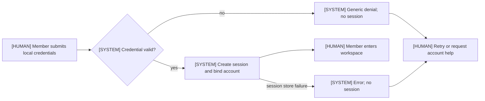

**Failure and compensation:** invalid credentials create no session and no account-existence signal; a session-store failure creates no session. Compensation is a new attempt or an account-administration request. Account recovery and disabled-account behaviour are outside BR-001 and are `[TBD-BIZ-004]` and `[TBD-BIZ-013]`.

### FLOW-002 — Chat message and assistant response

**Trigger:** a signed-in person opens a conversation and sends a message. **Status:** Confirmed — BR-002. Search, citations, skill selection, and tool calls are excluded from this flow (CAP-008, CAP-011, CAP-036, CAND-003, CAND-005). `[SRC: SRC-001]`

| Step | Actor | Input | Processing | Output | Exception | Time limit | Linked BR or TBD | Permission |
|---|---|---|---|---|---|---|---|---|
| N1 | ROLE-001 `[HUMAN]` | Session | Open or create a conversation | Conversation context | Inactive session → F1 | `TBD-BIZ-008`; suggested ≤ 200 ms (not a commitment) | BR-002 | own-only |
| N2 | ROLE-001 `[HUMAN]` | Message text | Submit a message | Message | Empty message → F1 | `TBD-BIZ-008`; suggested ≤ 200 ms (not a commitment) | BR-002 | own-only |
| D1 | SYS-002 `[SYSTEM]` | Message and session | Check message validity and an active session | Valid or rejected | Invalid → F1 | `TBD-BIZ-008`; suggested ≤ 200 ms (not a commitment) | BR-002 | allowed (system check) |
| N3 | SYS-002 `[SYSTEM]` | Valid message and conversation context | Send the prompt to the configured model | Model request | Provider timeout or error → D2 then F2 | `NFR-001` proposed ≤ 3,000 ms p95 to first token; `TBD-BIZ-008` | BR-002 | allowed (system) |
| D2 | SYS-002 `[SYSTEM]` | Model response | Check whether a response was received | Response or failure | No response → F2 | `NFR-001` proposed ≤ 3,000 ms p95; `TBD-BIZ-008` | BR-002 | allowed (system check) |
| N4 | SYS-002 `[SYSTEM]` | Model response | Append the assistant message | Assistant message | Append failure → F2 | `NFR-001` proposed ≤ 3,000 ms p95; `TBD-BIZ-008` | BR-002 | allowed (system) |
| N5 | ROLE-001 `[HUMAN]` | Assistant message | Read the answer | Answer | None | `NFR-001` proposed ≤ 3,000 ms p95; `TBD-BIZ-008` | BR-002 | own-only |
| F1 | SYS-002 `[SYSTEM]` | Invalid message or inactive session | Reject the message and create no assistant turn | Error | Correct and resend → C1 | `TBD-BIZ-008`; suggested ≤ 200 ms (not a commitment) | BR-002 | denied (no turn) |
| F2 | SYS-002 `[SYSTEM]` | Model timeout, provider error, or append failure | Show an error and create no fabricated answer | Error | Retry → C2 | `NFR-001` proposed ≤ 3,000 ms p95; `TBD-BIZ-008` | BR-002 | denied (no assistant message) |
| C1 | ROLE-001 `[HUMAN]` | Rejection | Correct the message and resend | New message | None | No limit — human action | BR-002 | own-only |
| C2 | ROLE-001 `[HUMAN]` | Provider error | Retry the request | New attempt | None | No limit — human action | BR-002 | own-only |
**Tag:** every row is sourced by BR-002; time limits are `[TBD-BIZ-008]` with `NFR-001` as a proposed target; the data boundary for N3 is `[TBD-BIZ-003]` and `[TBD-INFRA-009]`.

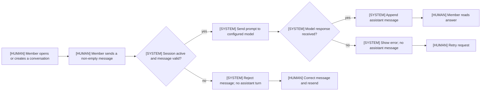

**Failure and compensation:** a provider failure produces an error and no assistant message; the person's message remains, and a retry is a new attempt. The product must not present a partial or invented answer as complete. The provider and data boundary are `[TBD-INFRA-009]` and `[TBD-BIZ-003]`; this flow does not settle them.

### FLOW-003 — Manual task run

**Trigger:** a signed-in person selects an existing task definition and submits inputs. **Status:** Confirmed for initiation and outcome — BR-005, BR-006, BR-008. Step execution is not effective until TBD-BIZ-007 closes; the task definition must already exist (FLOW-006, proposed). `[SRC: open_items.md#TBD-BIZ-002]` `[TBD-BIZ-007]`

| Step | Actor | Input | Processing | Output | Exception | Time limit | Linked BR or TBD | Permission |
|---|---|---|---|---|---|---|---|---|
| N1 | ROLE-001 `[HUMAN]` | Session | Select an existing task definition | Task definition and input form | No recorded task → F1 | `TBD-BIZ-008`; suggested ≤ 500 ms (not a commitment) | BR-005 | read-only |
| N2 | ROLE-001 `[HUMAN]` | Task inputs | Submit inputs | Run request | Invalid inputs → F1 | `TBD-BIZ-008`; suggested ≤ 500 ms (not a commitment) | BR-005 | allowed |
| D1 | SYS-004 `[SYSTEM]` | Run request and session | Validate inputs and an active session | Valid or rejected | Invalid → F1 | `TBD-BIZ-008`; suggested ≤ 500 ms (not a commitment) | BR-005 | allowed (system check) |
| F1 | SYS-004 `[SYSTEM]` | Invalid inputs or inactive session | Reject the run and create no run | Input error | Correct and retry → C1 | `TBD-BIZ-008`; suggested ≤ 500 ms (not a commitment) | BR-005 | denied (no run) |
| N3 | SYS-004 `[SYSTEM]` | Valid run request | Create the run and bind the initiating account | Run in `Initiated` | Creation failure → F2 | `TBD-BIZ-008`; suggested ≤ 500 ms (not a commitment) | BR-005; BR-006 | allowed (system) |
| N4 | SYS-004 `[SYSTEM]` | Run and next step | Execute the next step | Step result | Step failure or timeout → F2 | `NFR-003` proposed ≤ 2,000 ms to visible status; `TBD-BIZ-008` | BR-005 | allowed (system) |
| D2 | SYS-004 `[SYSTEM]` | Step result and remaining steps | Decide next action | Continue, succeed, or fail | Failure → F2 | `NFR-003` proposed ≤ 2,000 ms; `TBD-BIZ-008` | BR-008 | allowed (system check) |
| N5 | SYS-004 `[SYSTEM]` | Last step succeeded | Finalize the run as succeeded | Succeeded run and step statuses | Persistence failure → F2 | `NFR-003` proposed ≤ 2,000 ms; `TBD-BIZ-008` | BR-008 | allowed (system) |
| F2 | SYS-004 `[SYSTEM]` | Step failed, timed out, or run creation failed | Finalize the run as failed, record the failed step, and skip remaining steps | Failed run and failed step | Correct and start a new run → C2 | `NFR-003` proposed ≤ 2,000 ms; `TBD-BIZ-008` | BR-008 | denied (terminal failure) |
| N6 | ROLE-001 `[HUMAN]` | Succeeded run | View the outcome | Result | None | `NFR-003` proposed ≤ 2,000 ms; `TBD-BIZ-008` | BR-008 | own-only |
| N7 | ROLE-001 `[HUMAN]` | Failed run | View the failed outcome and failed step | Error and step status | None | `NFR-003` proposed ≤ 2,000 ms; `TBD-BIZ-008` | BR-008 | own-only |
| C1 | ROLE-001 `[HUMAN]` | Input error | Correct the inputs and start a new run | New run request | None | No limit — human action | BR-005 | allowed |
| C2 | ROLE-001 `[HUMAN]` | Failed run | Correct the cause and start a new run | New run request | Step execution model is `TBD-BIZ-007` | No limit — human action | BR-008 | allowed |
**Tag:** BR-005, BR-006, and BR-008 source the run lifecycle; time limits are `[TBD-BIZ-008]` with `NFR-003` as a proposed target; step execution is `[TBD-BIZ-007]`.

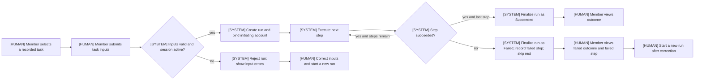

**Failure and compensation:** input rejection creates no run. A failed step stops the run and marks it failed; remaining steps are `Skipped`; the initiating person sees the failed step and the run outcome. There is no automatic retry in the confirmed core. An existing run is never mutated to hide a failure; compensation is a new run. `[DERIVED: BR-008]`

### FLOW-004 — Skill registration and publication (proposed, not effective)

**Trigger:** a proposed Admin opens the skill registry and creates a skill. **Status:** Proposed — not effective. Publication authority is `[TBD-BIZ-004]`; BR-003 confirms that the registry exists but does not grant a person the right to publish. `[SRC: open_items.md#TBD-BIZ-001]`

| Step | Actor | Input | Processing | Output | Exception | Time limit | Linked BR or TBD | Permission |
|---|---|---|---|---|---|---|---|---|
| N1 | ROLE-002 `[HUMAN]` | Session | Open the skill form | Draft skill | No authority → F2 | `TBD-BIZ-008`; suggested ≤ 500 ms for list read (not a commitment) | BR-003 | denied until TBD-BIZ-004 |
| N2 | ROLE-002 `[HUMAN]` | Name, description, instructions, input definition, declared tool dependencies | Record a draft | Draft skill | Validation failure → F1 | `TBD-BIZ-008`; suggested ≤ 500 ms (not a commitment) | BR-003 | denied until TBD-BIZ-004 |
| D1 | SYS-003 `[SYSTEM]` | Draft skill | Validate required content | Valid or invalid | Invalid → F1 | `TBD-BIZ-008`; suggested ≤ 500 ms (not a commitment) | BR-003 | allowed (system check) |
| F1 | SYS-003 `[SYSTEM]` | Invalid draft | Keep the draft and show validation errors | Draft retained | Correct and resubmit → C1 | `TBD-BIZ-008`; suggested ≤ 500 ms (not a commitment) | BR-003 | denied (no publication) |
| N3 | ROLE-002 `[HUMAN]` | Draft and sample input | Test the skill in an isolated draft conversation | Test result | Test failure → F1 | `TBD-BIZ-008`; suggested ≤ 3,000 ms p95 (not a commitment) | BR-003; CAND-008 | denied until TBD-BIZ-004 |
| D2 | SYS-003 `[SYSTEM]` | Valid draft and publication request | Check publication authority and validation | Allowed or denied | Denied → F2 | `TBD-BIZ-008`; suggested ≤ 500 ms (not a commitment) | BR-003 | allowed (system check) |
| F2 | SYS-003 `[SYSTEM]` | Missing authority or failed validation | Deny publication and keep the draft | Draft retained | Request authority → C2 | `TBD-BIZ-008`; suggested ≤ 500 ms (not a commitment) | BR-003 | denied (no version) |
| N4 | SYS-003 `[SYSTEM]` | Authorized valid draft | Publish an immutable version | Published skill version | Publication failure → F2 | `TBD-BIZ-008`; suggested ≤ 500 ms (not a commitment) | BR-003 | denied until TBD-BIZ-004 |
| N5 | ROLE-001 `[HUMAN]` | Published version | See the skill in the registry | Selectable skill | Registry unavailable → F2 | `NFR-002` proposed ≤ 500 ms p95 for 500 items; `TBD-BIZ-008` | BR-003 | read-only |
| C1 | ROLE-002 `[HUMAN]` | Validation error | Correct and resubmit | New draft submission | None | No limit — human action | BR-003 | denied until TBD-BIZ-004 |
| C2 | ROLE-002 `[HUMAN]` | Publication denial | Request publication authority | Authority request | None | No limit — human action | TBD-BIZ-004 | denied until TBD-BIZ-004 |
**Tag:** the flow is proposed and not effective; BR-003 supports registry visibility only; the human grants are `[TBD-BIZ-004]`; time limits are `[TBD-BIZ-008]` with `NFR-002` as a proposed target.

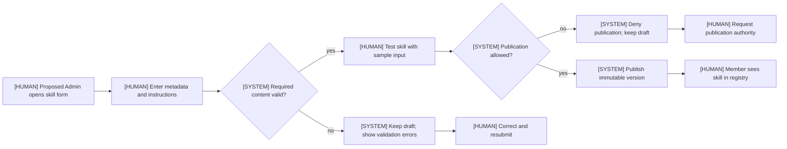

**Failure and compensation:** validation or test failure keeps the draft and publishes nothing; a denied publication keeps the draft and records the request. An immutable version is never overwritten; a correction creates a new version. Publication review, approval, and delegated authorship are CAND-001, CAND-002, and CAND-003 and are not active. `[DERIVED: BR-003 and CAND-001/002/003]`

### FLOW-005 — MCP server registration and allowlisting (proposed, not effective)

**Trigger:** a proposed Admin registers an MCP server, tests it, and allowlists tools. **Status:** Proposed — not effective. BR-004 confirms that the registry exists; registration and allowlist grants are `[TBD-BIZ-004]` and execution is `[TBD-BIZ-007]`. `[SRC: open_items.md#TBD-BIZ-001]`

| Step | Actor | Input | Processing | Output | Exception | Time limit | Linked BR or TBD | Permission |
|---|---|---|---|---|---|---|---|---|
| N1 | ROLE-002 `[HUMAN]` | Session | Open the MCP server form | Server draft | No authority → F2 | `TBD-BIZ-008`; suggested ≤ 500 ms (not a commitment) | BR-004 | denied until TBD-BIZ-004 |
| N2 | ROLE-002 `[HUMAN]` | Name, connection type, endpoint reference, auth reference, timeout | Record a server draft | Server draft | Validation failure → F1 | `TBD-BIZ-008`; suggested ≤ 500 ms (not a commitment) | BR-004 | denied until TBD-BIZ-004 |
| D1 | SYS-005 `[SYSTEM]` | Server draft | Test the connection | Success, failure, or needs authentication | Failure → F1 | `TBD-BIZ-008`; suggested ≤ 5,000 ms p95 (not a commitment) | BR-004 | allowed (system check) |
| F1 | SYS-005 `[SYSTEM]` | Connection failure | Record error health; expose no tools | Server in error state | Correct and retest → C1 | `TBD-BIZ-008`; suggested ≤ 5,000 ms p95 (not a commitment) | BR-004 | denied (no tools) |
| N3 | SYS-005 `[SYSTEM]` | Successful connection | Discover tools | Tool list | Discovery failure → F1 | `TBD-BIZ-008`; suggested ≤ 5,000 ms p95 (not a commitment) | BR-004 | allowed (system) |
| N4 | ROLE-002 `[HUMAN]` | Tool list | Allowlist individual tools | Allowed tool set | No authority → F2 | `TBD-BIZ-008`; suggested ≤ 500 ms (not a commitment) | BR-004 | denied until TBD-BIZ-004 |
| D2 | SYS-005 `[SYSTEM]` | Tool call | Check the tool against the allowlist | Allowed or denied | Not allowlisted → F2 | `TBD-BIZ-008`; suggested ≤ 500 ms (not a commitment) | BR-004 | allowed (system check) |
| F2 | SYS-005 `[SYSTEM]` | Tool not allowlisted | Deny the call and show an error | Denied call | Request allowlist change → C2 | `TBD-BIZ-008`; suggested ≤ 500 ms (not a commitment) | BR-004 | denied (no call) |
| N5 | SYS-005 `[SYSTEM]` | Allowed tool call | Invoke the tool and return the result | Tool result | Invocation error → F2 | `TBD-BIZ-008`; suggested ≤ 5,000 ms p95 (not a commitment) | BR-004 | denied until TBD-BIZ-007 |
| C1 | ROLE-002 `[HUMAN]` | Connection failure | Correct the connection and retest | New test | None | No limit — human action | BR-004 | denied until TBD-BIZ-004 |
| C2 | ROLE-001 `[HUMAN]` | Denied call | Request an allowlist change | Allowlist request | None | No limit — human action | TBD-BIZ-004 | denied until TBD-BIZ-004 |
**Tag:** the flow is proposed and not effective; BR-004 supports registry visibility and deny-on-unrecorded; the human grants are `[TBD-BIZ-004]`; invocation is `[TBD-BIZ-007]`.

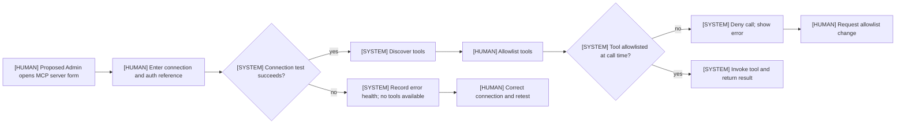

**Failure and compensation:** a failed test records error health and exposes no tools; a later retest can move the server to connected. A non-allowlisted call is denied and is not retried automatically. Credential values are never displayed; whether they are stored as references is CAND-021, not an active rule. Write-capable tools are proposed to be disabled (CAND-014), which is not active. `[DERIVED: BR-004 and CAND-014/021]`

### FLOW-006 — Task definition and publication (proposed, not effective)

**Trigger:** a proposed Admin defines a task and publishes a version. **Status:** Proposed — not effective. BR-005 confirms the task-run capability; who may define or publish a task depends on TBD-BIZ-004 and step execution depends on TBD-BIZ-007. `[SRC: open_items.md#TBD-BIZ-001]` `[TBD-BIZ-002]`

| Step | Actor | Input | Processing | Output | Exception | Time limit | Linked BR or TBD | Permission |
|---|---|---|---|---|---|---|---|---|
| N1 | ROLE-002 `[HUMAN]` | Session | Open the task form | Draft task | No authority → F2 | `TBD-BIZ-008`; suggested ≤ 500 ms (not a commitment) | BR-005 | denied until TBD-BIZ-004 |
| N2 | ROLE-002 `[HUMAN]` | Name, description, input definition, ordered steps, step parameters | Record a draft | Draft task | Validation failure → F1 | `TBD-BIZ-008`; suggested ≤ 500 ms (not a commitment) | BR-005 | denied until TBD-BIZ-004 |
| D1 | SYS-003 `[SYSTEM]` | Draft task | Validate the input definition and step references | Valid or invalid | Invalid → F1 | `TBD-BIZ-008`; suggested ≤ 500 ms (not a commitment) | BR-005 | allowed (system check) |
| F1 | SYS-003 `[SYSTEM]` | Invalid draft | Keep the draft and show errors | Draft retained | Correct and resubmit → C1 | `TBD-BIZ-008`; suggested ≤ 500 ms (not a commitment) | BR-005 | denied (no publication) |
| N3 | ROLE-002 `[HUMAN]` | Draft and sample inputs | Test-run the draft | Test run result | Test failure → F1 | `TBD-BIZ-008`; suggested ≤ 2,000 ms p95 (not a commitment) | BR-005; CAND-009 | denied until TBD-BIZ-004 |
| D2 | SYS-003 `[SYSTEM]` | Valid draft and publication request | Check publication authority and validation | Allowed or denied | Denied → F2 | `TBD-BIZ-008`; suggested ≤ 500 ms (not a commitment) | BR-005 | allowed (system check) |
| F2 | SYS-003 `[SYSTEM]` | Missing authority or failed validation | Deny publication and keep the draft | Draft retained | Request authority → C2 | `TBD-BIZ-008`; suggested ≤ 500 ms (not a commitment) | BR-005 | denied (no version) |
| N4 | SYS-003 `[SYSTEM]` | Authorized valid draft | Publish a task version | Published task version | Publication failure → F2 | `TBD-BIZ-008`; suggested ≤ 500 ms (not a commitment) | BR-005 | denied until TBD-BIZ-004 |
| N5 | ROLE-001 `[HUMAN]` | Published task version | See the task available for a manual run | Selectable task | Registry unavailable → F2 | `NFR-002` proposed ≤ 500 ms p95 for 500 items; `TBD-BIZ-008` | BR-005 | read-only |
| C1 | ROLE-002 `[HUMAN]` | Validation error | Correct and resubmit | New draft submission | None | No limit — human action | BR-005 | denied until TBD-BIZ-004 |
| C2 | ROLE-002 `[HUMAN]` | Publication denial | Request publication authority | Authority request | None | No limit — human action | TBD-BIZ-004 | denied until TBD-BIZ-004 |
**Tag:** the flow is proposed and not effective; BR-005 supports the run object only; the human grants are `[TBD-BIZ-004]`; execution is `[TBD-BIZ-007]`.

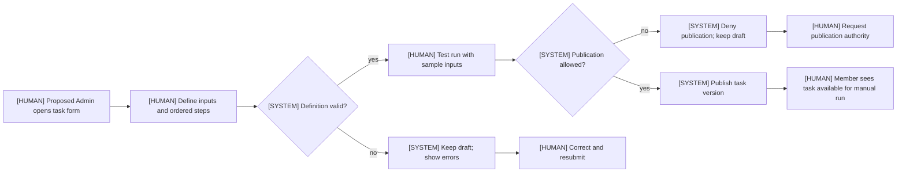

**Failure and compensation:** validation or test failure keeps the draft; a denied publication keeps the draft and records the request. A published version is not overwritten; edits create a new version (CAND-009). A task with no steps or with a reference to an unregistered target is invalid; enforcement is CAND-003. `[DERIVED: BR-005 and CAND-009]`

## 5. Entities and relationships

Entities describe business meaning, not storage. No table name, column type, index, or persistence key appears here. The unique key is the business reference that a person or a downstream contract uses to identify one instance. `[DERIVED: SRC-006 §⑤]`

**ER diagram tag:** the entities and cardinalities below are sourced by SRC-001 for ENT-001, ENT-003, ENT-004, ENT-006, ENT-008, ENT-011, and ENT-014; the remaining entities are `[TBD-BIZ-004]` and `[TBD-BIZ-007]` proposals. `[SRC: open_items.md#TBD-BIZ-001]`

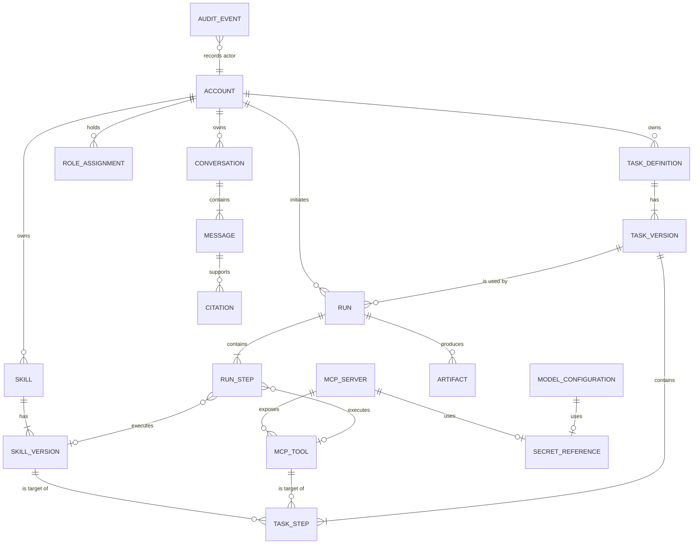

**ER reading note:** a Run Step references exactly one of Skill Version or MCP Tool, and a Task Step does the same. The optional edges express that either target may be present; they do not permit both targets at once. The diagram cannot express exclusive-or cardinality; the entity table is authoritative for the exactly-one constraint. `[DERIVED: §5.1 ENT-013 and ENT-015]`

### 5.1 Entity table

The data-classification column is deliberately `TBD-BIZ-003`: the product owner has not selected (a) no user data, (b) personal non-sensitive data, or (c) regulated or sensitive data. The PII column states whether a person-identifying field is defined; it is not a legal classification. `[TBD-BIZ-003]`

| ENT | Business meaning | Unique business key | Data classification | PII (yes/no) | Cardinality and links | Lifecycle or state model | Status | Tag |
|---|---|---|---|---|---|---|---|---|
| **ENT-001** Account | A person's workspace identity, provisioned as a local account | Sign-in name, unique within the workspace | `TBD-BIZ-003` (candidate B: personal, non-sensitive) | yes — sign-in name and display name identify a person | 1 Account owns 0..N Conversations; initiates 0..N Runs; owns 0..N Skills and Task Definitions; holds 0..N Role Assignments | STATE-006 | Identity confirmed; lifecycle proposed | `[SRC: open_items.md#TBD-BIZ-002]` `[TBD-BIZ-004]` `[TBD-BIZ-013]` |
| **ENT-002** Role Assignment | A role held by an account | (Account, role name), unique | `TBD-BIZ-003` (candidate B) | yes — the record links a person to a role | N Role Assignments belong to 1 Account; 1 Role Assignment names 1 role | None — assignment record | Proposed | `[TBD-BIZ-004]` `[CONFLICT-001]` |
| **ENT-003** Conversation | A persisted chat exchange between one person and the assistant | Conversation reference shown to the person, unique within the owner's account | `TBD-BIZ-003` (candidate B) | yes — owner identity; content may contain personal data | 1 Account owns 0..N Conversations; 1 Conversation contains 1..N Messages; 0..N Runs may be linked | None — create and continue only | Existence confirmed; rename, pin, and delete proposed | `[SRC: open_items.md#TBD-BIZ-001]` `[TBD-BIZ-003]` |
| **ENT-004** Message | One turn in a conversation, authored by the person or the assistant | (Conversation, position), unique | `TBD-BIZ-003` (candidate B) | yes — author identity; free text may contain personal data | N Messages belong to 1 Conversation; 1 assistant Message may carry 0..N Citations and 0..N tool receipts | None — immutable after append | Existence confirmed; immutability proposed | `[SRC: open_items.md#TBD-BIZ-001]` `[TBD-BIZ-003]` |
| **ENT-005** Citation | A source shown in support of an assistant answer | (Assistant message, ordinal), unique | `TBD-BIZ-003` (candidate A) | no — title and location are source metadata | 0..N Citations per assistant Message; 1 Citation names 1 source | None — immutable | Proposed | `[TBD-BIZ-011]` `[TBD-INFRA-011]` |
| **ENT-006** Skill | A versioned instruction bundle registered for reuse | Skill name, unique within the workspace | `TBD-BIZ-003` (candidate B) | yes — owner attribution | 1 Skill has 1..N Skill Versions; 0..N Task Steps reference a Skill Version | STATE-003 (version level) | Existence confirmed; lifecycle proposed | `[SRC: open_items.md#TBD-BIZ-001]` `[TBD-BIZ-004]` |
| **ENT-007** Skill Version | An immutable published snapshot of a Skill | (Skill name, version label), unique | `TBD-BIZ-003` (candidate B) | no — no person-identifying field; content may contain personal data | 1 Skill has 1..N Skill Versions; 0..N Task Steps reference a Skill Version | STATE-003 | Proposed | `[TBD-BIZ-004]` `[TBD-BIZ-007]` |
| **ENT-008** MCP Server | A registered MCP endpoint governed by the workspace | Server name, unique within the workspace | `TBD-BIZ-003` (candidate B) | no — endpoint and auth reference; no person field | 1 MCP Server exposes 0..N MCP Tools; 0..1 Secret Reference per Server | STATE-004 | Existence confirmed; lifecycle proposed | `[SRC: open_items.md#TBD-BIZ-001]` `[TBD-BIZ-004]` |
| **ENT-009** MCP Tool | A tool discovered on a registered MCP server | (Server name, tool name), unique | `TBD-BIZ-003` (candidate A) | no — tool name only | 1 MCP Server exposes 0..N MCP Tools; 0..N Task Steps reference a Tool | None — allowlist flag | Proposed | `[TBD-BIZ-004]` `[TBD-BIZ-007]` |
| **ENT-010** Secret Reference | A governed pointer to a credential used by a server or model configuration | Reference name plus purpose, unique | `TBD-BIZ-003` (candidate C if the reference resolves to a credential; otherwise B) | no — the reference contains no person field | 0..1 Secret Reference per MCP Server; 0..1 per Model Configuration | None — created, rotated, revoked | Proposed | `[TBD-BIZ-003]` `[TBD-INFRA-009]` |
| **ENT-011** Task Definition | A reusable, ordered composition of registered skills and MCP tools | Task name, unique within the workspace | `TBD-BIZ-003` (candidate B) | yes — owner attribution | 1 Task Definition has 1..N Task Versions; 1 Task Version is used by 0..N Runs | STATE-005 (version level) | Existence confirmed; lifecycle proposed | `[SRC: open_items.md#TBD-BIZ-001]` `[TBD-BIZ-004]` |
| **ENT-012** Task Version | An immutable published snapshot of a Task Definition | (Task name, version label), unique | `TBD-BIZ-003` (candidate B) | no — no person-identifying field | 1 Task Definition has 1..N Task Versions; 1 Task Version has 1..N Task Steps; 1 Task Version is used by 0..N Runs | STATE-005 | Proposed | `[TBD-BIZ-004]` `[TBD-BIZ-007]` |
| **ENT-013** Task Step | One ordered instruction in a task version | (Task version, ordinal), unique and contiguous | `TBD-BIZ-003` (candidate A) | no — instruction only | N Task Steps belong to 1 Task Version; 1 Task Step references exactly 1 Skill Version or 1 MCP Tool | None — frozen with the version | Proposed | `[TBD-BIZ-007]` |
| **ENT-014** Run | One manual execution of a task version by a signed-in person | Run reference shown to the person, unique within the workspace | `TBD-BIZ-003` (candidate B) | yes — initiator attribution | 1 Run uses 1 Task Version; 1 Account initiates 0..N Runs; 1 Run has 1..N Run Steps; 1 Run produces 0..N Artifacts | STATE-001 | Existence and initiation confirmed; other invariants proposed | `[SRC: open_items.md#TBD-BIZ-002]` `[TBD-BIZ-007]` |
| **ENT-015** Run Step | The execution record of one task step | (Run reference, ordinal), unique | `TBD-BIZ-003` (candidate B) | no — no person-identifying field | N Run Steps belong to 1 Run; 1 Run Step references 1 Skill Version or 1 MCP Tool | STATE-002 | Proposed | `[TBD-BIZ-007]` |
| **ENT-016** Artifact | A file or output produced by a run | (Run reference, artifact name), unique | `TBD-BIZ-003` (candidate B or C; content dependent) | yes — content may contain personal data; no person field is defined | 0..N Artifacts per Run | None — created with the run | Proposed | `[TBD-BIZ-003]` `[TBD-BIZ-004]` |
| **ENT-017** Audit Event | An append-only record of a consequential action | Event reference, unique and append-only | `TBD-BIZ-003` (candidate B) | yes — actor attribution | 0..N Audit Events per actor; 1 Audit Event names 1 action and 1 target | None — append-only | Proposed | `[TBD-BIZ-009]` |
| **ENT-018** Model Configuration | The configured model endpoint used by chat | Configuration name, unique; one active configuration | `TBD-BIZ-003` (candidate B) | no — endpoint and model name | 0..1 active Model Configuration per workspace; 0..1 Secret Reference | None — active or inactive | Proposed | `[TBD-INFRA-009]` |

### 5.2 Cross-entity invariants

1. Every Conversation has exactly one owning Account; every Run has exactly one initiating Account. Confirmed in substance by BR-002, BR-005, and BR-006 for the entities in the MVP. `[DERIVED: BR-002, BR-005, BR-006]`
2. A Run uses exactly one Task Version and has at least one Run Step. `[DERIVED: BR-005]`
3. A published Skill Version or Task Version is immutable; a correction creates a new version. `[TBD-BIZ-004]`
4. A Secret Reference never contains a credential value. `[TBD-BIZ-003]`
5. An Audit Event is append-only. `[TBD-BIZ-009]`
6. No entity is hard-deleted while a Run or an Audit Event still refers to it; retention and deletion are `[TBD-BIZ-003]`.
7. A disabled Account cannot authenticate or initiate new work; existing objects retain owner attribution until an offboarding policy is confirmed. `[TBD-BIZ-004]` `[TBD-BIZ-013]`

## 6. Roles and permissions

**Default rule:** every action is `denied` unless a confirmed permission or a confirmed system condition grants it. There are no implicit permissions. `[DERIVED: SRC-001 grants enumerated capabilities only]` `[TBD-BIZ-004]`

**Confirmed role:** only ROLE-001 has confirmed actions. ROLE-002, ROLE-003, and ROLE-004 are proposed and have no effective grant. Their current result is `denied` in every matrix cell. `[TBD-BIZ-004]` `[CONFLICT-001]`

### 6.1 Role definitions

| ID | Actor | Status | Responsibilities | Accessible resources | Explicitly excludes | Tag |
|---|---|---|---|---|---|---|
| **ROLE-001** | Member | Confirmed base role | Sign in with a local account; start and continue own conversations; initiate a manual run of a recorded task definition; see the outcome of a run they initiated | Own conversation and messages; task-run initiation; own run outcome; registry listings | Creating or publishing registry entries; MCP registration or allowlisting; account administration; model or search configuration; another person's conversation or run; audit and export | `[SRC: open_items.md#TBD-BIZ-002]` `[SRC: prd.md#§6]` |
| **ROLE-002** | Admin | Proposed | Full workspace administration: accounts and roles, skill and task publication, MCP registration and allowlisting, model and search configuration, all runs and audit | All workspace resources, subject to proposed secret and audit limits | Reading secret values (CAND-021); bypassing audit (CAND-004); no confirmed exclusion is stated in the inputs | `[SRC: prd.md#§6]` `[TBD-BIZ-004]` |
| **ROLE-003** | Author | Proposed | Create and edit skill and task drafts; test drafts | Own drafts and their test results | Publication; MCP registration or allowlisting; account administration; audit; model or search configuration | `[SRC: prd.md#§6]` `[TBD-BIZ-004]` |
| **ROLE-004** | Auditor | Proposed; blocked by CONFLICT-001 | Review runs and audit records; export audit if confirmed | All runs and audit records, read-only | Chat; run initiation; registry edits; account administration; model or search configuration | `[SRC: prd.md#§6]` `[CONFLICT-001]` `[TBD-BIZ-009]` |

### 6.2 Effective permission matrix

Rows are roles. Columns are `entity.operation`. Every cell is exactly one of `allowed`, `denied`, `own-only`, or `read-only`; no cell is blank. `denied` means no confirmed grant exists. `[DERIVED: SRC-006 §⑤]` `[TBD-BIZ-004]`

| Role | Account.read | Account.manage | Conversation.chat | Conversation.read | Message.read | Skill.read | Skill.publish | McpServer.read | McpServer.register | McpTool.allowlist | McpTool.invoke | TaskDefinition.read | TaskDefinition.publish | Run.initiate | Run.read | RunStep.read | Artifact.read | Audit.read |
|---|---|---|---|---|---|---|---|---|---|---|---|---|---|---|---|---|---|---|
| **ROLE-001** Member | denied | denied | own-only | own-only | own-only | read-only | denied | read-only | denied | denied | denied | read-only | denied | allowed | own-only | own-only | denied | denied |
| **ROLE-002** Admin (proposed) | denied | denied | denied | denied | denied | denied | denied | denied | denied | denied | denied | denied | denied | denied | denied | denied | denied | denied |
| **ROLE-003** Author (proposed) | denied | denied | denied | denied | denied | denied | denied | denied | denied | denied | denied | denied | denied | denied | denied | denied | denied | denied |
| **ROLE-004** Auditor (proposed) | denied | denied | denied | denied | denied | denied | denied | denied | denied | denied | denied | denied | denied | denied | denied | denied | denied | denied |

### 6.2.1 Matrix tag basis

Every non-denied cell is listed here with its source. A derived cell is a permission entailed by a named BR, not a new rule; if the product owner rejects the entailment, the cell becomes `denied` and no BR changes. Every `denied` cell is `[TBD-BIZ-004]` for human authority, `[TBD-BIZ-009]` for audit, `[TBD-BIZ-003]` for artifact download, and `[TBD-BIZ-007]` for tool invocation. `[DERIVED: default deny]`

| Role | Non-denied cells | Source | Remaining cells |
|---|---|---|---|
| ROLE-001 | `Conversation.chat` = own-only; `Conversation.read` = own-only; `Message.read` = own-only; `Run.read` = own-only; `RunStep.read` = own-only | BR-002 creates and continues the owner's conversation; BR-008 shows the outcome and failed step to the initiator; `RunStep.read` is limited to the initiator's own run and covers the step statuses required by FLOW-003 N6/N7 | `[TBD-BIZ-004]` for registry and account authority, including `Account.read`; `[TBD-BIZ-003]` for Artifact.read; `[TBD-BIZ-009]` for Audit.read |
| ROLE-001 | `Skill.read`, `McpServer.read`, `TaskDefinition.read` = read-only | `[DERIVED: BR-003 lists recorded skills; BR-004 lists recorded servers; BR-005 makes a recorded task the object of initiation]` | none |
| ROLE-001 | `Run.initiate` = allowed | BR-005 and BR-006 | none |
| ROLE-002 | none | No confirmed grant; proposed grants are in §6.3 | `[TBD-BIZ-004]`; `[CONFLICT-001]` for audit |
| ROLE-003 | none | No confirmed grant; proposed grants are in §6.3 | `[TBD-BIZ-004]` |
| ROLE-004 | none | No confirmed grant; blocked by CONFLICT-001 | `[CONFLICT-001]`; `[TBD-BIZ-009]` |

### 6.3 Proposed role grants (not effective)

These grants are proposals from the Draft PRD §6/§13 and the prototype. They are not permissions in v0.2. `[TBD-BIZ-004]` `[SRC: prd.md#§13]`

| Actor | Resource and action | Current result | Scope BR | Proposed result | Condition and candidate | Tag |
|---|---|---|---|---|---|---|
| ROLE-002 Admin | Skill create, edit, publish, deprecate | denied | BR-003 | Proposed allowed | TBD-BIZ-004; CAND-001, CAND-002 | `[TBD-BIZ-004]` |
| ROLE-002 Admin | MCP server register, test, allowlist, retire | denied | BR-004 | Proposed allowed | TBD-BIZ-004; CAND-001, CAND-002 | `[TBD-BIZ-004]` |
| ROLE-002 Admin | Task create, publish, retire | denied | BR-005 | Proposed allowed | TBD-BIZ-004; CAND-001, CAND-002 | `[TBD-BIZ-004]` |
| ROLE-002 Admin | View all runs and audit; export | denied | BR-008 for runs | Proposed allowed | TBD-BIZ-009, TBD-BIZ-011; CAND-004 | `[TBD-BIZ-009]` |
| ROLE-002 Admin | Manage accounts and roles | denied | BR-001 for account existence | Proposed allowed | TBD-BIZ-004, TBD-BIZ-013; CAND-015 | `[TBD-BIZ-004]` |
| ROLE-002 Admin | Configure model endpoint and search provider | denied | BR-002 for the model | Proposed allowed | TBD-INFRA-009, TBD-INFRA-011; CAND-006 | `[TBD-INFRA-009]` |
| ROLE-003 Author | Create and edit own skill and task drafts | denied | BR-003, BR-005 | Proposed allowed | TBD-BIZ-004; CAND-001, CAND-002 | `[TBD-BIZ-004]` |
| ROLE-003 Author | Publish or deprecate | denied | BR-003, BR-005 | Proposed denied | Draft PRD §6 says the Author cannot publish | `[SRC: prd.md#§6]` |
| ROLE-003 Author | Register MCP servers or allowlist tools | denied | BR-004 | Proposed denied | Draft PRD §6 excludes it | `[SRC: prd.md#§6]` |
| ROLE-004 Auditor | View all runs and audit; export | denied | BR-008 for runs | Proposed allowed | CONFLICT-001, TBD-BIZ-009; CAND-004 | `[CONFLICT-001]` |
| ROLE-004 Auditor | Chat, initiate runs, or edit registries | denied | none | Proposed denied | CONFLICT-001 | `[CONFLICT-001]` |
| ROLE-002/003/004 | Use ROLE-001 actions | denied | BR-001, BR-002 | Proposed allowed through ROLE-001 | CAND-001 role layering; not effective | `[TBD-BIZ-004]` |

### 6.4 System and external actors

| Actor | Resource and action | Result | Linked BR | Condition | Tag |
|---|---|---|---|---|---|
| SYS-001 | Authenticate a local account | allowed | BR-001 | Credential must match a local account | `[SRC: open_items.md#TBD-BIZ-002]` |
| SYS-001 | Create a session and bind the actor | allowed | BR-001 | Only after successful local authentication | `[SRC: open_items.md#TBD-BIZ-002]` |
| SYS-002 | Send a prompt to the configured model | allowed | BR-002 | Model must be configured; the data boundary is `[TBD-BIZ-003]` and `[TBD-INFRA-009]` | `[SRC: open_items.md#TBD-BIZ-001]` |
| SYS-002 | Append an assistant message | allowed | BR-002 | Only after a successful model response | `[SRC: open_items.md#TBD-BIZ-001]` |
| SYS-003 | Store a registry entry | denied | BR-003, BR-004, BR-005 | No confirmed human submission authority; `[TBD-BIZ-004]` | `[TBD-BIZ-004]` |
| SYS-003 | Validate a registry entry | allowed | BR-003, BR-004, BR-005 | Validation runs on every submission | `[SRC: open_items.md#TBD-BIZ-001]` |
| SYS-004 | Create a run | allowed | BR-006 | Only with a signed-in initiating account; no schedule or external trigger | `[SRC: open_items.md#TBD-BIZ-002]` |
| SYS-004 | Execute a task step | allowed | BR-005 | Step target must be registered; the execution model is `[TBD-BIZ-007]` | `[SRC: open_items.md#TBD-BIZ-002]` |
| SYS-004 | Finalize a run as succeeded or failed | allowed | BR-008 | Terminal outcome must be recorded | `[SRC: open_items.md#TBD-BIZ-002]` |
| SYS-005 | Test an MCP connection | denied | BR-004 | Requires a registered server and a human grant; `[TBD-BIZ-004]` | `[TBD-BIZ-004]` |
| SYS-005 | Invoke an MCP tool | denied | BR-004 | Tool must be allowlisted; policy is `[TBD-BIZ-004]` and `[TBD-BIZ-007]` | `[TBD-BIZ-007]` |
| SYS-005 | Read a secret value to complete a connection | denied | BR-004 | Secret handling is `[TBD-BIZ-003]` and CAND-021 | `[TBD-BIZ-003]` |
| SYS-006 | Append an audit event | denied | none | No confirmed audit obligation; `[TBD-BIZ-009]` | `[TBD-BIZ-009]` |
| EXT-001 | Receive tool invocation arguments | denied | BR-004 | Invocation is not confirmed; `[TBD-BIZ-007]` | `[TBD-BIZ-007]` |
| EXT-001 | Read conversations or registry content | denied | none | No grant | `[DERIVED: no confirmed grant]` |
| EXT-001 | Receive credential values | denied | none | Only a Secret Reference may be used; CAND-021 | `[TBD-BIZ-003]` |
| EXT-002 | Receive prompt context | allowed | BR-002 | Only within the confirmed data boundary; `[TBD-BIZ-003]` and `[TBD-INFRA-009]` | `[TBD-BIZ-003]` |
| EXT-002 | Receive credential values | denied | none | No grant | `[DERIVED: no confirmed grant]` |
| EXT-003 | Receive a search query | denied | none | Search is out of the confirmed MVP; `[TBD-BIZ-011]` and `[TBD-INFRA-011]` | `[TBD-BIZ-011]` |

## 7. State model

Six state models are effective or proposed. STATE-001 and STATE-002 are effective because they follow from the confirmed manual-run capability and BR-005, BR-006, and BR-008. STATE-003 through STATE-006 are proposed and not effective; their transitions rest on TBD-BIZ-004 and, where execution is involved, TBD-BIZ-007. The contract's "one diagram per entity" wording is interpreted as one diagram per state-bearing entity; that interpretation is TBD-BIZ-015 and is not a product-owner decision. `[SRC: open_items.md#TBD-BIZ-002]` `[TBD-BIZ-004]` `[TBD-BIZ-015]`

Every entity is mapped to a state model or to an explicit "no state model" reason in §7.0, so no entity is left unadjudicated. An immutable, append-only, or derived entity has no lifecycle state to draw; a `stateDiagram-v2` for it would invent states that the inputs do not support. `[DERIVED: SRC-006 §⑥]`

### 7.0 Entity-to-state coverage

| ENT | State model | Reason | Tag |
|---|---|---|---|
| ENT-001 Account | STATE-006 | Account lifecycle is proposed | `[TBD-BIZ-004]` `[TBD-BIZ-013]` |
| ENT-002 Role Assignment | None | Assignment is a record with an assigned or revoked flag, not a lifecycle | `[TBD-BIZ-004]` |
| ENT-003 Conversation | None | Only create and continue are confirmed; rename, pin, and delete are CAP-018 | `[TBD-BIZ-011]` |
| ENT-004 Message | None | Immutable after append | `[TBD-BIZ-003]` |
| ENT-005 Citation | None | Immutable with its message | `[TBD-BIZ-011]` |
| ENT-006 Skill | STATE-003 (version level) | Skill lifecycle is carried by its versions | `[TBD-BIZ-004]` |
| ENT-007 Skill Version | STATE-003 | Draft, published, deprecated, superseded, discarded | `[TBD-BIZ-004]` |
| ENT-008 MCP Server | STATE-004 | Health lifecycle is proposed | `[TBD-BIZ-004]` |
| ENT-009 MCP Tool | None | Allowlist flag, not a lifecycle | `[TBD-BIZ-004]` |
| ENT-010 Secret Reference | None | Created, rotated, revoked; no state semantics are confirmed | `[TBD-BIZ-003]` |
| ENT-011 Task Definition | STATE-005 (version level) | Task lifecycle is carried by its versions | `[TBD-BIZ-004]` |
| ENT-012 Task Version | STATE-005 | Draft, published, retired, superseded, discarded | `[TBD-BIZ-004]` |
| ENT-013 Task Step | None | Frozen with its task version | `[TBD-BIZ-007]` |
| ENT-014 Run | STATE-001 | Initiated, running, succeeded, failed | `[SRC: open_items.md#TBD-BIZ-002]` |
| ENT-015 Run Step | STATE-002 | Pending, running, succeeded, failed, skipped | `[SRC: open_items.md#TBD-BIZ-002]` |
| ENT-016 Artifact | None | Created with the run; no separate lifecycle | `[TBD-BIZ-003]` |
| ENT-017 Audit Event | None | Append-only | `[TBD-BIZ-009]` |
| ENT-018 Model Configuration | None | Active or inactive configuration | `[TBD-INFRA-009]` |

### 7.1 STATE-001 — Run (ENT-014), effective

| State | Entry condition | Exit condition | Terminal | Tag |
|---|---|---|---|---|
| `Initiated` | SYS-004 accepts a valid manual run request and binds the initiating account | The first step starts, or the runner rejects the run | No | `[SRC: open_items.md#TBD-BIZ-002]` |
| `Running` | At least one run step is `Running` | The last step succeeds, or a step fails or times out | No | `[SRC: open_items.md#TBD-BIZ-002]` |
| `Succeeded` | Every run step is `Succeeded` | None | Yes | `[DERIVED: BR-008]` |
| `Failed` | A step failed, timed out, or the runner rejected the run | None | Yes | `[DERIVED: BR-008]` |

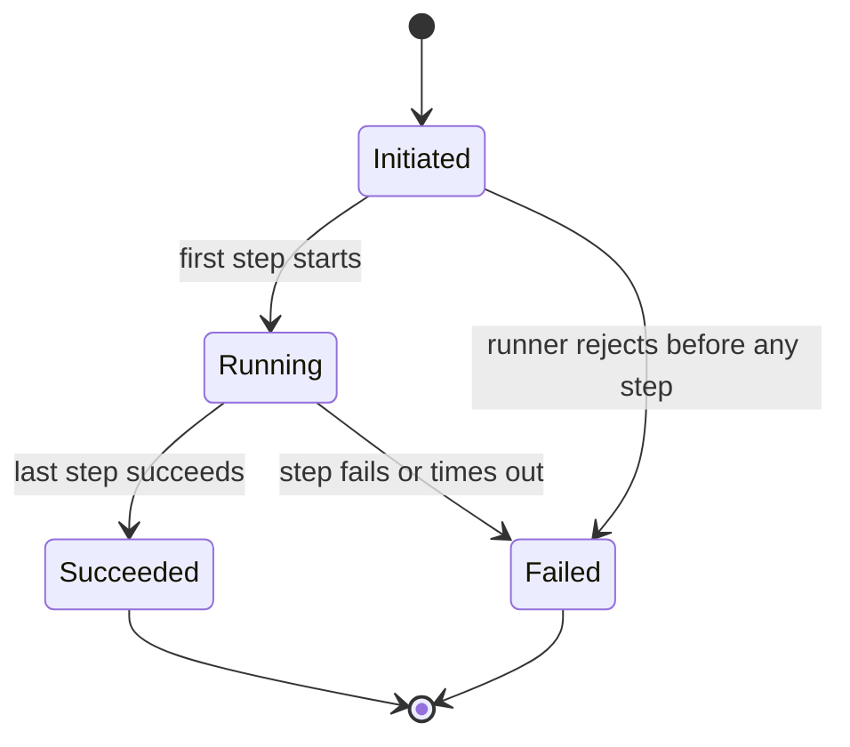

| From | To | Trigger | Guard condition | Actor | Action | Failure destination | Linked BR | Tag |
|---|---|---|---|---|---|---|---|---|
| `Initiated` | `Running` | First step starts | `run.step_count >= 1 AND target.registered == true` | SYS-004 | Start the first run step | `Failed` | BR-005 | `[DERIVED: BR-005]` |
| `Initiated` | `Failed` | Runner rejects before any step | `task_version.valid == false OR target.available == false` | SYS-004 | Finalize as `Failed`; record no step results | `Failed` (terminal) | BR-008 | `[DERIVED: BR-005 and BR-008]` |
| `Running` | `Succeeded` | Last step succeeds | `run_step.failed_count == 0 AND run_step.pending_count == 0` | SYS-004 | Finalize as `Succeeded`; persist the outcome | `Failed` if the outcome cannot be persisted | BR-008 | `[DERIVED: BR-008]` |
| `Running` | `Failed` | A step fails or times out | `run_step.failed_count >= 1 OR step.timeout == true` | SYS-004 | Stop the run; mark the failed step; skip remaining steps; finalize as `Failed` | `Failed` (terminal) | BR-008 | `[DERIVED: BR-008]` |

**Terminal states:** `Succeeded`, `Failed`. **Reachability:** `Initiated` is the initial state; `Running`, `Succeeded`, and `Failed` are reachable from it. **Dead states:** none; both terminal states exit to `[*]`, and both non-terminal states have an outgoing transition. `[DERIVED: §7.7]`

### 7.2 STATE-002 — Run Step (ENT-015), effective

| State | Entry condition | Exit condition | Terminal | Tag |
|---|---|---|---|---|
| `Pending` | The run is created or a prior step succeeds | The runner starts the step, or a predecessor fails | No | `[DERIVED: BR-005]` |
| `Running` | SYS-004 starts the step | The step succeeds, fails, or times out | No | `[DERIVED: BR-008]` |
| `Succeeded` | The target returns a successful result | None | Yes | `[DERIVED: BR-008]` |
| `Failed` | The target returns an error or times out | None | Yes | `[DERIVED: BR-008]` |
| `Skipped` | A predecessor failed | None | Yes | `[DERIVED: BR-008]` |

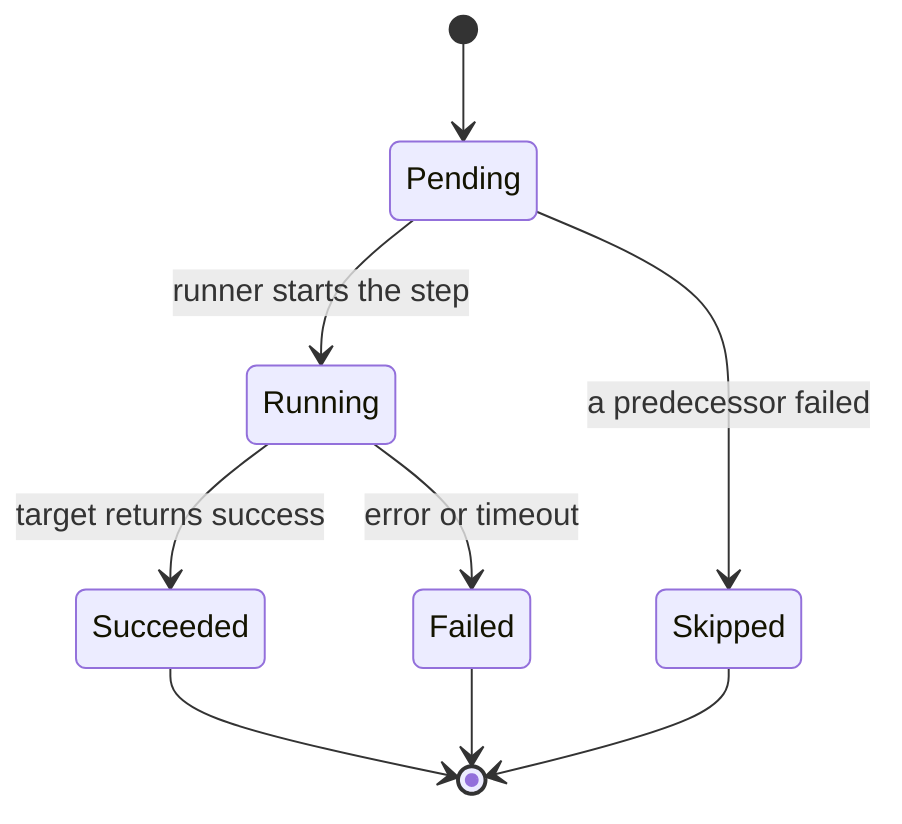

| From | To | Trigger | Guard condition | Actor | Action | Failure destination | Linked BR | Tag |
|---|---|---|---|---|---|---|---|---|
| `Pending` | `Running` | Runner starts the step | `run.state == "Running" AND target.registered == true` | SYS-004 | Invoke the skill or MCP tool | `Failed` | BR-005 | `[DERIVED: BR-005]` |
| `Pending` | `Skipped` | A predecessor failed | `predecessor.state == "Failed"` | SYS-004 | Record the skip and the failed predecessor | `Failed` for the run | BR-008 | `[DERIVED: BR-008]` |
| `Running` | `Succeeded` | Target returns success | `result.present == true` | SYS-004 | Record duration and result summary | `Failed` if the result cannot be stored | BR-008 | `[DERIVED: BR-008]` |
| `Running` | `Failed` | Error or timeout | `error.present == true OR step.timeout == true` | SYS-004 | Record the error and duration | `Failed` (terminal for the step) | BR-008 | `[DERIVED: BR-008]` |

**Terminal states:** `Succeeded`, `Failed`, `Skipped`. **Reachability:** all five states are reachable from `Pending` or `Running`. **Dead states:** none; every terminal state exits to `[*]`, and both non-terminal states have outgoing transitions. `[DERIVED: §7.7]`

### 7.3 STATE-003 — Skill Version (ENT-007), proposed and not effective

| State | Entry condition | Exit condition | Terminal | Tag |
|---|---|---|---|---|
| `Draft` | A proposed Author or Admin creates a draft | Publication succeeds, or the draft is discarded | No | `[TBD-BIZ-004]` |
| `Published` | A valid draft is published | Deprecation, or a newer version is published | No | `[TBD-BIZ-004]` |
| `Deprecated` | A proposed Admin deprecates the version | None | Yes | `[TBD-BIZ-004]` |
| `Superseded` | A newer version of the same skill is published | None | Yes | `[TBD-BIZ-004]` |
| `Discarded` | A proposed Author or Admin discards a draft | None | Yes | `[TBD-BIZ-004]` |

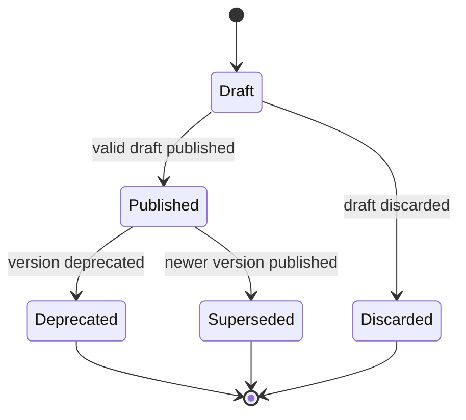

| From | To | Trigger | Guard condition | Actor | Action | Failure destination | Linked BR | Tag |
|---|---|---|---|---|---|---|---|---|
| `[*]` | `Draft` | Create a skill draft | `session.active == true AND draft_authority.confirmed == true` | ROLE-002 or ROLE-003 (proposed) | Record the draft | No `Draft` created; error shown | BR-003 | `[TBD-BIZ-004]` |
| `Draft` | `Published` | Publish a valid draft | `validation.passed == true AND publication_authority.confirmed == true` | ROLE-002 (proposed) | Create an immutable version | `Draft`; validation or authority error | BR-003 | `[TBD-BIZ-004]` |
| `Published` | `Deprecated` | Deprecate a version | `authority.confirmed == true AND version.active_new_use == false` | ROLE-002 (proposed) | Mark deprecated; keep readable for existing runs | `Published`; error shown | BR-003 | `[TBD-BIZ-004]` |
| `Published` | `Superseded` | A newer version is published | `new_version.valid == true AND new_version.published == true` | SYS-003 | Mark the older version superseded | Older version stays `Published` | BR-003 | `[TBD-BIZ-004]` |
| `Draft` | `Discarded` | Discard a draft | `authority.confirmed == true` | ROLE-002 or ROLE-003 (proposed) | Remove the draft from the active list | `Draft`; error shown | BR-003 | `[TBD-BIZ-004]` |

**Terminal states:** `Deprecated`, `Superseded`, `Discarded`. **Reachability:** every state is reachable from `Draft`. **Dead states:** none; all terminal states exit to `[*]`, and `Draft` and `Published` have outgoing transitions. **Status:** proposed; no transition is effective until `[TBD-BIZ-004]` closes.

### 7.4 STATE-004 — MCP Server health (ENT-008), proposed and not effective

| State | Entry condition | Exit condition | Terminal | Tag |
|---|---|---|---|---|
| `Registered` | A proposed Admin registers a server | A connection test succeeds, requires authentication, or fails | No | `[TBD-BIZ-004]` |
| `Connected` | A test succeeds | A later test fails, or the server is retired | No | `[TBD-BIZ-004]` |
| `Needs authentication` | A test reports a missing or invalid credential | Authentication succeeds and a retest passes, or the server is retired | No | `[TBD-BIZ-004]` |
| `Error` | A test fails or a health check fails | A retest succeeds, or the server is retired | No | `[TBD-BIZ-004]` |
| `Retired` | A proposed Admin retires the server | None | Yes | `[TBD-BIZ-004]` |

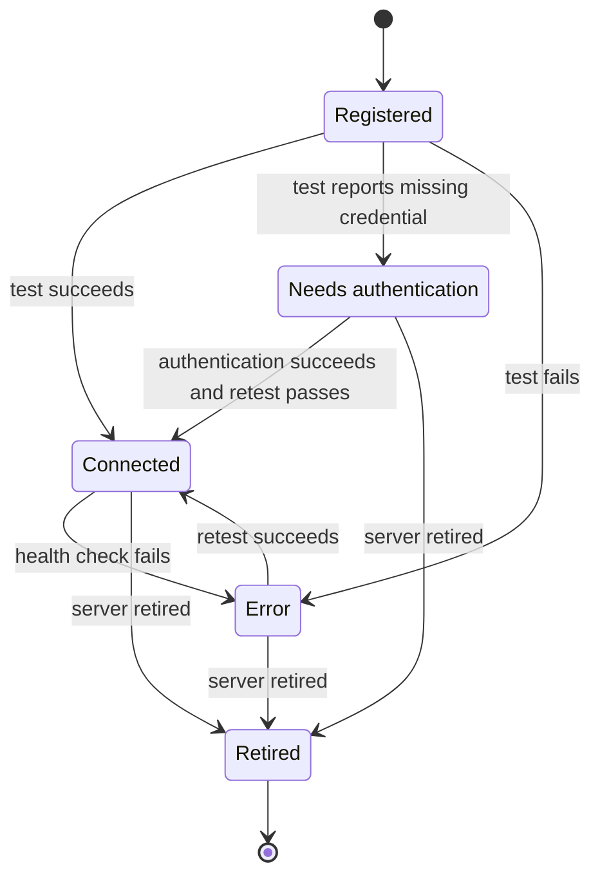

| From | To | Trigger | Guard condition | Actor | Action | Failure destination | Linked BR | Tag |
|---|---|---|---|---|---|---|---|---|
| `[*]` | `Registered` | Register a server | `session.active == true AND registration_authority.confirmed == true` | ROLE-002 (proposed) | Record the server and auth reference | No server created; error shown | BR-004 | `[TBD-BIZ-004]` |
| `Registered` | `Connected` | Test succeeds | `endpoint.reachable == true AND auth.valid == true` | SYS-005 | Record health and discovered tools | `Registered`; record `Error` on failure | BR-004 | `[TBD-BIZ-004]` |
| `Registered` | `Needs authentication` | Test reports a missing credential | `endpoint.reachable == true AND auth.present == false` | SYS-005 | Record the state; expose no tools | `Registered` if the state cannot be recorded | BR-004 | `[TBD-BIZ-004]` |
| `Registered` | `Error` | Test fails | `endpoint.reachable == false OR config.invalid == true` | SYS-005 | Record error health; expose no tools | `Registered`; error shown | BR-004 | `[TBD-BIZ-004]` |
| `Needs authentication` | `Connected` | Authentication succeeds and retest passes | `auth.valid == true AND retest.passed == true` | SYS-005 | Record health and tool list | `Needs authentication` on failure | BR-004 | `[TBD-BIZ-004]` |
| `Connected` | `Error` | Health check fails | `health_check.passed == false` | SYS-005 | Record error health; stop new calls | Error state; no silent tool call | BR-004 | `[TBD-BIZ-004]` |
| `Error` | `Connected` | Retest succeeds | `retest.passed == true` | SYS-005 | Record health and tool list | `Error` on failure | BR-004 | `[TBD-BIZ-004]` |
| `Connected` | `Retired` | Retire the server | `authority.confirmed == true AND active_run.dependency == false` | ROLE-002 (proposed) | Mark retired; revoke callability | `Connected`; error shown | BR-004 | `[TBD-BIZ-004]` |
| `Needs authentication` | `Retired` | Retire the server | `authority.confirmed == true AND active_run.dependency == false` | ROLE-002 (proposed) | Mark retired; revoke callability | `Needs authentication`; error shown | BR-004 | `[TBD-BIZ-004]` |
| `Error` | `Retired` | Retire the server | `authority.confirmed == true AND active_run.dependency == false` | ROLE-002 (proposed) | Mark retired; revoke callability | `Error`; error shown | BR-004 | `[TBD-BIZ-004]` |

**Terminal state:** `Retired`. **Reachability:** all states are reachable from `Registered`. **Dead states:** none; `Retired` exits to `[*]`, and `Registered`, `Connected`, `Needs authentication`, and `Error` have outgoing transitions. **Status:** proposed; no transition is effective until `[TBD-BIZ-004]` closes.

### 7.5 STATE-005 — Task Version (ENT-012), proposed and not effective

| State | Entry condition | Exit condition | Terminal | Tag |
|---|---|---|---|---|
| `Draft` | A proposed Author or Admin creates a task draft | Publication succeeds, or the draft is discarded | No | `[TBD-BIZ-004]` |
| `Published` | A valid draft is published | Retirement, or a newer version is published | No | `[TBD-BIZ-004]` |
| `Retired` | A proposed Admin retires the version | None | Yes | `[TBD-BIZ-004]` |
| `Superseded` | A newer version of the same task is published | None | Yes | `[TBD-BIZ-004]` |
| `Discarded` | A proposed Author or Admin discards a draft | None | Yes | `[TBD-BIZ-004]` |

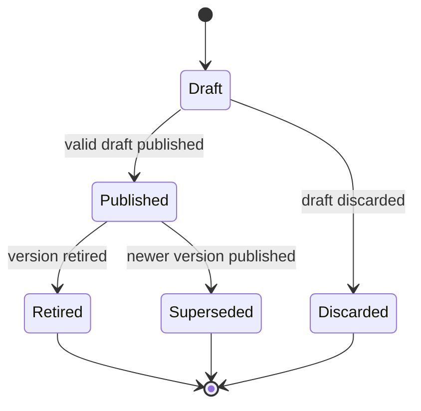

| From | To | Trigger | Guard condition | Actor | Action | Failure destination | Linked BR | Tag |
|---|---|---|---|---|---|---|---|---|
| `[*]` | `Draft` | Create a task draft | `session.active == true AND draft_authority.confirmed == true` | ROLE-002 or ROLE-003 (proposed) | Record the draft and steps | No `Draft` created; error shown | BR-005 | `[TBD-BIZ-004]` |
| `Draft` | `Published` | Publish a valid draft | `step_count >= 1 AND validation.passed == true AND publication_authority.confirmed == true` | ROLE-002 (proposed) | Create an immutable version | `Draft`; validation or authority error | BR-005 | `[TBD-BIZ-004]` |
| `Published` | `Retired` | Retire a version | `authority.confirmed == true AND new_run.allowed == false` | ROLE-002 (proposed) | Mark retired; keep existing runs readable | `Published`; error shown | BR-005 | `[TBD-BIZ-004]` |
| `Published` | `Superseded` | A newer version is published | `new_version.valid == true AND new_version.published == true` | SYS-003 | Mark the older version superseded | Older version stays `Published` | BR-005 | `[TBD-BIZ-004]` |
| `Draft` | `Discarded` | Discard a draft | `authority.confirmed == true` | ROLE-002 or ROLE-003 (proposed) | Remove the draft from the active list | `Draft`; error shown | BR-005 | `[TBD-BIZ-004]` |

**Terminal states:** `Retired`, `Superseded`, `Discarded`. **Reachability:** every state is reachable from `Draft`. **Dead states:** none; all terminal states exit to `[*]`, and `Draft` and `Published` have outgoing transitions. **Status:** proposed; no transition is effective until `[TBD-BIZ-004]` closes.

### 7.6 STATE-006 — Account (ENT-001), proposed and not effective

| State | Entry condition | Exit condition | Terminal | Tag |
|---|---|---|---|---|
| `Invited` | A proposed Admin provisions an account | The person signs in, or the invitation is revoked | No | `[TBD-BIZ-004]` |
| `Active` | The person signs in with a local account | The account is disabled or deleted | No | `[SRC: open_items.md#TBD-BIZ-002]` |
| `Disabled` | A proposed Admin disables the account | The account is re-enabled or deleted | No | `[TBD-BIZ-013]` |
| `Deleted` | A proposed Admin deletes the account | None | Yes | `[TBD-BIZ-013]` |

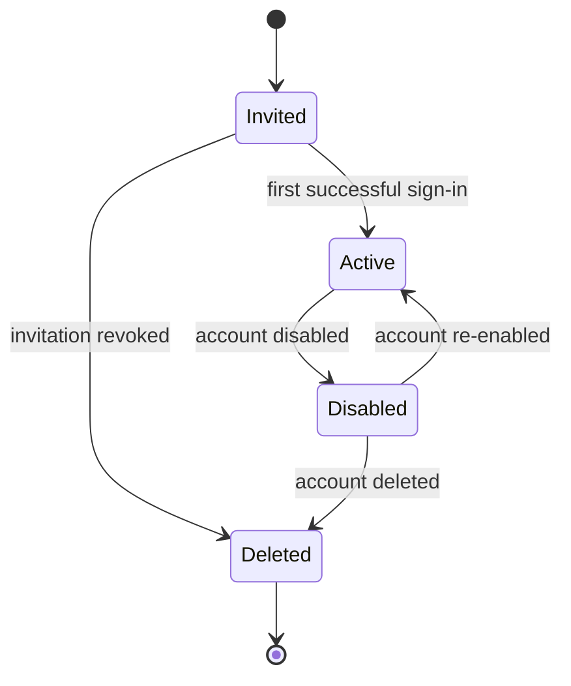

| From | To | Trigger | Guard condition | Actor | Action | Failure destination | Linked BR | Tag |
|---|---|---|---|---|---|---|---|---|
| `[*]` | `Invited` | Provision an account | `authority.confirmed == true` | ROLE-002 (proposed) | Record the account without a usable credential | No account created; error shown | BR-001 | `[TBD-BIZ-004]` |
| `Invited` | `Active` | First successful sign-in | `credential.valid == true AND auth_provider == "local"` | ROLE-001 and SYS-001 | Activate the account and create a session | `Invited` on failure | BR-001 | `[DERIVED: BR-001]` |
| `Invited` | `Deleted` | Revoke or expire the invitation | `authority.confirmed == true` | ROLE-002 (proposed) | Delete the invitation | `Invited` if deletion cannot be recorded | BR-001 | `[TBD-BIZ-013]` |
| `Active` | `Disabled` | Disable the account | `authority.confirmed == true` | ROLE-002 (proposed) | Block new sessions; keep owner attribution | `Active` if disable cannot be recorded | BR-001 | `[TBD-BIZ-013]` |
| `Disabled` | `Active` | Re-enable the account | `authority.confirmed == true` | ROLE-002 (proposed) | Allow sign-in again | `Disabled` on failure | BR-001 | `[TBD-BIZ-013]` |
| `Disabled` | `Deleted` | Delete the account | `authority.confirmed == true AND owned_objects.disposition.confirmed == true` | ROLE-002 (proposed) | Delete the account; retain or transfer owned objects | `Disabled` if deletion cannot be recorded | BR-001 | `[TBD-BIZ-013]` |

**Terminal state:** `Deleted`. **Reachability:** all states are reachable from `Invited`. **Dead states:** none; `Deleted` exits to `[*]`, and `Invited`, `Active`, and `Disabled` have outgoing transitions. **Status:** proposed; `Invited` is prototype-derived (SRC-003) and the lifecycle depends on `[TBD-BIZ-004]` and `[TBD-BIZ-013]`.

### 7.7 Reachability and dead-state check

| STATE | States | Initial | Terminals | Non-terminal states with outgoing transition | Unreachable states | Dead states | Result | Tag |
|---|---|---|---|---|---|---|---|---|
| STATE-001 | 4 | `Initiated` | `Succeeded`, `Failed` | `Initiated`, `Running` | 0 | 0 | Pass | `[DERIVED: §7.1]` |
| STATE-002 | 5 | `Pending` | `Succeeded`, `Failed`, `Skipped` | `Pending`, `Running` | 0 | 0 | Pass | `[DERIVED: §7.2]` |
| STATE-003 | 5 | `Draft` | `Deprecated`, `Superseded`, `Discarded` | `Draft`, `Published` | 0 | 0 | Pass (proposed) | `[DERIVED: §7.3]` |
| STATE-004 | 5 | `Registered` | `Retired` | `Registered`, `Connected`, `Needs authentication`, `Error` | 0 | 0 | Pass (proposed) | `[DERIVED: §7.4]` |
| STATE-005 | 5 | `Draft` | `Retired`, `Superseded`, `Discarded` | `Draft`, `Published` | 0 | 0 | Pass (proposed) | `[DERIVED: §7.5]` |
| STATE-006 | 4 | `Invited` | `Deleted` | `Invited`, `Active`, `Disabled` | 0 | 0 | Pass (proposed) | `[DERIVED: §7.6]` |

## 8. Business rules

Every rule below is sourced from SRC-001. No rule cites SRC-002, SRC-003, SRC-004, or SRC-006 as its authority. A rule is decidable when its trigger and expression can be evaluated to true or false. `[SRC: SRC-001]` `[DERIVED: SRC-006 §⑦]`

### BR-001 — Local-account authentication only

| Field | Value | Tag |
|---|---|---|
| **Statement** | Only when a person authenticates with a workspace-local account may SYS-001 establish a session. SYS-001 must not authenticate a person through an external identity provider. | `[SRC: open_items.md#TBD-BIZ-002]` |
| **Source** | `open_items.md` TBD-BIZ-002 Resolution source — deployment "Self-hosted + local accounts for MVP". | `[SRC: open_items.md#TBD-BIZ-002]` |
| **Trigger condition** | A sign-in request is submitted. | `[SRC: open_items.md#TBD-BIZ-002]` |
| **Decision expression — field** | `request.auth_provider`, `credential.match` | `[DERIVED: the statement names the authentication path and the credential check]` |
| **Decision expression — operator** | `==` | `[DERIVED: equality against an allowed value]` |
| **Decision expression — threshold** | `"local"`, `true` | `[DERIVED: "local accounts for MVP"]` |
| **Decision expression** | `request.auth_provider == "local" AND credential.match == true` | `[DERIVED: the confirmed deployment decision names local accounts]` |
| **Consequence of violation** | No session is created; the request receives a generic denial; no account-existence signal is returned; an external-identity assertion creates no session. | `[DERIVED: the rule's only permitted path is a local account]` |
| **Objective** | OBJ-001 | `[DERIVED: sign-in is the entry condition for chat]` |
| **Actor** | SYS-001 (authenticate and create session); ROLE-001 (person signing in) | `[SRC: open_items.md#TBD-BIZ-002]` |
| **Preconditions** | A local account exists; a credential is presented; no external identity-provider path is enabled. | `[SRC: open_items.md#TBD-BIZ-002]` |
| **Inputs** | Sign-in name; credential. | `[SRC: open_items.md#TBD-BIZ-002]` |
| **Outcome** | A session exists and is attributable to the local account; an external identity-provider assertion creates no session. | `[DERIVED: the permitted path is local authentication]` |
| **Exceptions** | This rule does not define account recovery or disabled-account behaviour. | `[DERIVED: the confirmed decision is silent on both]` |
| **Priority** | P0 | `[DERIVED: sign-in is a precondition for every other capability]` |
| **Positive example** | Given a person with a local account, when they submit the correct credential, then a session is created and that account is the actor. | `[DERIVED: direct evaluation of the expression]` |
| **Negative example** | Given a person whose only credential is an external identity-provider assertion, when they attempt sign-in, then no session is created and a denial is returned. | `[DERIVED: direct evaluation of the expression]` |
| **Derivation** | Direct: "local accounts for MVP" fixes the authentication path and excludes an external identity provider. | `[DERIVED: open_items.md#TBD-BIZ-002]` |
| **Status** | Active | `[DERIVED: the rule has a confirmed source and a decidable expression]` |

### BR-002 — Signed-in chat with response integrity

| Field | Value | Tag |
|---|---|---|
| **Statement** | Only when a person is signed in with a local account may ROLE-001 start or continue a conversation. SYS-002 must append an assistant message only when a model response is returned. | `[SRC: open_items.md#TBD-BIZ-001]` |
| **Source** | `open_items.md` TBD-BIZ-001 Resolution source — the internal agent workspace and its four capabilities; `CHG-001` Decision log — "chat". | `[SRC: open_items.md#TBD-BIZ-001]` |
| **Trigger condition** | A signed-in person sends a message. | `[SRC: open_items.md#TBD-BIZ-001]` |
| **Decision expression — field** | `session.state`, `message.text.length`, `model.response.status` | `[DERIVED: the statement names session, message, and response]` |
| **Decision expression — operator** | `==`, `>`, `==` | `[DERIVED: equality and a non-empty length check]` |
| **Decision expression — threshold** | `"active"`, `0`, `"success"` | `[DERIVED: an active session, a non-empty message, a successful response]` |
| **Decision expression** | `(session.state == "active" AND message.text.length > 0) => message accepted; (model.response.status == "success") => one assistant message appended; otherwise no assistant message.` | `[DERIVED: the statement's two conditions]` |
| **Consequence of violation** | A rejected message creates no turn; a failed model call creates no assistant message and shows an error; a partial or fabricated answer must not be presented as complete. | `[DERIVED: response integrity follows from the statement]` |
| **Objective** | OBJ-001 | `[DERIVED: chat is the first confirmed capability]` |
| **Actor** | ROLE-001 (person); SYS-002 (chat and model gateway) | `[SRC: open_items.md#TBD-BIZ-001]` |
| **Preconditions** | Active session; non-empty message; a model endpoint is available at runtime. | `[DERIVED: the expression requires a session and a response]` |
| **Inputs** | Message text; conversation context. | `[SRC: open_items.md#TBD-BIZ-001]` |
| **Outcome** | The conversation contains the person's message and, on success, an assistant message; on failure, an error and no assistant message. | `[DERIVED: the expression's two branches]` |
| **Exceptions** | Model provider unavailable or timed out: show an error and create no assistant message. Search, citations, skill selection, and tool calls are not in this rule. | `[DERIVED: excluded capabilities are CAP-008, CAP-011, CAP-036]` |
| **Priority** | P0 | `[DERIVED: chat is the entry capability]` |
| **Positive example** | Given a signed-in person and a reachable model, when they send "Summarize this page", then the message is stored and one assistant message is appended on success. | `[DERIVED: direct evaluation of the expression]` |
| **Negative example** | Given a signed-in person and an unreachable model, when they send a message, then the message remains and no assistant message is appended; an error is shown. | `[DERIVED: direct evaluation of the expression]` |
| **Derivation** | Direct: chat is one of the confirmed four capabilities. Response integrity is part of an observable chat outcome. | `[DERIVED: open_items.md#TBD-BIZ-001]` |
| **Status** | Active | `[DERIVED: the rule has a confirmed source and a decidable expression]` |

### BR-003 — Skill registry is the record of offered skills

| Field | Value | Tag |
|---|---|---|
| **Statement** | Only when a skill is recorded in the workspace skill registry may SYS-003 list it to a person as a skill. SYS-003 must reject a reference to a skill that is not recorded. | `[SRC: open_items.md#TBD-BIZ-001]` |
| **Source** | `open_items.md` TBD-BIZ-001 Resolution source — "four capabilities"; `CHG-001` Decision log — "skill registry". | `[SRC: open_items.md#TBD-BIZ-001]` |
| **Trigger condition** | A person views the registry, or a skill reference is resolved. | `[SRC: open_items.md#TBD-BIZ-001]` |
| **Decision expression — field** | `skill.registry_state` | `[DERIVED: the statement names the registry state]` |
| **Decision expression — operator** | `==` | `[DERIVED: equality against the recorded state]` |
| **Decision expression — threshold** | `"recorded"` | `[DERIVED: the statement's only permitted value]` |
| **Decision expression** | `skill.registry_state == "recorded"` | `[DERIVED: the confirmed capability is a registry]` |
| **Consequence of violation** | The skill is not listed and the reference is rejected; no invocation occurs. | `[DERIVED: an unrecorded entry is not in the registry]` |
| **Objective** | OBJ-002 | `[DERIVED: the registry supports reuse]` |
| **Actor** | SYS-003 (registry and validation); ROLE-001 (viewer) | `[SRC: open_items.md#TBD-BIZ-001]` |
| **Preconditions** | The registry is available. | `[DERIVED: the expression reads registry state]` |
| **Inputs** | A recorded skill entry or a skill reference; session. | `[SRC: open_items.md#TBD-BIZ-001]` |
| **Outcome** | The registry list contains only recorded skills; an unrecorded skill reference is not resolvable. | `[DERIVED: the expression's only true branch]` |
| **Exceptions** | This rule does not define draft visibility, publication authority, or deprecation. | `[DERIVED: the confirmed decision names the registry, not its authoring policy]` |
| **Priority** | P0 | `[DERIVED: the skill registry is a confirmed capability]` |
| **Positive example** | Given a recorded skill, when a signed-in person opens the registry, then the skill appears in the list. | `[DERIVED: direct evaluation of the expression]` |
| **Negative example** | Given a skill that is not recorded, when a person or a task references it, then the reference is rejected and no invocation occurs. | `[DERIVED: direct evaluation of the expression]` |
| **Derivation** | Direct entailment: the confirmed capability is a registry, and an unregistered entry is not in the registry. | `[DERIVED: open_items.md#TBD-BIZ-001]` |
| **Status** | Active | `[DERIVED: the rule has a confirmed source and a decidable expression]` |

### BR-004 — MCP registry is the record of usable servers

| Field | Value | Tag |
|---|---|---|
| **Statement** | Only when an MCP server is recorded in the workspace MCP registry may SYS-005 use it to call a tool. SYS-005 must deny a tool call whose server is not recorded. | `[SRC: open_items.md#TBD-BIZ-001]` |
| **Source** | `open_items.md` TBD-BIZ-001 Resolution source — "four capabilities"; `CHG-001` Decision log — "MCP registry". | `[SRC: open_items.md#TBD-BIZ-001]` |
| **Trigger condition** | A server is registered, or a tool call targets a server. | `[SRC: open_items.md#TBD-BIZ-001]` |
| **Decision expression — field** | `mcp_server.registry_state` | `[DERIVED: the statement names the registry state]` |
| **Decision expression — operator** | `==` | `[DERIVED: equality against the recorded state]` |
| **Decision expression — threshold** | `"recorded"` | `[DERIVED: the statement's only permitted value]` |
| **Decision expression** | `mcp_server.registry_state == "recorded"` | `[DERIVED: the confirmed capability is a registry]` |
| **Consequence of violation** | The server is not listed; a tool call targeting it is denied and no tool is invoked. | `[DERIVED: an unrecorded server is not in the registry]` |
| **Objective** | OBJ-002 | `[DERIVED: the registry supports reuse]` |
| **Actor** | SYS-003 (registry); SYS-005 (tool executor); ROLE-001 (viewer) | `[SRC: open_items.md#TBD-BIZ-001]` |
| **Preconditions** | The registry is available; the server is recorded. | `[DERIVED: the expression reads registry state]` |
| **Inputs** | A recorded server entry or a tool-call request; session. | `[SRC: open_items.md#TBD-BIZ-001]` |
| **Outcome** | Only recorded servers appear in the registry; a call to an unrecorded server is denied. | `[DERIVED: the expression's only true branch]` |
| **Exceptions** | This rule does not define allowlisting, write-capable tool policy, or registration authority. A failed connection records error health and exposes no tools. | `[DERIVED: the confirmed decision names the registry, not its operating policy]` |
| **Priority** | P0 | `[DERIVED: the MCP registry is a confirmed capability]` |
| **Positive example** | Given a recorded MCP server, when a signed-in person opens the registry, then the server appears with its recorded health. | `[DERIVED: direct evaluation of the expression]` |
| **Negative example** | Given a server that is not recorded, when a tool call targets it, then the call is denied and no tool is invoked. | `[DERIVED: direct evaluation of the expression]` |
| **Derivation** | Direct entailment: the confirmed capability is a registry, and an unregistered server is not in the registry. | `[DERIVED: open_items.md#TBD-BIZ-001]` |
| **Status** | Active | `[DERIVED: the rule has a confirmed source and a decidable expression]` |

### BR-005 — Recorded task definition and attributed manual run

| Field | Value | Tag |
|---|---|---|
| **Statement** | Only when a task definition is recorded in the workspace may ROLE-001 initiate a run of it. SYS-004 must create the run with one initiating account and one recorded task version. | `[SRC: open_items.md#TBD-BIZ-001]` `[SRC: open_items.md#TBD-BIZ-002]` |
| **Source** | `open_items.md` TBD-BIZ-001 Resolution source — "four capabilities"; TBD-BIZ-002 Resolution source — "manual tasks"; `CHG-001` Decision log — "task definitions". | `[SRC: open_items.md#TBD-BIZ-001]` `[SRC: open_items.md#TBD-BIZ-002]` |
| **Trigger condition** | A signed-in person selects a recorded task definition and submits inputs. | `[SRC: open_items.md#TBD-BIZ-002]` |
| **Decision expression — field** | `task_definition.registry_state`, `inputs.valid`, `initiator.account_id` | `[DERIVED: the statement names the definition, the inputs, and the initiator]` |
| **Decision expression — operator** | `==`, `==`, `!=` | `[DERIVED: equality and non-null checks]` |
| **Decision expression — threshold** | `"recorded"`, `true`, `null` | `[DERIVED: the statement's only permitted values]` |
| **Decision expression** | `task_definition.registry_state == "recorded" AND inputs.valid == true AND initiator.account_id != null` | `[DERIVED: the statement's three conditions]` |
| **Consequence of violation** | No run is created and the request is rejected; no run may exist without exactly one initiating account and one recorded task version. | `[DERIVED: the run object requires both attributions]` |
| **Objective** | OBJ-003 | `[DERIVED: manual runs are the third confirmed capability]` |
| **Actor** | ROLE-001 (initiator); SYS-003 (record a definition); SYS-004 (create and execute a run) | `[SRC: open_items.md#TBD-BIZ-001]` |
| **Preconditions** | Active session; task definition recorded; inputs satisfy the declared input requirements. | `[DERIVED: the expression's three conditions]` |
| **Inputs** | Task reference; inputs; session. | `[SRC: open_items.md#TBD-BIZ-002]` |
| **Outcome** | A run exists with one initiating account and one recorded task version; an invalid request creates no run. | `[DERIVED: the expression's only true branch]` |
| **Exceptions** | This rule does not define step execution policy, retries, or task authoring. | `[DERIVED: the confirmed decision names manual runs, not the execution engine]` |
| **Priority** | P0 | `[DERIVED: task definitions and manual tasks are confirmed]` |
| **Positive example** | Given a recorded task definition, when a signed-in person submits valid inputs, then a run is created with that account as initiator and the recorded version. | `[DERIVED: direct evaluation of the expression]` |
| **Negative example** | Given a task reference that is not recorded, when a signed-in person submits a run request, then no run is created and the request is rejected. | `[DERIVED: direct evaluation of the expression]` |
| **Derivation** | Direct: task definitions and manual runs are confirmed; a run needs a definition to run. | `[DERIVED: open_items.md#TBD-BIZ-001]` `[DERIVED: open_items.md#TBD-BIZ-002]` |
| **Status** | Active | `[DERIVED: the rule has a confirmed source and a decidable expression]` |

### BR-006 — Manual initiation only

| Field | Value | Tag |
|---|---|---|
| **Statement** | Only when a signed-in person initiates a run may SYS-004 create it. SYS-004 must not create a run from a schedule, cron, webhook, or event. | `[SRC: open_items.md#TBD-BIZ-002]` |
| **Source** | `open_items.md` TBD-BIZ-002 Resolution source — "manual tasks"; `CHG-001` Task Brief — MVP "chat + registries + manual tasks". | `[SRC: open_items.md#TBD-BIZ-002]` |
| **Trigger condition** | Any request that would create a run. | `[SRC: open_items.md#TBD-BIZ-002]` |
| **Decision expression — field** | `run.trigger_type`, `initiator.account_id` | `[DERIVED: the statement names the trigger and the initiator]` |
| **Decision expression — operator** | `==`, `!=` | `[DERIVED: equality against "manual" and a non-null check]` |
| **Decision expression — threshold** | `"manual"`, `null` | `[DERIVED: the statement permits only manual initiation]` |
| **Decision expression** | `run.trigger_type == "manual" AND initiator.account_id != null` | `[DERIVED: "manual tasks" fixes the initiation mode]` |
| **Consequence of violation** | A schedule, cron, webhook, or event request creates no run. | `[DERIVED: every non-manual trigger is excluded]` |
| **Objective** | OBJ-003 | `[DERIVED: manual runs are the third confirmed capability]` |
| **Actor** | SYS-004 (run creation); ROLE-001 (initiator) | `[SRC: open_items.md#TBD-BIZ-002]` |
| **Preconditions** | A signed-in person is present; the request is not from a schedule, webhook, or event. | `[DERIVED: the expression's two conditions]` |
| **Inputs** | Run-start request; session. | `[SRC: open_items.md#TBD-BIZ-002]` |
| **Outcome** | Every run has an initiating account; no scheduled or externally triggered run exists. | `[DERIVED: the expression's only true branch]` |
| **Exceptions** | None in the confirmed MVP. This rule does not define a future trigger model. | `[SRC: open_items.md#TBD-BIZ-002]` |
| **Priority** | P0 | `[DERIVED: the initiation mode is a confirmed constraint]` |
| **Positive example** | Given a signed-in person, when they press Run, then a run is created with that account as initiator. | `[DERIVED: direct evaluation of the expression]` |
| **Negative example** | Given a scheduled trigger fires with no signed-in person, when the trigger requests a run, then no run is created. | `[DERIVED: direct evaluation of the expression]` |
| **Derivation** | Direct: "manual tasks" fixes the initiation mode. | `[DERIVED: open_items.md#TBD-BIZ-002]` |
| **Status** | Active | `[DERIVED: the rule has a confirmed source and a decidable expression]` |

### BR-007 — Self-hosted operation without a vendor control plane

| Field | Value | Tag |
|---|---|---|
| **Statement** | Only when the product is deployed on team-controlled infrastructure may the confirmed capabilities be offered. SYS-001, SYS-002, SYS-003, SYS-004, and SYS-005 must not require a vendor-hosted multi-tenant control plane. | `[SRC: open_items.md#TBD-BIZ-002]` |
| **Source** | `open_items.md` TBD-BIZ-002 Resolution source — deployment "Self-hosted + local accounts for MVP"; `CHG-001` Task Brief — deployment "self-hosted + local accounts". | `[SRC: open_items.md#TBD-BIZ-002]` |
| **Trigger condition** | Deployment or operation of the workspace. | `[SRC: open_items.md#TBD-BIZ-002]` |
| **Decision expression — field** | `deployment.hosting`, `deployment.vendor_control_plane_required` | `[DERIVED: the statement names hosting and control-plane dependency]` |
| **Decision expression — operator** | `==`, `==` | `[DERIVED: equality against the permitted deployment values]` |
| **Decision expression — threshold** | `"team_controlled"`, `false` | `[DERIVED: "self-hosted" and no vendor control plane]` |
| **Decision expression** | `deployment.hosting == "team_controlled" AND deployment.vendor_control_plane_required == false` | `[DERIVED: the confirmed deployment decision]` |
| **Consequence of violation** | The deployment does not meet the confirmed operating condition; the capability must not be offered as the confirmed MVP on that deployment. | `[DERIVED: the rule's only permitted deployment]` |
| **Objective** | OBJ-001, OBJ-002, and OBJ-003 through the deployment precondition; the v0.1 deployment objective is retired into this rule | `[DERIVED: §2 consolidation]` |
| **Actor** | SYS-001, SYS-002, SYS-003, SYS-004, and SYS-005 (the product runtime) | `[SRC: open_items.md#TBD-BIZ-002]` |
| **Preconditions** | Team-controlled infrastructure is available and operated by the team. | `[SRC: open_items.md#TBD-BIZ-002]` |
| **Inputs** | Deployment environment. | `[SRC: open_items.md#TBD-BIZ-002]` |
| **Outcome** | Chat, registries, and manual runs operate on team-controlled infrastructure; no vendor control plane is required. | `[DERIVED: the expression's only true branch]` |
| **Exceptions** | External model, MCP, and search providers remain external dependencies. They are function and data dependencies, not a vendor control plane. | `[DERIVED: external providers are outside the deployment rule]` |
| **Priority** | P0 | `[DERIVED: self-hosted deployment is a confirmed decision]` |
| **Positive example** | Given team-controlled infrastructure, when the MVP is deployed, then chat, registries, and manual runs operate without a vendor control-plane tenant. | `[DERIVED: direct evaluation of the expression]` |
| **Negative example** | Given a deployment that requires a vendor-hosted tenant control plane for sign-in or core data, when it is assessed against this rule, then it does not meet BR-007. | `[DERIVED: direct evaluation of the expression]` |
| **Derivation** | Direct: "self-hosted" fixes where the product runs and excludes a vendor control plane. | `[DERIVED: open_items.md#TBD-BIZ-002]` |
| **Status** | Active | `[DERIVED: the rule has a confirmed source and a decidable expression]` |

### BR-008 — Failed step produces a failed, visible run

| Field | Value | Tag |
|---|---|---|
| **Statement** | Only when every step succeeds may SYS-004 finalize a run as `Succeeded`. When a step fails, SYS-004 must finalize the run as `Failed` and show the failed step to ROLE-001. | `[SRC: open_items.md#TBD-BIZ-002]` `[SRC: open_items.md#TBD-BIZ-001]` |
| **Source** | `open_items.md` TBD-BIZ-002 Resolution source — "manual tasks"; TBD-BIZ-001 Resolution source — "four capabilities". | `[SRC: open_items.md#TBD-BIZ-002]` `[SRC: open_items.md#TBD-BIZ-001]` |
| **Trigger condition** | A step fails or times out, or the run completes. | `[DERIVED: the statement's two cases]` |
| **Decision expression — field** | `run.step_failed_count`, `failed_step.visible` | `[DERIVED: the statement names the failure count and the visible step]` |
| **Decision expression — operator** | `==`, `>=`, `==` | `[DERIVED: zero and at-least-one thresholds; a visibility equality]` |
| **Decision expression — threshold** | `0`, `1`, `true` | `[DERIVED: zero failures for success; at least one for failure; visible step]` |
| **Decision expression** | `run.step_failed_count == 0 => Succeeded; run.step_failed_count >= 1 => Failed AND failed_step.visible == true` | `[DERIVED: the statement's success and failure conditions]` |
| **Consequence of violation** | A failed step must not produce `Succeeded`; the failed step and terminal outcome must be visible to the initiator; remaining steps are `Skipped`. | `[DERIVED: a failed run must be visible and terminal]` |
| **Objective** | OBJ-003 | `[DERIVED: the run outcome is the third objective's outcome]` |
| **Actor** | SYS-004 (task runner); ROLE-001 (initiating account) | `[SRC: open_items.md#TBD-BIZ-002]` |
| **Preconditions** | The run has started. | `[DERIVED: the expression reads run state]` |
| **Inputs** | Step result or error. | `[DERIVED: the expression reads step outcome]` |
| **Outcome** | The run has a terminal state; a failed step is visible; a failed run is never reported as succeeded. | `[DERIVED: the expression's two branches]` |
| **Exceptions** | This rule does not define a retry policy. | `[DERIVED: the confirmed decision names manual runs, not retries]` |
| **Priority** | P0 | `[DERIVED: an observable outcome is part of the manual-run capability]` |
| **Positive example** | Given step 2 of a three-step run fails, when the runner finalizes, then the run is `Failed`, step 2 is `Failed`, step 3 is `Skipped`, and the initiator sees the failed step. | `[DERIVED: direct evaluation of the expression]` |
| **Negative example** | Given a step fails, when the runner finalizes, then the run must not be `Succeeded` and the failure must not be hidden. | `[DERIVED: direct evaluation of the expression]` |
| **Derivation** | Direct entailment of an observable manual-run outcome. | `[DERIVED: open_items.md#TBD-BIZ-002]` |
| **Status** | Active | `[DERIVED: the rule has a confirmed source and a decidable expression]` |

**BR scope note:** this document adds no business rule of its own. The eight rules are the v0.1 confirmed set, restated with trigger, decision expression, and violation consequence. `[DERIVED: CHG-007]`

## 9. Non-functional requirements

NFRs are quality targets, not business rules. NFR-001 to NFR-003 and NFR-006 to NFR-008 and NFR-010 to NFR-012 carry numeric targets and are **proposed** until TBD-BIZ-008 closes. NFR-004, NFR-005, and NFR-009 carry a `TBD-BIZ` target plus a suggested baseline that is explicitly not a commitment. `[TBD-BIZ-008]` `[DERIVED: SRC-006 §⑧]`

| NFR | Area | Metric | Target value | Measurement point | Time window | Measurement method | Environment | Verification stage | Tag |
|---|---|---|---|---|---|---|---|---|---|
| **NFR-001** | Performance | Time from message submit to first streamed assistant token, p95 | ≤ 3,000 ms (proposed) | Browser send event to first SSE token | Per request; 7-day rolling p95 in operation (proposed); 20 prompts in the Stage 8 test | Send 20 prompts of 50–100 words; record submit and first-token timestamps; compute p95 | Local single machine on the internal network (TBD-INFRA-004) | Stage 8 — Testing | `[SRC: prd.md#§12]` `[TBD-BIZ-008]` |
| **NFR-002** | Performance | Registry list read response, p95 | ≤ 500 ms for 500 items (proposed) | Registry list endpoint response | Per request; 7-day rolling p95 (proposed); 50 reads in the Stage 8 test | Seed 500 synthetic entries; issue 50 reads; compute p95 | Local single machine (TBD-INFRA-004) | Stage 8 — Testing | `[SRC: prd.md#§12]` `[TBD-BIZ-008]` |
| **NFR-003** | Performance | Delay from a run-step state change to its visible update, p95 | ≤ 2,000 ms (proposed) | Run-step state store to rendered status | Per step transition; 7-day rolling p95 (proposed); 10 runs in the Stage 8 test | Record state-change and render timestamps; compute p95 | Local single machine (TBD-INFRA-004) | Stage 8 — Testing | `[SRC: prd.md#§12]` `[TBD-BIZ-008]` |
| **NFR-004** | Capacity | Concurrent accounts, conversations, and runs supported without error | `TBD-BIZ-004`, `TBD-BIZ-008`; suggested baseline 50 accounts, 20 concurrent sessions, 10 concurrent runs (not a commitment) | Workspace request boundary and error rate | `TBD-BIZ-008`; suggested 30-minute peak window (not a commitment) | Load generator replays 20 sessions and 10 runs; record error rate and p95 latency | Local single machine (TBD-INFRA-004) | Stage 8 — Testing | `[TBD-BIZ-004]` `[TBD-BIZ-008]` |
| **NFR-005** | Availability | Monthly service availability | `TBD-BIZ-008`; suggested 99.0% per 30-day month (not a commitment) | Workspace health endpoint | 30 consecutive days; monthly rollup | Synthetic health check every 60 seconds; compute available minutes | Local single machine (TBD-INFRA-004) | Stage 10 — Operations | `[TBD-BIZ-008]` |
| **NFR-006** | Security | Secret values in product responses or logs; secret-reference resolution | 0 secret values; 100% of references resolved server-side | API response body, log sink, and secret resolver | Per release candidate; 10 requests per secret path | Place a canary secret in each path; inspect responses and logs; attempt a direct read through the product | Local single machine or local CI | Stage 9 — Security | `[SRC: prd.md#§12]` `[TBD-BIZ-003]` |
| **NFR-007** | Security | Permission rows enforced server-side | 100% of the 18 matrix columns; 0 client-only checks | API boundary for every `denied` and `allowed` cell | Per release candidate; one negative and one positive request per cell | Repeat each request without the client; compare the result to the matrix | Local single machine | Stage 9 — Security | `[DERIVED: §6.2]` `[TBD-BIZ-004]` |
| **NFR-008** | Security and compliance | Conversation or run content sent to an external provider before the boundary is confirmed | 0 bytes before TBD-BIZ-003, TBD-BIZ-014, TBD-INFRA-009, and TBD-INFRA-011 close | Network egress from the workspace process | Per release candidate; 10 chats with a canary string | Capture outbound destinations and payloads; inspect for the canary | Local single machine with network capture | Stage 9 — Security | `[TBD-BIZ-003]` `[TBD-BIZ-014]` |
| **NFR-009** | Data retention | Retention period for conversations, messages, runs, artifacts, and audit events | `TBD-BIZ-003`; suggested baseline conversations 90 days, runs 180 days, audit 365 days (not a commitment) | Retention job output and deletion audit | Retention period `TBD-BIZ-003`; suggested 90/180/365 days (not a commitment). Measurement sample: 30 consecutive days. | Create records with controlled timestamps; run the job; verify deletion and no orphan | Local single machine (TBD-INFRA-004) | Stage 8 — Testing; Stage 10 — Operations | `[TBD-BIZ-003]` |
| **NFR-010** | Observability | Runs with a run reference and initiating account in structured logs; failed runs with an error code | 100% and 100% (proposed) | Structured log sink | Per release candidate; 20 runs including 5 failures | Query logs for run reference, actor, and error code | Local single machine | Stage 8 — Testing; re-checked at Stage 10 | `[SRC: prd.md#§12]` `[TBD-BIZ-009]` |
| **NFR-011** | Accessibility | WCAG 2.2 AA conformance for core flows; critical automated violations; keyboard-only completion; text and control contrast | 0 critical violations; 100% of FLOW-001 to FLOW-003 keyboard-completable; ≥ 4.5:1 text and ≥ 3:1 controls (proposed) | Browser DOM, keyboard path, and contrast measurement | One full pass per release candidate | Automated axe scan plus a manual keyboard and contrast checklist | Local browser | Stage 4 — Design; Stage 8 — Testing | `[SRC: design_system.md#6]` `[TBD-BIZ-008]` |
| **NFR-012** | Durability | Completed runs readable after a process restart | 100% of completed runs (proposed) | Run detail after a restart | Per release candidate; 3 completed runs | Complete 3 runs; restart the product; read each run and its step outcomes | Local single machine | Stage 8 — Testing | `[TBD-INFRA-003]` `[TBD-INFRA-005]` |

**NFR notes:**

- NFR-001 to NFR-003 are proposed thresholds from Draft PRD §12. They are not accepted targets; TBD-BIZ-008 confirms or replaces them. `[TBD-BIZ-008]`
- NFR-004, NFR-005, and NFR-009 use a registered TBD as the target and a separate suggested baseline. The suggested value is not a commitment and cannot be used as an acceptance threshold. `[DERIVED: SRC-006 §⑧]`
- NFR-006, NFR-007, and NFR-008 are security and privacy targets, not compliance conclusions. No P3 constraint exists, so the model does not claim that any control satisfies a law or contract. `[TBD-BIZ-014]`
- NFR-009 is the retention NFR. Writing a retention period as a commitment would be a fabricated policy; the suggested periods are labelled as non-binding. `[TBD-BIZ-003]`

## 10. Traceability matrix

### 10.1 Forward: OBJ → CAP → BR/NFR → SRC

| OBJ | In-MVP CAP | BR and NFR | SRC | Tag |
|---|---|---|---|---|
| OBJ-001 | CAP-001 | BR-001, BR-002; NFR-001, NFR-004, NFR-005, NFR-007, NFR-008, NFR-009, NFR-011 | SRC-001 | `[SRC: open_items.md#TBD-BIZ-001]` |
| OBJ-002 | CAP-002, CAP-003 | BR-003, BR-004; NFR-002, NFR-004, NFR-005, NFR-006, NFR-007, NFR-008, NFR-009 | SRC-001 | `[SRC: open_items.md#TBD-BIZ-001]` |
| OBJ-003 | CAP-004 | BR-005, BR-006, BR-008; NFR-003, NFR-004, NFR-005, NFR-007, NFR-009, NFR-010, NFR-012 | SRC-001 | `[SRC: open_items.md#TBD-BIZ-002]` |
| OBJ-001, OBJ-002, OBJ-003 | CAP-005 (deployment precondition) | BR-001, BR-007; NFR-006, NFR-007, NFR-009 | SRC-001 | `[SRC: open_items.md#TBD-BIZ-002]` |

### 10.2 Backward: BR/NFR → CAP → OBJ

| ID | Type | CAP | OBJ | Status | Tag |
|---|---|---|---|---|---|
| BR-001 | BR | CAP-005 | OBJ-001, OBJ-002, OBJ-003 | Active | `[SRC: open_items.md#TBD-BIZ-002]` |
| BR-002 | BR | CAP-001 | OBJ-001 | Active | `[SRC: open_items.md#TBD-BIZ-001]` |
| BR-003 | BR | CAP-002 | OBJ-002 | Active | `[SRC: open_items.md#TBD-BIZ-001]` |
| BR-004 | BR | CAP-003 | OBJ-002 | Active | `[SRC: open_items.md#TBD-BIZ-001]` |
| BR-005 | BR | CAP-004 | OBJ-003 | Active | `[SRC: open_items.md#TBD-BIZ-001]` |
| BR-006 | BR | CAP-004 | OBJ-003 | Active | `[SRC: open_items.md#TBD-BIZ-002]` |
| BR-007 | BR | CAP-005 | OBJ-001, OBJ-002, OBJ-003 | Active | `[SRC: open_items.md#TBD-BIZ-002]` |
| BR-008 | BR | CAP-004 | OBJ-003 | Active | `[SRC: open_items.md#TBD-BIZ-002]` |
| NFR-001 | NFR | CAP-001 | OBJ-001 | Proposed — TBD-BIZ-008 | `[TBD-BIZ-008]` |
| NFR-002 | NFR | CAP-002, CAP-003 | OBJ-002 | Proposed — TBD-BIZ-008 | `[TBD-BIZ-008]` |
| NFR-003 | NFR | CAP-004 | OBJ-003 | Proposed — TBD-BIZ-008 | `[TBD-BIZ-008]` |
| NFR-004 | NFR | CAP-001 through CAP-005 | OBJ-001 through OBJ-003 | TBD target plus suggested baseline — TBD-BIZ-004, TBD-BIZ-008 | `[TBD-BIZ-004]` |
| NFR-005 | NFR | CAP-001 through CAP-005 | OBJ-001 through OBJ-003 | TBD target plus suggested baseline — TBD-BIZ-008 | `[TBD-BIZ-008]` |
| NFR-006 | NFR | CAP-003, CAP-005 | OBJ-002 | Proposed — TBD-BIZ-003, TBD-BIZ-008 | `[TBD-BIZ-003]` |
| NFR-007 | NFR | CAP-001 through CAP-005 | OBJ-001 through OBJ-003 | Proposed — TBD-BIZ-004 | `[TBD-BIZ-004]` |
| NFR-008 | NFR | CAP-001, CAP-003 | OBJ-001 | Proposed — blocked by TBD-BIZ-003, TBD-BIZ-014, TBD-INFRA-009, TBD-INFRA-011 | `[TBD-BIZ-014]` |
| NFR-009 | NFR | CAP-001 through CAP-005 | OBJ-001 through OBJ-003 | TBD target plus suggested baseline — TBD-BIZ-003 | `[TBD-BIZ-003]` |
| NFR-010 | NFR | CAP-004 | OBJ-003 | Proposed — TBD-BIZ-009, TBD-INFRA-004 | `[TBD-BIZ-009]` |
| NFR-011 | NFR | CAP-001, CAP-004 | OBJ-001, OBJ-003 | Proposed — TBD-BIZ-008 | `[TBD-BIZ-008]` |
| NFR-012 | NFR | CAP-004 | OBJ-003 | Proposed — TBD-INFRA-003, TBD-INFRA-005 | `[TBD-INFRA-003]` |

### 10.3 Flow, entity, and state coverage

| Item | Covered by | Tag |
|---|---|---|
| FLOW-001 | BR-001; STATE-006 | `[SRC: open_items.md#TBD-BIZ-002]` |
| FLOW-002 | BR-002; ENT-003, ENT-004 | `[SRC: open_items.md#TBD-BIZ-001]` |
| FLOW-003 | BR-005, BR-006, BR-008; STATE-001, STATE-002; ENT-011, ENT-014, ENT-015 | `[SRC: open_items.md#TBD-BIZ-002]` |
| FLOW-004 | BR-003; STATE-003; ENT-006, ENT-007 | `[TBD-BIZ-004]` |
| FLOW-005 | BR-004; STATE-004; ENT-008, ENT-009 | `[TBD-BIZ-004]` |
| FLOW-006 | BR-005; STATE-005; ENT-011, ENT-012, ENT-013 | `[TBD-BIZ-004]` |
| ENT-001 to ENT-018 | §5.1; §7.0 maps each entity to a state model or a no-state reason | `[DERIVED: §5.1 and §7.0]` |

### 10.4 Retired IDs

| Retired ID | v0.1 meaning | Disposition in v0.2 | Tag |
|---|---|---|---|
| OBJ-004 | Recurring work defined as a task and run manually | Absorbed into OBJ-003; the ID is not reused | `[DERIVED: §2 consolidation]` |
| OBJ-005 | Self-hosted deployment with local accounts | Converted into the deployment constraint in BR-001 and BR-007 and the CAP-005 boundary; the ID is not reused | `[DERIVED: §2 consolidation]` |

### 10.5 Mechanical checks

**v0.3 note:** Appendix B updates the MVP to six CAPs and the out-of-scope register to 30; the v0.2 counts in this table are historical and are superseded by Appendix B.6/B.9. `[DERIVED: CHG-012]`

| Check | Result | Evidence | Tag |
|---|---|---|---|
| Every OBJ has at least one BR | Pass | OBJ-001 → BR-001/002; OBJ-002 → BR-003/004; OBJ-003 → BR-005/006/008 | `[DERIVED: §10.1]` |
| Every in-MVP CAP has at least one BR | Pass | CAP-001 → BR-002; CAP-002 → BR-003; CAP-003 → BR-004; CAP-004 → BR-005/006/008; CAP-005 → BR-001/007 | `[DERIVED: §10.1]` |
| Every BR resolves to SRC-001 | Pass | 8/8 `Source` fields cite SRC-001; no BR cites SRC-002, SRC-003, SRC-004, or SRC-006 as authority | `[DERIVED: §8]` |
| Every BR has a trigger, decision expression, and violation consequence | Pass | 8/8 BR cards include the three fields | `[DERIVED: §8]` |
| Every NFR has a target or a TBD plus a suggested baseline | Pass | 9 numeric targets; NFR-004, NFR-005, NFR-009 use a TBD target plus a suggested baseline | `[DERIVED: §9]` |
| Every NFR has a measurement point and a time window | Pass | 12/12 rows | `[DERIVED: §9]` |
| No dangling reference | Pass | All `CAP`, `OBJ`, `BR`, `NFR`, `ENT`, `STATE`, `FLOW`, `ROLE`, `SYS`, `EXT`, `TBD`, `CONFLICT`, and `CAND` IDs are defined here or in `open_items.md`; CHG-007 records the check | `[DERIVED: CHG-007]` |
| No orphan BR or NFR | Pass | 8/8 BRs and 12/12 NFRs map to a CAP and an OBJ | `[DERIVED: §10.2]` |
| Out-of-scope count | Pass | 31 CAPs; 31 ≥ 10 and 31 ≥ 2 × 5 | `[DERIVED: §3.2]` |
| Required-topic coverage | Pass | 18/18 topics in §3.3, each with a CAP and a displaced MVP item | `[DERIVED: §3.3]` |
| Source eligibility | Pass | Confirmed rules use SRC-001; SRC-002, SRC-003, SRC-004, and SRC-006 appear only in `CAND`, `CHL`, out-of-scope CAP rationale, proposed NFRs, and proposed entity or state notes; no BR cites them | `[DERIVED: §8]` |

## 11. Product owner challenge log

Every challenge has a disposition; none is silently dismissed. `Open` means the underlying product decision is still open. `[DERIVED: SRC-006 §⑨]`

| CHL | Question | Severity | Impact | Disposition | Rationale | Change location | Status | Tag |
|---|---|---|---|---|---|---|---|---|
| **CHL-001** | PRD v0.1 is `Draft` and its §19 acceptance criteria are unrecorded. Can this model treat its scope, roles, security stance, and NFRs as confirmed? | Blocker | All OBJ, CAP, BR; document status | Accept finding; convert to TBD-BIZ-012 | Only SRC-001 may source a BR. The PRD records the product owner's selections but is not an accepted document. | §1.1 SRC-002; §12.1 | Resolved — Gate 1 scope boundary accepted (option (b)); roles, metrics, NFRs, and execution remain candidates | `[TBD-BIZ-012]` |
| **CHL-002** | The confirmed MVP includes three registries, but no role is confirmed to create, publish, register, or allowlist entries. Can the MVP operate? | Blocker | ROLE-002/003/004; §6; FLOW-004 to FLOW-006; CAP-002/003/004 | Accept; keep default `denied`; convert to TBD-BIZ-004; proposed grants in CAND-001/CAND-002 | A registry is confirmed, but authority is not. With no grant, no person can populate the registries, so the confirmed MVP is not operable. | §6.2 to §6.3; §12.1 | Open | `[TBD-BIZ-004]` |
| **CHL-003** | No P3 legal, platform, or contractual constraint and no data classification, PII, or retention decision exist. Can the model set data-handling rules? | Blocker | NFR-006, NFR-008, NFR-009; CAND-021/022/023; CAP-003 | Accept; convert to TBD-BIZ-003 and TBD-BIZ-014; issue no compliance conclusion | A compliance conclusion needs a quoted P3 clause; none exists. Retention and PII rules would be invented. | §1.1 P3 missing; §5.1; §9; §12.1 | Open | `[TBD-BIZ-003]` `[TBD-BIZ-014]` |
| **CHL-004** | Are the objectives measurable now? | Major | OBJ-001 to OBJ-003 | Accept; convert to TBD-BIZ-006, with TBD-BIZ-004 and TBD-BIZ-005 for denominators and first work | No baseline, target, time window, or frequency is confirmed. "Active member" and team size are undefined. | §2; §12.1 | Open | `[TBD-BIZ-006]` |
| **CHL-005** | PRD §8 includes search, audit, model configuration, and account management; `README.md` line 9 says "Chat with search"; P1 names four capabilities plus local accounts. Which boundary is authoritative? | Major | CAP-008 to CAP-011; CAP-017 to CAP-021; ROLE; NFR scope | Accept; convert to TBD-BIZ-011; classify as out of the confirmed MVP; do not edit the root README | Adding them would promote Draft-PRD or README claims. The root README is Tech Lead-owned and is not a P1 source. | §3; §12.1 | Open | `[TBD-BIZ-011]` |
| **CHL-006** | Are the proposed NFR thresholds feasible and measurable on a personal-project local machine? | Major | NFR-001 to NFR-003; NFR-010; NFR-011 | Accept; convert to TBD-BIZ-008; mark `Proposed` or a TBD target; record TBD-INFRA-004 as the environment gap | There is no Stage 1 baseline, no verified test command, and no production load. A local measurement may not predict internal-network behaviour. | §9; §12.1 | Open | `[TBD-BIZ-008]` |
| **CHL-007** | Is the v1 execution model prompt-only and linear, or does it include code and branching? | Major | BR-005, BR-008; FLOW-003 to FLOW-006; STATE-003 to STATE-005; CAND-003/008/009/010/019 | Accept; convert to TBD-BIZ-007; do not create a code or branching rule | PRD §5 and §7 propose prompt-only and linear execution, but TBD-BIZ-007 is open. A rule would be a proposal, not a confirmed constraint. | §4; §7; §12.1 | Open | `[TBD-BIZ-007]` |
| **CHL-008** | Is audit a must-have MVP capability, and which events are in scope? | Major | CAP-009; CAND-004; NFR-010; ROLE-004 | Accept; convert to TBD-BIZ-009; keep audit out of the confirmed MVP | Audit appears in Draft PRD G6/US-07 and the prototype, not in P1. No event list, reader, export, or retention rule is confirmed. | §3 CAP-009; §12.1 | Open | `[TBD-BIZ-009]` |
| **CHL-009** | Should cost and a monthly budget meter be in the MVP? | Major | CAP-016, CAP-017; CAND-013/014; OBJ measurement | Accept; convert to TBD-BIZ-010; create no pricing, quota, or budget rule | The prototype shows a budget meter, but no commercial policy exists. Setting a budget would decide a product-owner-only matter. | §3; Appendix A; §12.1 | Open | `[TBD-BIZ-010]` |
| **CHL-010** | Does an Auditor role exist separately from Admin? | Minor | ROLE-004; CAND-002, CAND-004 | Accept; record CONFLICT-001; block ROLE-004 | PRD §6 says the Auditor capability is Admin's in v1; PRD §13 grants Auditor its own column. Neither side is chosen. | §6.1; §12.2 | Open | `[CONFLICT-001]` |
| **CHL-011** | The prototype states "Admin-only publishing", "write-capable tools Blocked in v1", and a monthly budget. Should these be rules? | Minor | CAND-001/003/014; CAP-016 | Reject promotion; record as candidates only | SRC-003 is a P5 mock artifact and its own README says policy is proposed. A prototype cannot source a BR. | Appendix A; this row | Closed — no promotion | `[DERIVED: SRC-003 is P5]` |
| **CHL-012** | The repository stage map calls Stage 5 "Data Design"; the task contract calls this business model Stage 5. Which is authoritative? | Minor | Document metadata; downstream routing | Accept; record CONFLICT-002; store the document per the contract; choose no side | Two authoritative-looking locations disagree. Resolving it requires the product owner and Tech Lead to amend one of them. | Metadata; §12.2 | Open | `[CONFLICT-002]` |
| **CHL-013** | What happens to skills, tasks, and runs when an owner is disabled or leaves? | Major | ENT-006, ENT-011; STATE-003, STATE-005, STATE-006; ROLE-002; CAND-020 | Accept; convert to TBD-BIZ-013 | The registry has owners, but no transfer, disable, or retirement policy exists. | §5; §7; §12.1 | Open | `[TBD-BIZ-013]` |
| **CHL-014** | Should the PRD's "write-capable tools are disabled by default" be a P0 business rule? | Major | BR scope; CAND-014; CAP-014; security posture | Reject promotion; keep as a candidate; point to TBD-BIZ-004 and TBD-BIZ-007 | The security stance is in Draft PRD §12, not P1 or P3. An unconfirmed policy cannot be a BR. | Appendix A CAND-014; §12.1 | Closed — no promotion | `[TBD-BIZ-007]` |
| **CHL-015** | The v0.2 contract requires a permission matrix by `entity.operation` and a time limit per flow step. Are those values confirmed? | Major | §4; §6.2 | Accept; use default `denied` in every unconfirmed cell and `TBD-BIZ-008` for every unconfirmed time limit | Only ROLE-001 has confirmed actions, and no step-level latency budget is confirmed. Inventing either value would violate the no-invention rule. | §4; §6.2; §9 | Open | `[TBD-BIZ-004]` `[TBD-BIZ-008]` |
| **CHL-016** | The v0.2 contract requires a PII yes/no per entity, but TBD-BIZ-003 is open. Can the model answer yes/no? | Major | §5.1; NFR-008; NFR-009 | Accept; state yes/no by whether a person-identifying field is defined, and keep the legal classification at TBD-BIZ-003 | The field-level answer is an entity-design fact; the regulated classification is a product-owner decision. The two are separated explicitly. | §5.1; §12.1 | Open | `[TBD-BIZ-003]` |

## 12. TBD, CONFLICT, and glossary

The canonical entries are in `docs/00_setup/open_items.md` under RULE-014. This section is the business-impact view; it mirrors the canonical question, owner, `Must confirm by`, and status without redefining the entry. `[SRC: project_rules.md#RULE-014]`

### 12.1 TBD register (business view)

| TBD | Question | Options | Affects | Owner | Must confirm by (canonical) | Status | Tag |
|---|---|---|---|---|---|---|---|
| **TBD-BIZ-003** | What data classification, PII boundary, retention, and deletion rules apply? | (a) no user data; (b) personal, non-sensitive; (c) regulated or sensitive | NFR-006, NFR-008, NFR-009; §5.1; CAND-021/022; CAP-003 | Product Owner | Stage 2 — Product Definition, before any data handling or dataset sharing | Resolved | `[TBD-BIZ-003]` |
| **TBD-BIZ-004** | Who may create, publish, register, allowlist, and administer the workspace? | (a) admin-only publication; (b) anyone drafts, admin approves; (c) anyone publishes with audit only | ROLE-002/003/004; §6; FLOW-004 to FLOW-006; CAND-001/002 | Product Owner | Stage 2 close-out (PRD review) | Resolved | `[TBD-BIZ-004]` |
| **TBD-BIZ-005** | Which MCP integrations and first three tasks validate the MVP? | (a) docs/wiki search; (b) issue tracker; (c) Git provider; (d) read-only database; (e) chat/notification; candidate tasks: summarize a document, create a ticket, produce a weekly report | OBJ-002/003 measurement; CAP-003/004 acceptance | Product Owner | Stage 2 close-out (PRD review) / Stage 3 | Open | `[TBD-BIZ-005]` |
| **TBD-BIZ-006** | What metrics, baselines, targets, time windows, and go-live threshold apply? | (a) weekly active members; (b) runs per week; (c) task success rate; (d) time saved; (e) zero secret-exposure incidents | OBJ-001 to OBJ-003; CAP-017; CAND-013 | Product Owner | Stage 2 close-out (PRD review) | Open | `[TBD-BIZ-006]` |
| **TBD-BIZ-007** | Is v1 prompt-only and linear, or code-capable and branching; what retry policy applies? | (a) prompt-only skill steps; (b) prompt plus MCP tool steps, linear; (c) code skills and branching/loops | BR-005, BR-008; FLOW-003 to FLOW-006; STATE-003 to STATE-005; CAND-003/008/009/010/019 | Product Owner | Stage 2 close-out (PRD review) | Open | `[TBD-BIZ-007]` |
| **TBD-BIZ-008** | What NFR thresholds and measurement environment apply? | (a) adopt the PRD §12 proposals; (b) set different numeric targets; (c) accept best-effort and mark performance/availability as a TBD | NFR-001 to NFR-012; OBJ-001 to OBJ-003 | Product Owner; Tech Lead supplies the environment | Gate 1 — before Stage 3 Architecture; measurement environment at Stage 7 — Development Setup | Open | `[TBD-BIZ-008]` |
| **TBD-BIZ-009** | Is audit required, which events are recorded, and who reads or exports them? | (a) registry, tool, and run events; (b) add authentication and account events; (c) no audit in MVP; (d) export only | CAP-009; CAND-004; NFR-010; ROLE-004 | Product Owner | Gate 1 — before Stage 3 Architecture | Resolved | `[TBD-BIZ-009]` |
| **TBD-BIZ-010** | Is cost visible, and is there a budget or quota? | (a) no cost display; (b) per-run token/cost; (c) monthly budget and alert; (d) hard quota | CAP-016, CAP-017; CAND-013/014 | Product Owner | Gate 1 — before Stage 3 Architecture | Open | `[TBD-BIZ-010]` |
| **TBD-BIZ-011** | Which supporting capabilities are in the MVP? | (a) strictly four capabilities plus local accounts and self-hosting; (b) add search; (c) add run/audit history and model configuration; (d) add file context and chat history actions; (e) a stated combination | CAP-008 to CAP-011; CAP-017 to CAP-021; CAP-024 to CAP-036; ROLE; NFR scope | Product Owner | Gate 1 — before Stage 3 Architecture | Resolved | `[TBD-BIZ-011]` |
| **TBD-BIZ-012** | What PRD v0.1 baseline is accepted at Gate 1? | (a) accept §2 to §5, §8, §9, and §12 as written; (b) accept scope only and keep roles, metrics, NFRs, and execution as candidates; (c) revise and issue v0.2 | All OBJ, CAP, BR; document status | Product Owner | Gate 1 — before Stage 3 Architecture | Resolved — option (b), scope boundary, applied to PRD v0.2; `CHG-021` | `[TBD-BIZ-012]` |
| **TBD-BIZ-013** | What happens to owned skills, tasks, and runs when an owner is disabled or leaves? | (a) transfer ownership to an Admin; (b) keep attribution and deprecate; (c) delete or retire; (d) no policy in MVP | ENT-006, ENT-011; STATE-003, STATE-005, STATE-006; ROLE-002; CAND-020 | Product Owner | Gate 1 — before Stage 3 Architecture | Open | `[TBD-BIZ-013]` |
| **TBD-BIZ-014** | What legal, platform, or contractual constraints apply? | (a) none apply; (b) internal policy applies; (c) external regulation or contract applies | NFR-006, NFR-008, NFR-009; CAND-021/022/023; any compliance BR | Product Owner | Gate 1 — before connecting internal data or external providers | Open | `[TBD-BIZ-014]` |
| **TBD-BIZ-015** | Does the acceptance contract's "one state diagram per entity" accept the state-bearing-entity interpretation? | (a) accept the interpretation and keep six models; (b) require a diagram for every entity, including single-state diagrams; (c) add diagrams only where a lifecycle exists | STATE-001 to STATE-006; §7.0; self-check row 5 | Product Owner | Gate 1 — before Stage 3 Architecture | Open | `[TBD-BIZ-015]` |

**TBD-BIZ-001 and TBD-BIZ-002 are `Resolved`** and are the basis of SRC-001. They are not repeated as open items. `[SRC: open_items.md#TBD-BIZ-001]` `[SRC: open_items.md#TBD-BIZ-002]`

### 12.2 CONFLICT register (business view)

**[CONFLICT-001] Point of conflict:** whether an Auditor role exists separately from Admin in v1. `[CONFLICT-001]`

- **Side A:** `docs/01_product/prd.md` §6, Auditor row: "| **Auditor** | Reviews usage and audit records | Read-only access to runs and audit; in v1 this is an Admin capability |" `[SRC: prd.md#§6]`
- **Side B:** `docs/01_product/prd.md` §13, permission matrix: "| View all runs and audit | ✓ | — | — | ✓ |" `[SRC: prd.md#§13]`
- **Blocked:** ROLE-004, CAND-002, CAND-004. **Arbiter:** Product Owner. **Status:** Resolved — Admin audit read. `[CONFLICT-001]`
- **Closing condition:** the product owner records either (a) the Auditor is a separate role with read-only runs and audit, or (b) the Auditor is an Admin capability and PRD §13 is corrected; the Tech Lead records the chosen side in `open_items.md`. **Gate:** Gate 1 — before Stage 3 Architecture. `[SRC: open_items.md#CONFLICT-001]`

**[CONFLICT-002] Point of conflict:** what "Stage 5" denotes and where its deliverable lives. `[CONFLICT-002]`

- **Side A:** `docs/00_setup/README.md`, Stage map: "| 5 | Data Design | `docs/04_data/` |". `[SRC: 00_setup/README.md#Stage map]`
- **Side B:** Stage 5 task contract (SRC-006), §②: "Acceptance requirements for this stage (Stage 5)"; §④: "Output contract: `docs/01_product/business_model.md`". `[SRC: SRC-006 §②]`
- **Blocked:** the document's originating-stage metadata and downstream routing between `docs/01_product/` and `docs/04_data/`; no business rule is blocked. **Arbiter:** Product Owner with the Tech Lead. **Status:** Open. `[CONFLICT-002]`
- **Closing condition:** the product owner and Tech Lead amend either the stage map in `docs/00_setup/README.md` or the Stage 5 task contract, and record which document is authoritative in `open_items.md`. **Gate:** Before Stage 5 close-out. `[SRC: open_items.md#CONFLICT-002]`

### 12.3 Glossary

| Term | Definition | Banned or ambiguous terms | Tag |
|---|---|---|---|
| Business rule (`BR`) | A confirmed, decidable statement of who must or must not do what, with an observable outcome | "best practice", "industry norm" | `[DERIVED: SRC-006 §⑦]` |
| Candidate (`CAND`) | An unconfirmed proposal with a named promotion path; never a rule | "assumption", "design decision" | `[DERIVED: SRC-006 §⑧]` |
| Confirmed | Explicitly decided by the product owner and recorded in SRC-001 | "implied", "obvious" | `[SRC: open_items.md#TBD-BIZ-001]` |
| Gate 1 | The product-owner decision point that accepts or amends the product baseline | "sign-off" without a recorded decision | `[SRC: open_items.md#TBD-BIZ-012]` |
| Local account | A workspace-managed identity and credential; no external identity provider | "SSO account", "tenant user" | `[SRC: open_items.md#TBD-BIZ-002]` |
| Workspace | The single internal hound-dock instance operated by the team | "tenant" for the MVP | `[SRC: open_items.md#TBD-BIZ-002]` |
| Member (`ROLE-001`) | The confirmed base role: signs in, chats, and initiates manual runs | "end user", "customer" | `[SRC: open_items.md#TBD-BIZ-002]` |
| Admin, Author, Auditor (`ROLE-002` to `ROLE-004`) | Proposed roles from Draft PRD §6; not effective | "administrator", "creator", "reviewer" used as a grant | `[TBD-BIZ-004]` |
| Skill | A versioned instruction bundle registered for reuse | "tool", "plugin" | `[SRC: open_items.md#TBD-BIZ-001]` |
| Skill Version | An immutable published snapshot of a skill | "current skill" without a version | `[TBD-BIZ-004]` |
| MCP server | A registered Model Context Protocol endpoint governed by the registry | "connector" | `[SRC: open_items.md#TBD-BIZ-001]` |
| MCP | Model Context Protocol, the protocol a registered server uses to expose tools to the workspace | "integration" without a registry entry | `[SRC: prd.md#§7]` |
| SSO | Single sign-on through an external identity provider; excluded from the MVP in favor of a local account | "external login" for the MVP | `[TBD-INFRA-010]` |
| Internationalization (i18n) | Interface translation and locale formatting for more than one language; excluded from the MVP | "multi-language" without a locale requirement | `[TBD-BIZ-011]` |
| PII | Personal data that identifies a person; the legal classification is `TBD-BIZ-003` | "personal data" used as a settled classification | `[TBD-BIZ-003]` |
| MCP tool | A tool discovered on an MCP server | "skill" (a tool is not a skill) | `[TBD-BIZ-004]` |
| Allowlist | The set of tools approved for invocation | "all tools by default" | `[TBD-BIZ-004]` |
| Task definition | A versioned, ordered composition of registered skills and tools | "workflow engine", "automation" | `[SRC: open_items.md#TBD-BIZ-001]` |
| Task version | An immutable published snapshot of a task definition | "latest task" without a version | `[TBD-BIZ-004]` |
| Step | One ordered instruction in a task version | "node", "stage" | `[TBD-BIZ-007]` |
| Run | One manual execution of a task version by a signed-in person | "scheduled run", "trigger" | `[SRC: open_items.md#TBD-BIZ-002]` |
| Run step | The execution record of one step | "sub-run" | `[SRC: open_items.md#TBD-BIZ-002]` |
| Artifact | A file or output produced by a run | "attachment" for a run output | `[TBD-BIZ-003]` |
| Registry | The governed collection of skills, MCP servers, or task definitions | "marketplace" | `[SRC: open_items.md#TBD-BIZ-001]` |
| Secret reference | A governed pointer to a credential, never the credential value | "secret" when the value is meant | `[TBD-BIZ-003]` |
| Audit event | An append-only record of a consequential action | "system log" (an audit event is a business record) | `[TBD-BIZ-009]` |
| TBD / CONFLICT | A registered open decision or disagreement, owned in `open_items.md` | "to be confirmed" without an ID | `[SRC: project_rules.md#RULE-014]` |

**Banned wording:** this document does not use "etc.", "related", "similar", "several", "appropriate", "as much as possible", "high-performance", "high-availability", "friendly", or "flexible" in a normative statement. Where a quality target is needed, it carries a number, a unit, a measurement point, and a time window (see §9). The words appear here only as the banned list. `[DERIVED: SRC-006 §⑨]`

## Appendix A — Candidate and recommendation pool

Nothing in this appendix becomes a `BR` directly. These are proposals from Draft PRD v0.1 (SRC-002), the prototype (SRC-003), or the design system reference (SRC-004). Each has a source, a reason it was not adopted, the IDs it would affect, and the person who must confirm it. `[SRC: SRC-006 §⑧]`

| CAND | Source | Proposal | Reason not adopted | IDs affected if adopted | Who must confirm | Tag |
|---|---|---|---|---|---|---|
| **CAND-001** | `[SRC: prd.md#§6]`; `[SRC: prototype/README.md#What to review]` | Admin, Author, and Auditor roles, additive to ROLE-001; Author drafts, Admin publishes | Role model and publication policy are TBD-BIZ-004; PRD is Draft | ROLE-002/003/004; ENT-002; §6 | Product Owner | `[TBD-BIZ-004]` |
| **CAND-002** | `[SRC: prd.md#§13]` | The PRD permission matrix: Admin full, Author drafts, Member chat/run, Auditor read-only runs/audit | Permission grants are TBD-BIZ-004; Auditor is CONFLICT-001 | §6.2/§6.3; ROLE-004 | Product Owner | `[TBD-BIZ-004]` |
| **CAND-003** | `[SRC: prd.md#§9]`; `[SRC: prd.md#§10]`; `[SRC: prototype/README.md#What to review]` | Registry governance: published-only invocation, immutable versions, per-tool allowlist, write tools blocked | TBD-BIZ-004, TBD-BIZ-007; Draft PRD | BR-003, BR-004; ENT-006, ENT-009; FLOW-004/005/006 | Product Owner | `[TBD-BIZ-004]` |
| **CAND-004** | `[SRC: prd.md#§5]`; `[SRC: prd.md#US-07]`; `[SRC: prototype/README.md#What to review]` | Append-only audit for registry changes, tool calls, runs, and access events, with filters and export | Audit obligation is TBD-BIZ-009 and TBD-BIZ-011; prototype adds access events | CAP-009; ENT-017; NFR-010; ROLE-004 | Product Owner | `[TBD-BIZ-009]` |
| **CAND-005** | `[SRC: prd.md#US-02]`; `[SRC: prototype/README.md#What to review]` | Per-conversation search toggle with citations; degrade to an answer without search on failure | Search provider and data boundary are TBD-INFRA-011 and TBD-BIZ-011 | CAP-008; ENT-005; FLOW-002 | Product Owner | `[TBD-INFRA-011]` |
| **CAND-006** | `[SRC: prd.md#US-09]`; `[SRC: prototype/README.md#What to review]` | Model endpoint, model name, secret reference, and a connection test | Provider, gateway, and residency are TBD-INFRA-009; scope is TBD-BIZ-011 | CAP-010; ENT-018; NFR-008 | Product Owner with Tech Lead | `[TBD-INFRA-009]` |
| **CAND-007** | `[SRC: prd.md#FR-006]`; `[SRC: prototype/README.md#What to review]` | Attach files to a conversation and include their text as context | Data boundary is TBD-BIZ-003; scope is TBD-BIZ-011 | CAP-011 | Product Owner | `[TBD-BIZ-003]` |
| **CAND-008** | `[SRC: prd.md#FR-017]`; `[SRC: prototype/README.md#What to review]` | Test a skill in an isolated draft conversation | Execution model is TBD-BIZ-007; draft authority is TBD-BIZ-004 | FLOW-004 N3 | Product Owner | `[TBD-BIZ-007]` |
| **CAND-009** | `[SRC: prd.md#US-05]`; `[SRC: prototype/README.md#What to review]` | Task drafts, test run before publish, and a new version on every edit | Publication authority and execution model are TBD-BIZ-004 and TBD-BIZ-007 | FLOW-006; ENT-012; STATE-005 | Product Owner | `[TBD-BIZ-004]` |
| **CAND-010** | `[SRC: prd.md#US-06]` | Run statuses queued/running/succeeded/failed, step statuses, stop on failed step, retry only transient connection errors | Retry and branching are TBD-BIZ-007; PRD is Draft | STATE-001/002; BR-008 exceptions | Product Owner | `[TBD-BIZ-007]` |
| **CAND-011** | `[SRC: prd.md#FR-035]`; `[SRC: prototype/README.md#What to review]` | Downloadable run outputs and artifacts for the runner and Admins | Access and retention are TBD-BIZ-003 and TBD-BIZ-004 | ENT-016; CAP-009 | Product Owner | `[TBD-BIZ-003]` |
| **CAND-012** | `[SRC: prototype/README.md#What to review]` | Chat pin, rename, delete, and history search | Scope is TBD-BIZ-011; retention and deletion are TBD-BIZ-003 | CAP-018; ENT-003 | Product Owner | `[TBD-BIZ-011]` |
| **CAND-013** | `[SRC: prototype/README.md#What to review]` | Usage dashboard with KPI cards, activity chart, and most-run tasks | Metrics are TBD-BIZ-006; cost is TBD-BIZ-010 | CAP-017 | Product Owner | `[TBD-BIZ-006]` |
| **CAND-014** | `[SRC: prd.md#FR-042]`; `[SRC: prototype/README.md#What to review]` | Per-run token and cost tracking; monthly budget meter and alert | Commercial and quota policy is TBD-BIZ-010; prototype only | CAP-016; OBJ; NFR scope | Product Owner | `[TBD-BIZ-010]` |
| **CAND-015** | `[SRC: prd.md#US-08]`; `[SRC: prototype/README.md#What to review]` | Invite, disable, reset, and role management for local accounts | Account authority is TBD-BIZ-004; offboarding is TBD-BIZ-013 | CAP-021; ENT-002; ENT-006 | Product Owner | `[TBD-BIZ-004]` |
| **CAND-016** | `[SRC: prd.md#FR-009]` | Group conversations and tasks into projects | Could requirement; scope is TBD-BIZ-011 | CAP-019 | Product Owner | `[TBD-BIZ-011]` |
| **CAND-017** | `[SRC: prd.md#FR-036]` | Task templates | Should requirement; scope is TBD-BIZ-011 | CAP-020 | Product Owner | `[TBD-BIZ-011]` |
| **CAND-018** | `[SRC: prd.md#FR-048]`; `[TBD-INFRA-010]` | SSO/OIDC login after the MVP | Confirmed out of the MVP; identity provider unconfirmed | CAP-007 | Product Owner | `[TBD-INFRA-010]` |
| **CAND-019** | `[SRC: prd.md#§5]`; `[SRC: prd.md#§15]` | Scheduler, approvals, webhooks, and code skills in a later phase | Confirmed or proposed non-goals; TBD-BIZ-007 | CAP-006, CAP-012, CAP-013, CAP-014 | Product Owner | `[TBD-BIZ-007]` |
| **CAND-020** | `[SRC: prd.md#§6]`; `[SRC: prototype/README.md#What to review]` | Ownership transfer, deprecation, or retirement when an owner leaves | Offboarding policy is TBD-BIZ-013 | ENT-006, ENT-011; STATE-003/005/006 | Product Owner | `[TBD-BIZ-013]` |
| **CAND-021** | `[SRC: prd.md#§12]`; `[SRC: prototype/README.md#What to review]` | Encrypted secret references, redaction, rotation, and no secret display | Data and security policy are TBD-BIZ-003 and TBD-INFRA-009 | NFR-006; ENT-010; EXT-001/002 | Product Owner | `[TBD-BIZ-003]` |
| **CAND-022** | `[SRC: prd.md#§12]` | No PII or production data to an external model or search provider without an approved boundary | Boundary is TBD-BIZ-003, TBD-BIZ-014, TBD-INFRA-009, TBD-INFRA-011 | NFR-008; CAND-005/006 | Product Owner | `[TBD-BIZ-014]` |
| **CAND-023** | `[SRC: prd.md#§12]` | Argon2id or bcrypt, HttpOnly/Secure/SameSite cookies, CSRF protection, login rate limiting, server-side role checks | Security stance is Draft PRD §12, not P1/P3; environment baseline missing | NFR-007; BR-001 implementation | Product Owner with Tech Lead | `[TBD-INFRA-004]` |

**Promotion path:** a `CAND` becomes a `BR` only when (1) the product owner records the decision in a change record, (2) the source becomes `Confirmed`, `Approved`, or `Frozen`, (3) the affected TBD is marked `Resolved` in `open_items.md`, and (4) the full BR fields and traceability are added in a new document version. A `CAND` never becomes a rule by editing this appendix alone. `[DERIVED: SRC-006 §⑧]`

## Appendix B — Enterprise-internal baseline (v0.3 amendment)

**Status:** Effective amendment, `Draft`. **Decision source:** `CHG-012`, product-owner selection of 2026-10-18. **Reading rule:** where this appendix conflicts with an earlier section, this appendix wins. It did not itself accept the PRD; Gate 1 acceptance is recorded separately in `TBD-BIZ-012`/`CHG-021`. It does not resolve `CONFLICT-002` or create a new `TBD`/`CONFLICT` ID.

### B.1 Deployment and data boundary

- The product is for **enterprise internal daily work only**: one self-hosted workspace, local accounts, and no vendor control plane. `BR-007` is unchanged. `[SRC: BR-007]`
- The model provider is an **internal OpenAI-compatible gateway** with no external egress. `TBD-INFRA-009` is resolved by this decision. `[DERIVED: CHG-012]`
- Search, file context, external MCP invocation, cost tracking, chat-history actions, projects, task templates, notifications, import/export, and account administration remain out of the MVP. `[DERIVED: CHG-012]`
- No `Public` data is produced by the product; the workspace is not a publication surface. `[DERIVED: CHG-012]`

### B.2 Data classification, retention, and protection

**Classification.** This table replaces every `TBD-BIZ-003` classification label in §5.1 and the retention references in §9.

| Level | Data in scope | Handling rule |
|---|---|---|
| `Public` | None | No product data is classified Public |
| `Internal` | Internal identifiers, ordinals, state and kind enumerations, action/outcome values, structural metadata | Internal-only access; not exposed outside the workspace |
| `Sensitive` | Account identifiers and sign-in names; conversation/message content; skill and task names, descriptions, instructions, and input definitions; step parameters; MCP server names and endpoint references; run references; run/step result and error summaries; timestamps and durations; audit actor, target, and correlation | Access limited to the owning Member and Admin as the matrix allows; no content or identifiers in logs; no external egress |
| `Highly Sensitive` | Prohibited in the MVP | No field is classified Highly Sensitive. Credentials and secret values are never stored in a business record. If such data must enter, a new security decision and controls are required before use |

`TBD-BIZ-003` is resolved by this table. It is not a claim that no legal or contractual constraint applies; `TBD-BIZ-014` remains open for the internal-policy reference. `[DERIVED: CHG-012]`

**Retention.**

| Data | Period | Boundary |
|---|---|---|
| Conversations and messages | 90 days from creation | Deletion job and exact trigger are a later operational design |
| Runs and run steps | 180 days from creation | Completed-run readability is preserved within the period |
| Audit events | 365 days from event occurrence | Append-only; no early deletion |
| Accounts | While active | Offboarding and deletion remain `TBD-BIZ-013` |
| Skill, task, and MCP registry records | While recorded | Retirement, deprecation, and deletion remain `TBD-BIZ-004`/`TBD-BIZ-013` |
| Artifacts, citations, secrets, model configuration | Not persisted | No retention period |

`NFR-009` is satisfied by this table for the persisted records; the retention job itself is a later implementation. `[DERIVED: CHG-012]`

**Protection.** TLS in transit; encryption at rest; no message content, sign-in names, endpoint references, tool names, or credentials in operational logs; Admin-only audit read; no Highly Sensitive data. Encryption algorithm, key management, and masking rules remain security design under `TBD-INFRA-004` and the security folder. `[DERIVED: CHG-012]`

### B.3 Roles and permissions

- **ROLE-001 Member** is unchanged: sign in; chat own-only; read recorded skills, MCP servers, and tasks; initiate and read own runs.
- **ROLE-002 Admin** becomes effective for **skill and task publication** and **audit read**. Admin accounts also hold the Member role; the Admin grants below are additive.
- **ROLE-003 Author** and **ROLE-004 Auditor** remain proposed and denied. `CONFLICT-001` is resolved toward the Admin-capability side: audit read is an Admin capability, not a separate Auditor role. `[DERIVED: CHG-012]`

**Admin grants (additive to Member).**

| Operation | Admin result | Boundary |
|---|---|---|
| `Skill.publish` | allowed | Create, publish, deprecate, and discard skill versions |
| `TaskDefinition.publish` | allowed | Create, publish, and retire task versions |
| `Skill.read`, `TaskDefinition.read`, `McpServer.read` | read-only | Registry read remains read-only for MCP |
| `Run.read` | allowed | All runs, not only the Admin's own |
| `Audit.read` | allowed | Read-only; no export |
| `McpServer.register`, `McpTool.allowlist`, `McpTool.invoke` | denied | MCP registration and invocation remain out of the MVP |
| `Account.manage`, `Artifact.read` | denied | Account administration and artifact access remain out |

This table replaces the ROLE-002 row of §6.2 where it conflicts. The Member row is unchanged. `[DERIVED: CHG-012]`

### B.4 Audit

- `CAP-009` enters the MVP as an append-only audit capability.
- Recorded events: sign-in success and failure; skill created, published, deprecated, discarded; task created, published, retired, discarded; run initiated, succeeded, failed; audit read. No account, role, MCP, or export events in the MVP.
- The actor is the signed-in account for human actions and a system actor for terminal run transitions. The target is the affected record reference.
- Audit is read-only for Admin; there is no export. Operational logs are not audit events.
- Retention is 365 days. Audit events are append-only and are never edited or deleted before retention.

`TBD-BIZ-009` is resolved by this section. `ENT-017` becomes an effective entity. `[DERIVED: CHG-012]`

### B.5 State models

**`STATE-003` — Skill Version, effective.** States: `Draft`, `Published`, `Deprecated`, `Superseded`, `Discarded`. Transitions:

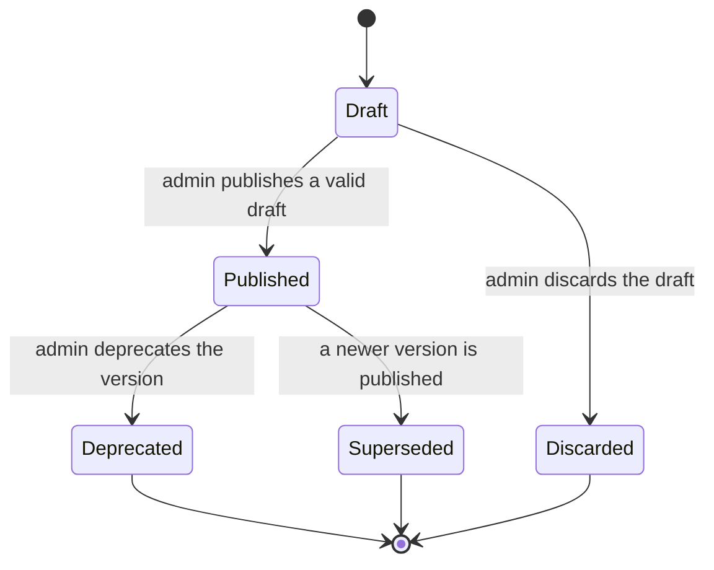

**`STATE-005` — Task Version, effective.** States: `Draft`, `Published`, `Retired`, `Superseded`, `Discarded`. Transitions:

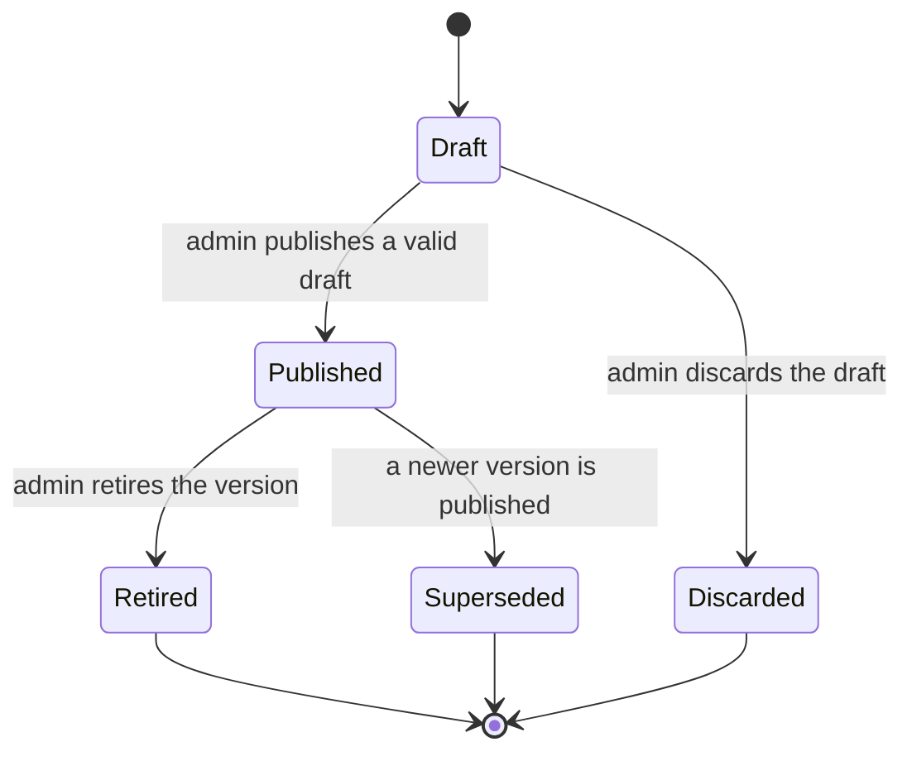

`STATE-004` (MCP server health) and `STATE-006` (account) remain **reserved**. `STATE-001`/`STATE-002` remain effective and unchanged. `[DERIVED: CHG-012]`

### B.6 MVP scope

The MVP is **six capabilities**: `CAP-001` Chat, `CAP-002` Skill registry with admin authoring, `CAP-003` MCP registry read-only, `CAP-004` Task definitions and manual runs with admin authoring, `CAP-005` self-hosted local accounts, and `CAP-009` audit.

The out-of-scope register drops from 31 to **30 CAPs**: `CAP-009` is now in; `CAP-006`–`CAP-008` and `CAP-010`–`CAP-036` remain out. The required-topic table's audit-log row moves to the MVP; the other 17 topics remain out. `[DERIVED: CHG-012]`

### B.7 Store and provider

- **PostgreSQL** is selected as the data store. `TBD-INFRA-003` is resolved; the physical schema, indexes, and migrations remain a separate change.
- The model gateway is internal, OpenAI-compatible, and has no external egress. `TBD-INFRA-009` is resolved.
- The stack, dependency tooling, environment baseline, and verified commands remain open (`TBD-INFRA-001`, `-002`, `-004`, `-005`, `-007`).

### B.8 Remaining open items

- `TBD-BIZ-005`, `-006`, `-007`, `-008`, `-010`, `-012`, `-013`, `-014`, `-015`.
- `TBD-INFRA-001`, `-002`, `-004`, `-005`, `-006`, `-007`, `-010`, `-011`.
- `CONFLICT-002`.
- `TBD-BIZ-014` is narrowed: internal policy applies, but the policy reference or clause is still missing; no legal or compliance conclusion is issued.

### B.9 Superseded statements

| Location | v0.2 statement | v0.3 amendment |
|---|---|---|
| §3.1 | Exactly five MVP CAPs | Six CAPs: CAP-001–005 + CAP-009 |
| §3.2 | CAP-009 audit is out of scope | CAP-009 is in the MVP |
| §3.3 topic 10 | Audit log out of MVP | Audit log is in the MVP |
| §5.1 | Classification column is `TBD-BIZ-003` | Replaced by B.2 |
| §5.1 | Skill/task lifecycle is proposed | Skill/task version states are effective per B.5 |
| §6.1 | ROLE-002 Admin is proposed | Admin is effective for B.3 grants |
| §6.2 | ROLE-002 row is all `denied` | Replaced by B.3 additive grants |
| §7.3/§7.5 | STATE-003/STATE-005 are proposed | Effective per B.5 |
| §9 NFR-009 | Retention is `TBD-BIZ-003` | 90/180/365 per B.2 |
| §10.2 | NFR-009 maps to `TBD-BIZ-003` | Retention per B.2 |
| §10.5 | Mechanical counts use 31 out-of-scope CAPs and MVP ≤5 | Superseded by B.6 (30 out, six CAPs) |
| §12.1 | TBD-BIZ-003/004/009/011 and TBD-INFRA-003/009 are Open | Resolved per B.1–B.7 |
| §12.2 | CONFLICT-001 is Open | Resolved toward Admin audit read |
| §12.3 | PII classification is `TBD-BIZ-003`; audit event is `TBD-BIZ-009` | Internal/Sensitive per B.2; audit event effective per B.4 |
| §1.1 SRC-006 | Stage 5 contract with five CAPs | The product owner's 2026-10-18 baseline decision supersedes the five-CAP limit |

### B.10 Appendix B self-check

| # | Check | Verdict | Evidence |
|---|---|---|---|
| B-1 | Every amended item names its new value | Pass | B.1–B.9; superseded table in B.9 |
| B-2 | No `TBD` is used as a settled value | Pass | `TBD-BIZ-014` remains open; no policy reference is invented |
| B-3 | No new `TBD`/`CONFLICT` ID | Pass | Only existing IDs are referenced |
| B-4 | Admin and audit are bounded to the selected baseline | Pass | B.3–B.4; MCP registration, account administration, and export remain out |
| B-5 | State models have terminals and no dead states | Pass | B.5; every terminal exits to `[*]`, and Draft/Published have outgoing transitions |
| B-6 | Retention is explicit and bounded | Pass | B.2; 90/180/365 with open operational trigger |
| B-7 | No compliance conclusion | Pass | `TBD-BIZ-014` remains open; B.2 is a product-owner classification, not a legal conclusion |
| B-8 | Mermaid is statically valid | Partial — static check only | Two `stateDiagram-v2` blocks; no renderer installed |

**Appendix B verdict:** Pass 7 / Partial 1 / Fail 0. The base v0.2 self-check below applies to the unamended sections; this appendix is the authoritative v0.3 amendment.

## Pre-completion self-check

**Self-check tag:** every row is a conclusion derived from the evidence in its Evidence cell. This table applies to the unamended v0.2 base; Appendix B has its own check in B.10. `[DERIVED: §1–§12; CHG-007]`

| # | Check | Verdict | Evidence (section and ID) | Fix action |
|---|---|---|---|---|
| 1 | No untagged assertion | Pass | §1.2 defines the tag legend; every table carries a `Tag` column or a tagged caption; every prose claim carries an inline tag; headings and column labels are not assertions. | None |
| 2 | BRs decidable, IDs unique and sequential | Pass | §8: 8/8 BR cards have a trigger, field/operator/threshold expression, and violation consequence; BR-001 to BR-008 are unique and unreused; CHG-007 records the ID-resolution check. | None |
| 3 | Every NFR has a value or a TBD plus a suggested baseline | Pass | §9: NFR-001 to NFR-003 and NFR-010 to NFR-012 have proposed numeric targets; NFR-004, NFR-005, and NFR-009 use a TBD target plus a labelled suggested baseline; every row has a measurement point and a time window. | None |
| 4 | No blank cells in the permission matrix | Pass | §6.2: 4 roles × 18 `entity.operation` columns; every cell is `allowed`, `denied`, `own-only`, or `read-only`; zero blanks. | None |
| 5 | No dead states and state-model coverage | Partial | §7.7: six models; every terminal state exits to `[*]`; every non-terminal state has an outgoing transition; zero dead states and zero unreachable states. Coverage is partial: six diagrams cover eight state-bearing entities; ten entities are mapped to `None` in §7.0. The per-entity interpretation is TBD-BIZ-015. | Close TBD-BIZ-015; add per-entity diagrams if the product owner requires the literal reading. |
| 6 | Mermaid renders | Unverified — static syntax only | 6 `flowchart LR` diagrams, 1 `erDiagram`, and 6 `stateDiagram-v2` diagrams are fenced and balanced; node IDs, edge endpoints, and quotes pass a static check. No Mermaid CLI is installed and adding a dependency is prohibited by RULE-007 and RULE-012, so rendering was not executed. | Independent Verifier should render with an available tool. |
| 7 | No dangling references | Pass | §10.5 and CHG-007: every referenced `CAP`, `OBJ`, `BR`, `NFR`, `ENT`, `STATE`, `FLOW`, `ROLE`, `SYS`, `EXT`, `TBD`, `CONFLICT`, and `CAND` ID resolves here or in `open_items.md`. | None |
| 8 | Out-of-scope count met and each says what it displaces | Pass | §3.2: 31 out-of-scope CAPs; 31 ≥ 10 and 31 ≥ 2 × 5; every row has a `Displaces` cell naming a CAP-001 to CAP-005 item. §3.3 maps all 18 required topics. | None |
| 9 | MVP ≤ 5, each has acceptance criteria | Pass | §3.1: exactly 5 CAPs; each has an acceptance-criteria cell and a `Covers BR` cell. | None |
| 10 | No forbidden terms | Pass | CHG-007 records a scan for the ten banned terms; the only occurrence is in the §12.3 banned list. No normative statement uses a banned term. | None |
| 11 | No TBD used as settled fact | Pass | Every `TBD` reference names a decision and its status; §2, §5.1, §9, and §12.1 label targets, classifications, and gates by their current status; no `TBD` appears in a BR `Source` field. | None |
| 12 | Source eligibility | Pass | §8: 8/8 BR `Source` fields cite SRC-001. SRC-002, SRC-003, SRC-004, and SRC-006 appear in CAP/CAND/CHL evidence, proposed NFRs, proposed entity or state notes, and as cited context in §1, §2, §4, and §8; no BR cites them. | None |

**Verdict:** Pass 10 / Partial 1 / Unverified 1 / Fail 0 for the v0.2 base. Appendix B supersedes rows 4, 5, 9, and 11 where they conflict (permission matrix, state coverage, CAP count, and TBD status). The v0.3 document remains `Draft` because CONFLICT-002 is open; Gate 1 acceptance is recorded in `TBD-BIZ-012`/`CHG-021`. `[TBD-BIZ-012]`

**Residual verification limits:**

- Mermaid diagrams were syntax-checked but not rendered: no Mermaid CLI is installed, and adding one is prohibited by the dependency rules. `[DERIVED: RULE-007 and RULE-012]`
- The Stage 5 acceptance contract (SRC-006) was supplied in the product owner's message, not as a repository file; the substitution is noted in §1.1 and CONFLICT-002. `[SRC: SRC-006 §④]`
- No P3 constraint exists. The document issues no compliance conclusion; TBD-BIZ-014 records the gap. `[TBD-BIZ-014]`
- Source quotes were checked against the repository working tree on 2026-10-18. If the PRD is revised, SRC-002 locations must be re-checked. `[SRC: CHG-007#Verification]`

```
Status: Draft
Self-check: Base v0.2 Pass 10 / Partial 1 / Unverified 1 / Fail 0; Appendix B Pass 7 / Partial 1 / Fail 0.
Blocked: 0 Blocked BRs; CONFLICT-002 (Stage 5 definition). Skill and task registries are operable through Admin publication; the MCP registry remains read-only and reservation-bound.
Decisions still open after Gate 1 (ranked by impact, <=5):
1. Supply the internal-policy reference for TBD-BIZ-014. The classification decision is recorded; the legal/compliance conclusion is not.
2. Confirm the first integrations and first three tasks — TBD-BIZ-005. Without them the acceptance demo has no content.
3. Confirm the execution model and retry policy — TBD-BIZ-007. Skill/task execution semantics remain unresolved.
4. Confirm objectives, go-live threshold, and NFR targets — TBD-BIZ-006 and TBD-BIZ-008.
Gate 1 accepted at the scope boundary on 2026-10-19 (TBD-BIZ-012 option (b), CHG-021). Open after Gate 1: TBD-BIZ-005, TBD-BIZ-006, TBD-BIZ-007, TBD-BIZ-008, TBD-BIZ-010, TBD-BIZ-013, TBD-BIZ-014, TBD-BIZ-015; TBD-INFRA-004, TBD-INFRA-005, TBD-INFRA-007, TBD-INFRA-011, TBD-INFRA-012, TBD-INFRA-013, TBD-INFRA-014. Stack, tooling, and command gates remain implementation gates.
Deliverable: docs/01_product/business_model.md v0.3
```
