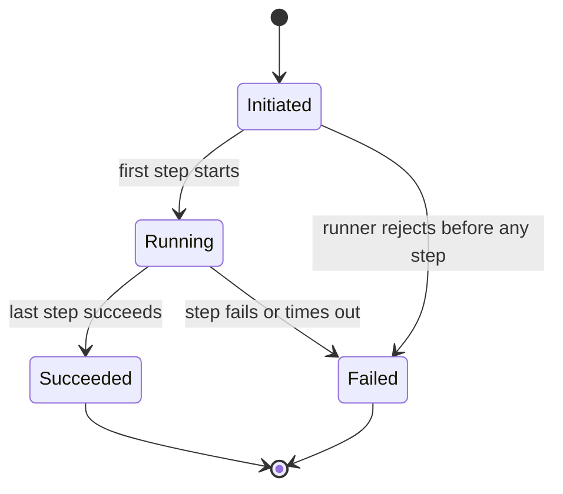
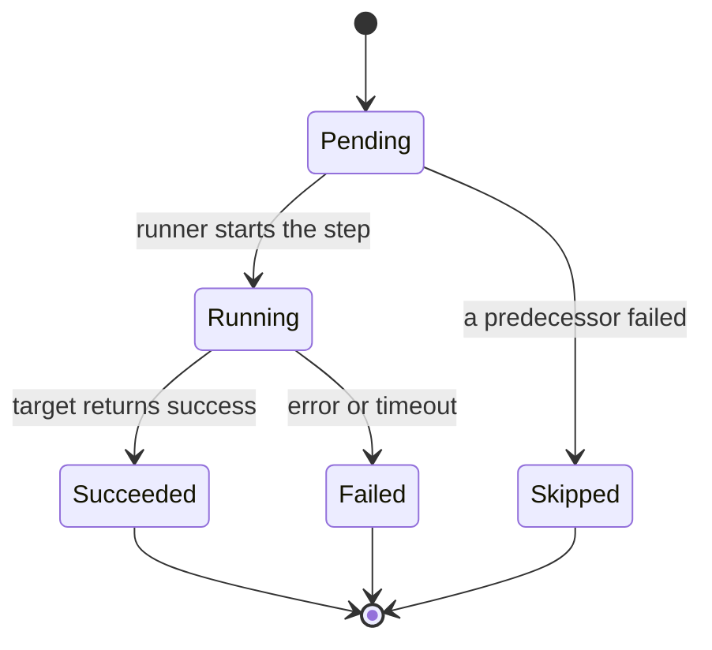

# hound-dock backend architecture

Status: Draft
Version: 0.1
As-of: 2026-10-18
Owner: Lead architecture agent for the Docs Agent
Input authority: `docs/01_product/business_model.md` v0.2 (`Draft`) — effective items only
Change record: `docs/13_changes/CHG-010-backend-architecture.md`
Companion documents: [research and input traceability](00_research_and_input_traceability.md) · [domain and service architecture](01_domain_and_service_architecture.md) · [API, workflow and state mapping](02_api_workflow_and_review.md) · [security, reliability and operations](03_security_reliability_and_operations.md) · [architecture review](04_architecture_review.md)

## 1. Document control and status

This is the single integrated architecture draft for the confirmed hound-dock MVP. It is `Draft`. It is not the Gate 1 acceptance of the PRD, which is recorded in `CHG-021`; it does not resolve `CONFLICT-001` or `CONFLICT-002`, and it does not answer any `TBD-BIZ` or `TBD-INFRA` entry.

The document is technology-neutral. It defines boundaries, responsibilities, state, data flow, and operating constraints. It does **not** define endpoints, request/response schemas, database tables, migrations, deployment commands, or implementation code. Those belong to `docs/05_api/`, `docs/04_data/`, `docs/06_development/`, `docs/09_deployment/`, and the implementation stages.

The architecture is written under a known constraint: the confirmed MVP is **not operable end to end** while `TBD-BIZ-004` is open, because no confirmed person may create, publish, register, or allowlist a registry entry. This document states that blocker; it does not invent an administrator to remove it.

## 2. Executive summary

### 2.1 Scope

The architecture covers exactly the five confirmed capabilities:

| CAP | Capability | Effective flow | Architecture surface |
|---|---|---|---|
| CAP-001 | Chat | FLOW-002 | Conversation and message records; model boundary; response integrity |
| CAP-002 | Skill registry | FLOW-004 read side | Read-only skill registry projection |
| CAP-003 | MCP registry | FLOW-005 read context | Read-only server metadata and recorded health |
| CAP-004 | Task definitions and manual runs | FLOW-003 | Recorded task version; run and run-step lifecycle; executor port |
| CAP-005 | Self-hosted deployment with local accounts | FLOW-001 | Local authentication; session; single-workspace deployment constraint |

`CAP-006`–`CAP-036` are out of scope. `FLOW-004`–`006`, `STATE-003`–`006`, skill publication, MCP registration/allowlisting, and task publication are **proposed — reserved; not implemented**.

### 2.2 Recommended shape

A **modular monolith** with capability modules and explicit ports is the recommended shape, following the backend-stack decision (`TBD-INFRA-002`, Resolved to Python 3.12 + FastAPI + uv). It keeps one deployable unit for a self-hosted single-team workspace, while preserving boundaries that can be separated later. This is a shape recommendation, not a further stack selection: the language and framework are recorded in `open_items.md`, while process model, exact versions, and store implementation remain separate decisions.

Modules: identity/session, conversation/chat, registry read, run orchestration, policy/access, observability/operations, external integration ports, and a reserved change/audit boundary. Policy is called by every application service; no module bypasses it. Registry read is read-only. Run orchestration creates a run only from the manual command.

### 2.3 Three key decisions

1. **The business-model permission matrix is the single policy source.** Every command and query is decided server-side with `allowed`, `denied`, `own-only`, or `read-only`; default is `denied`; `own-only` is enforced at query scope; `read-only` is a projection rule. No administrator path is invented. See [ADR-001](adr/adr_001_permission_matrix_single_source.md).
2. **The run record is the source of truth for outcome, and terminal states are immutable.** Manual creation only; one initiator and one recorded task version; a failed step makes the run `Failed`, remaining steps `Skipped`, and the failure visible; no automatic retry; a new run is the compensation. The executor is a port because `TBD-BIZ-007` is open. See [ADR-002](adr/adr_002_run_terminal_state_immutability.md).
3. **The confirmed registries are read-only and the MVP introduces neither an MCP runtime nor a HITL workflow.** Authoring, publication, registration, allowlisting, tool invocation, approval, interrupt, checkpoint, and resume are reserved. Empty registries are valid; no hidden seed/admin path exists. See [ADR-003](adr/adr_003_registry_read_only_mvp.md) and [ADR-004](adr/adr_004_no_mcp_runtime_no_hitl.md).

### 2.4 Critical findings

- **Operability blocker:** `TBD-BIZ-004` leaves CAP-002, CAP-003, and CAP-004 without a confirmed human authority. The read-only architecture is correct but the MVP cannot be populated by the product. This is a product blocker, not a missing module.
- **Egress tension:** CAP-001 requires a model call; `NFR-008` blocks external content until `TBD-BIZ-003`, `TBD-BIZ-014`, `TBD-INFRA-009`, and `TBD-INFRA-011` close. The model boundary is a port with an explicit gate. The tension is recorded, not resolved.
- **Execution gap:** `TBD-BIZ-007` is open. Run and run-step records and transitions can be designed; the step executor cannot. CAP-004's failure demonstration cannot be end-to-end until an execution model and a recorded task exist.
- **Streaming is not confirmed:** PRD `FR-001` proposes SSE, but CAP-001 and the interaction design only require an assistant message on success. The response boundary is transport-neutral; streaming is a candidate.

## 3. Purpose, scope and non-goals

### 3.1 Purpose

Define a backend architecture that is traceable to the effective business model, safe to implement in stages, and honest about what is unknown. The architecture must let a reviewer answer: what are the boundaries, who may do what, what is persisted, what happens on failure, what is measured, and what is deliberately absent.

### 3.2 In scope

- System context, module boundaries, dependency rules, and ownership of concepts.
- Domain model at the business-entity level, aggregate boundaries, and invariants.
- The two effective state machines: Run and Run Step.
- Commands, queries, and domain events at principle level.
- Consistency, concurrency, idempotency, failure recovery, and compensation.
- Interface principles, error classes, synchronization/asynchrony, progress and retry semantics, and frontend state mapping.
- Trust boundaries, authentication/authorization, data-boundary posture, reliability, observability, operations, and cost posture.
- Stack decision inputs: candidates, criteria, impact, and the owner's recorded decision by reference (§12).
- ADRs for high-cost-to-reverse decisions.
- Open risks, gaps, and verification plan.

### 3.3 Non-goals

- No stack, store, dependency-tooling, gateway, search-provider, hosting, or CI selection originating in this document; the recorded stack and store selections are references to `open_items.md` and `CHG-019`.
- No endpoint, path, HTTP method, status code, request/response schema, OpenAPI document, event payload schema, or pagination contract.
- No database schema, table, column, index, migration, or query.
- No deployment manifest, command, environment file, or secret value.
- No application code, scaffold, dependency manifest, or lockfile.
- No answer to a `TBD`; no resolution of a `CONFLICT`; no PRD acceptance.
- No decision on roles beyond ROLE-001, and no invented registry authority.
- No MCP runtime, MCP authorization flow, tool invocation, approval workflow, or HITL framework.
- No retention period, encryption algorithm, PII classification, deletion rule, residency conclusion, or compliance conclusion.

## 4. Inputs, traceability and assumptions

### 4.1 Authority order

1. `business_model.md` v0.2 effective items: CAP-001–005, FLOW-001–003, STATE-001/002, BR-001–008, ROLE-001 and the effective matrix cells.
2. `interaction_design.md` v0.1 for page states, exception feedback, route keys, and non-disclosure rules. It supplies interaction constraints, not backend behavior.
3. `prd.md` v0.1 only as candidate material. A PRD statement never overrides an effective business-model item.
4. `open_items.md` as the only TBD/CONFLICT registry. References only; no redefinition.

### 4.2 Effective, proposed, assumed, gap

| Class | What it includes | How this document treats it |
|---|---|---|
| Effective | The five CAPs, three flows, two state models, eight BRs, ROLE-001 matrix cells, the twelve NFR measurement points | May drive a boundary, command, state, or test obligation |
| Proposed — reserved | FLOW-004–006, STATE-003–006, publication/registration/intake, ROLE-002–004, CAND-001–023, PRD-only surfaces | Reserved extension point or non-goal; not implemented or promised |
| Architecture assumption | A working assumption with no confirmed source | Named with its dependency; never an acceptance criterion |
| Gap | An unanswered question with no TBD | Listed for the Tech Lead; no new ID created |

The full trace is in [00_research_and_input_traceability.md](00_research_and_input_traceability.md). The key assumptions are: run execution may be asynchronous but is manually triggered (A-01, depends on `TBD-BIZ-007`); one model endpoint is configured at deployment time (A-02, depends on `TBD-INFRA-009`); one workspace with no tenant concept or isolation model (A-03); conversation list is own-only with no confirmed paging (A-04); registry entries are prepared out of band (A-05, blocked by `TBD-BIZ-004`); operational logs are not audit events (A-06, `TBD-BIZ-009`); a disconnected client does not cancel accepted work (A-07).

### 4.3 What cannot be concluded here

No data classification, retention, encryption, PII, residency, compliance, capacity, availability, backup objective, role grant, provider, store, or stack conclusion originating here; the recorded stack and store selections are references to `open_items.md`. Each remaining item is either a `TBD` or an unregistered gap. The architecture states the boundary and the measurement point; it does not fill the decision.

## 5. System context and constraints

### 5.1 Actors

| Actor | Role | Effective interaction |
|---|---|---|
| ROLE-001 Member | Confirmed base role | Sign in; create/continue own conversation; read the three registries; initiate a manual run; read own run and run steps |
| ROLE-002 Admin, ROLE-003 Author, ROLE-004 Auditor | Proposed, all matrix cells denied | No effective page or action; no role administration; no audit read |
| SYS-001 | Authentication and session | Verify a local credential; create a session; bind the actor |
| SYS-002 | Chat and model boundary | Persist the user message; call the configured model; append one assistant message only on success |
| SYS-003 | Registry and validation | Read recorded entries; validate a submission only in a reserved authoring path |
| SYS-004 | Run orchestration | Create a manual run; drive run/step transitions through the executor port; finalize the outcome |
| SYS-005 | MCP boundary | Read recorded server metadata; no test, allowlist, or invocation |
| SYS-006 | Audit boundary (reserved) | No audit event is appended in the MVP; operational logs are separate |
| EXT-001 | MCP server | No call is made in the MVP |
| EXT-002 | Model provider | Receives prompt context only through the model port, subject to the egress gate |
| EXT-003 | Search provider | Excluded; no call |

### 5.2 Context constraints

- **Single workspace:** one team-controlled deployment; no multi-tenant control plane (`BR-007`; `CAP-023` excluded).
- **Local accounts only:** no external identity provider in the MVP (`BR-001`; `CAP-007` excluded).
- **No registry writes:** no effective human authority to populate the registries (`TBD-BIZ-004`).
- **No scheduler or external trigger:** runs are manual only (`BR-006`).
- **No MCP runtime:** the MCP registry is metadata and recorded health (`CAP-003`, `BR-004`).
- **Model egress gate:** no external content before the data-boundary and gateway decisions (`NFR-008`).
- **Stack and store recorded; runtime unverified:** the stack and store are recorded (`TBD-INFRA-001`–`003` Resolved); exact versions, deployment, and commands remain open (see §12).

A text context view:

```text
Member (ROLE-001)
  -> workspace runtime
       -> identity/session boundary (local account)
       -> conversation/chat boundary -> model port -> external model provider (gated)
       -> registry read boundary -> recorded skill / MCP server / task records
       -> run orchestration -> executor port (unresolved)
       -> policy boundary (every command/query)
       -> observability boundary (logs, metrics, health)
  -> future SSO (post-MVP, excluded)
  -> future MCP runtime (reserved, not implemented)
```

## 6. Module responsibilities and boundaries

The module names are architecture-local identifiers (`MOD-nn`). They are not packages, services, or deployment units. A single deployable unit is recommended; a future split is allowed only through the ports and boundaries below.

| Module | Responsibility | Owns | Must not |
|---|---|---|---|
| **MOD-01 Identity and Session** | Verify a local credential; create and bind a session; expose the actor identity to the policy boundary | Session runtime state; actor binding | Session termination/sign-out, external IdP, account administration, password reset, role management |
| **MOD-02 Conversation and Chat** | Create/continue a conversation; append a user message; call the model port; append exactly one assistant message on success | Conversation and message records; chat command boundary | Search, citations, file context, skill/tool calls, message edit/delete, streaming commitment |
| **MOD-03 Registry Read** | List/read recorded skills, MCP servers, and task definitions by business key; expose recorded health | Read projections over registry records | Create, edit, publish, deprecate, register, test, allowlist, invoke, delete |
| **MOD-04 Run Orchestration** | Create a manual run from a recorded task version; drive step transitions; finalize the outcome | Run and run-step records; run lifecycle | Scheduler, webhook, event trigger, automatic retry, branching, code execution, artifact download |
| **MOD-05 Policy and Access** | Decide every command/query from the matrix; enforce own-only scope; return a non-disclosing denial | Policy decisions; matrix mapping | Role administration; fine-grained ACLs; client-side authority |
| **MOD-06 Observability and Operations** | Structured operational logs, health signal, measurement points, failure visibility | Log schema and metrics boundary | Audit store/viewer/export; retention policy; SLO commitment |
| **MOD-07 External Integration Ports** | Define the model, executor, persistence, clock, identifier, and reserved secret/event ports | Port contracts and egress gate | Provider selection; MCP runtime; search; token store; secret backend |
| **MOD-08 Change and Audit Reservation** | Reserve domain events and an audit attachment point | Event names and reserved audit boundary | Audit persistence, append-only store, export, retention |

**Dependency rules:**

1. MOD-05 is called by every application service before a state change or a read that depends on the matrix. No module may bypass it.
2. MOD-03 is read-only. It may read records maintained outside the MVP, but it may not create them.
3. MOD-04 is the only module that creates a run; it accepts only a manual command from an authenticated ROLE-001.
4. MOD-02 and MOD-04 depend on ports, not on a provider, store, or transport.
5. MOD-08 is reserved; it must not become an implicit audit implementation.

## 7. Domain model, state, and data flow

### 7.1 Entity classification

| Class | Entities | Architecture treatment |
|---|---|---|
| Effective core | ENT-001 Account; ENT-003 Conversation; ENT-004 Message; ENT-006 Skill; ENT-008 MCP Server; ENT-011 Task Definition; ENT-014 Run | Minimal records needed by the effective flows; business keys; no schema |
| Structurally required by an effective rule | ENT-012 Task Version (BR-005 requires a recorded version); ENT-013 Task Step (the ordered composition a run version needs); ENT-015 Run Step (BR-008 requires visible failed step and skipped remaining steps); ENT-007 Skill Version where a skill read or step reference needs a version label | Minimal identity, ordinal, and status fields; no full lifecycle; no publication state machine |
| Reserved / proposed | ENT-002 Role Assignment; ENT-005 Citation; ENT-009 MCP Tool; ENT-010 Secret Reference; ENT-016 Artifact; ENT-017 Audit Event; ENT-018 Model Configuration | Not exposed; not persisted unless an effective read/run requires a minimal reference; no lifecycle implementation |

The `ENT-015` anomaly is handled explicitly: it is marked proposed in the business model, but `STATE-002` is effective, so the run-step record is not optional for `BR-008`. The architecture does not promote the other proposed entities.

### 7.2 Aggregates and invariants

| Aggregate | Members | Invariants |
|---|---|---|
| Conversation | Conversation, Messages | One owner account; messages append in order; an assistant message exists only for a successful model response |
| Registry record | Skill/Skill Version, MCP Server, Task Definition/Task Version | Business key unique; only recorded entries are listable/resolvable; read-only in the MVP |
| Run | Run, Run Steps | One initiator; one recorded task version; at least one run step; terminal states immutable; failed step visible; remaining steps skipped |
| Session | Session binding | Created only after local credential verification; bound to one account; no external IdP session |

The sourced invariants are in `business_model.md` §5.2. The architecture adds no business invariant. Structural rules such as "a run step has an ordinal" come from the effective state/flow needs, not from a new business decision.

### 7.3 Effective state machines

**STATE-001 Run:**



**STATE-002 Run Step:**



Rules: a terminal run is never mutated; a failed step is visible to the initiator; remaining steps are `Skipped`; there is no automatic retry; a new run is a new aggregate; a run rejected before any step is `Failed` with no step results. No scheduler, webhook, or event creates a run.

`STATE-003`–`006` are **reserved**. The architecture does not implement draft/published/deprecated/superseded/discarded, MCP health transitions, task retirement, or account invited/active/disabled/deleted transitions. MCP "recorded health" is a field on the read model, not a state machine.

### 7.4 Data flow

**Chat (FLOW-002):** accept a non-empty message for an active, own session -> persist the user message -> call the model port -> on success append exactly one assistant message; on failure append no assistant message and return an error. The user message stays. A partial answer is never stored as complete.

**Run (FLOW-003):** accept a manual command from ROLE-001 -> validate the recorded task version and inputs -> create the run and its run steps in `Initiated`/`Pending` -> the executor port starts steps -> update step states -> on the last success finalize `Succeeded`; on a failure finalize `Failed`, record the failed step, skip the rest -> expose the outcome to the initiator.

**Registry read (CAP-002/003/004):** project recorded entries by business key; an unrecorded key resolves to a non-disclosing "not found"; no create form, no owner display, no tool listing.

## 8. API and asynchronous principles

`docs/05_api/` owns the contract. This section defines only the boundary that a future contract must respect.

### 8.1 Interface classes

| Class | Examples | Behavior |
|---|---|---|
| Synchronous command | Sign in; create conversation; append user message; start a manual run | Validate, authorize, persist, return a reference or a failure class; no fabricated success |
| Model-dependent completion | Assistant reply | May outlive the request; on success append exactly one assistant message; on failure append none |
| Asynchronous run | Step execution and status | The run is created before execution; status is readable; terminal outcome is stable; no automatic retry |
| Read query | Conversation, run, run steps, registry records | Apply policy and own-only scope; no existence oracle; no owner fields that `Account.read=denied` forbids |

The domain catalog treats "append a user message and request one assistant reply" as one intent (`CMD-03`) with two durable effects: the accepted user message is retained, and the assistant message is appended only on success. Whether the contract exposes that intent as one operation or two is deferred to `docs/05_api/`; the two effects must remain independently confirmable either way. `[DERIVED: BR-002; 01 §7.1 CMD-03; 02 §5, §11]`

No transport, method, path, status code, or payload is defined here. Streaming is not required; the response boundary can support it later without changing the success/failure contract.

### 8.2 Error classes

| Class | Meaning | Disclosure and recovery |
|---|---|---|
| ERR-01 Validation | Input is invalid or incomplete | Field-level error; no record created; input preserved |
| ERR-02 Unauthenticated | No active session | Re-authenticate; no data disclosed |
| ERR-03 Forbidden | Policy says denied for a resource class the caller can legitimately identify; an own-only mismatch is deliberately reported as ERR-04, not here | Generic denial; no owner, title, or existence signal |
| ERR-04 Not found / non-disclosing unavailable | The business reference does not resolve, or the caller may not see it | Same response shape for both; no existence oracle |
| ERR-05 Conflict / duplicate / state conflict | A duplicate submission, an already-terminal run, or an invalid transition | Explicit conflict when detected; no silent replay. A blind retry is not confirmed as a duplicate and may create a second run (G-02); no dedup window is invented |
| ERR-06 Dependency unavailable | Model, store, or MCP metadata unavailable | Safe error; no fabricated answer or outcome; retry is a new user action |
| ERR-07 Internal | Unexpected failure | Generic error; no stack trace, secret, or PII; correlation id for operations |

The classes are architecture-local identifiers, not API codes or wire fields.

### 8.3 Run progress and retry

Progress is driven by the run/step records. The UI may read status; the architecture does not commit to polling, streaming, or a webhook. Retry is manual: a failed run is not retried in place; a new run is created after correction. An unconfirmed run start and a duplicate submission are gaps; the command boundary reserves an idempotency extension point but defines no dedup window.

### 8.4 Frontend nine-state mapping

The effective pages are PG-001, PG-002, PG-003, PG-004, PG-005, PG-006, PG-007, PG-008, PG-009. PG-010–012 are proposed and denied; they have no effective backend surface.

| Backend outcome | UI state | Constraint |
|---|---|---|
| Record set loaded | Default | Includes the recorded count where applicable |
| Read in progress | Loading | No zero count before the load completes |
| Valid empty set | Empty | A failed load must not become Empty |
| Business reference not resolvable, or not visible | No Result / not available | Same shape for non-existent and non-owned |
| Read/submit/status failure | Error | Retry or safe back route |
| Policy denied or inactive session | No Permission / sign-in | No data disclosed |
| Unsent input | Editing | Client state; no persistence across reload is confirmed |
| Command in flight | Submitting | No second send, no fabricated success |
| Terminal outcome | Success-Failure | `Succeeded` or `Failed`; `Initiated`/`Running` are never shown as terminal |

The full mapping is in [02_api_workflow_and_review.md](02_api_workflow_and_review.md) §9.

## 9. Human intervention

### 9.1 Position

**No HITL workflow is introduced in the MVP.** There is no effective human interruption, approval, denial, checkpoint, or resume flow. `CAP-014` approvals are excluded, `CAP-036` skill invocation and tool-call receipts are excluded, and `FLOW-004`–`006` are proposed. The architecture therefore has no interrupt state, no checkpoint, no resume command, no approval queue, and no LangGraph or equivalent dependency.

### 9.2 Why

Adding HITL would invent a workflow that the business model does not confirm, and would create a state that `STATE-001`/`STATE-002` do not contain. The interaction design also has no approval page; the "request authority" branches terminate at the product boundary.

### 9.3 Re-entry triggers

HITL research and design become necessary if one of the following becomes effective:

- `CAP-014` approval workflow enters the MVP.
- `CAP-036` tool invocation with a confirmation/denial surface becomes effective.
- `FLOW-005` MCP registration/invocation becomes effective.
- A future resumable workflow requirement introduces interrupt/checkpoint/resume semantics.

At that point the Tech Lead should register a TBD first, then research the official framework material, including idempotency and recovery. The MCP tools guidance in §11 is a related trigger, not an effective requirement.

## 10. Data, security, reliability, observability and operations

### 10.1 Trust boundaries

| Boundary | Crossing | Control objective | Status |
|---|---|---|---|
| Browser -> workspace | Session and credentials | Local authentication; generic denial; session binding | Effective, session mechanics deferred |
| Workspace -> model provider | Prompt context | Egress gate; data boundary; no content before the TBDs close | Blocked by `TBD-BIZ-003/014`, `TBD-INFRA-009` |
| Workspace -> MCP server | None in the MVP | No connection, test, or invocation | Excluded |
| Workspace -> persistence | All records | Durability for completed runs; no retention conclusion | `NFR-012`; `TBD-INFRA-003` |
| Operator -> deployment | Runtime configuration | Self-hosted; no vendor control plane; no secrets in docs | `BR-007`; `TBD-INFRA-006` |
| Future IdP -> workspace | SSO assertion | Excluded in the MVP | `TBD-INFRA-010` |

### 10.2 Security posture

- Local authentication only; no external IdP. The credential mechanism, session cookie flags, CSRF, and rate limiting are not decided here; `CAND-023` is not effective.
- Authorization is the matrix, default-deny, server-side; own-only is a query scope; read-only is a projection.
- No secret value is stored in a registry record, returned, or logged; only a credential reference may exist.
- Generic errors and non-disclosure: a denied action must not reveal whether a record or account exists.
- The model port has an explicit egress gate. The architecture does not select a provider or assert a data residency.
- No retention, encryption, PII, or compliance conclusion is made; `TBD-BIZ-003` and `TBD-BIZ-014` are open.
- Operational logs use correlation id, run reference, internal actor id, outcome, and error class; no secret or PII field is added. Audit events are separate and not implemented (`TBD-BIZ-009`).

### 10.3 Reliability

- `NFR-012` proposes that completed runs remain readable after a process restart; the persistence boundary must be able to support that target if it is adopted, but no store is selected.
- Dependency failure (model, store, MCP metadata) produces a safe error, not a fabricated success.
- An orphaned `Running` run after a crash has no confirmed recovery policy; this is a gap. No automatic fail, resume, or retry is invented.
- No availability target, RTO, RPO, or backup implementation is set. Backup is excluded from the MVP (`CAP-034`).
- Capacity (`NFR-004`) and availability (`NFR-005`) are TBD targets with suggested non-binding baselines.

### 10.4 Observability and operations

- Measurement points for NFR-001–012 are defined in [03_security_reliability_and_operations.md](03_security_reliability_and_operations.md) §13; thresholds are not commitments.
- Health, error rate, run duration, registry read latency, and run-state visibility are observable; no SLO is set.
- Operational logs are not audit events. No audit store, viewer, export, or retention is designed.
- Deployment and runbooks belong to `docs/09_deployment/` and `docs/10_operations/`; this document states no command and claims no operational readiness.

### 10.5 Cost

No token, cost, budget, or quota implementation is in the MVP (`TBD-BIZ-010`). The model call is the main cost driver; without a cost policy there is no per-run cost record and no budget meter. This is a visibility gap, not an architecture defect.

## 11. Research conclusions (MCP and HITL)

| Question | Conclusion | Project impact |
|---|---|---|
| Is the MCP registry an MCP runtime? | No. MCP defines host/client/server and prompts/resources/tools; the 2026-07-28 core is stateless | `ENT-008` is internal governance metadata; no MCP runtime, transport, or discovery |
| Does the official MCP Registry fit? | No. It is public, excludes private servers, and is not for self-hosting | No official registry API or `server.json`; internal business keys |
| Does MCP authorization apply now? | No connection is made; authorization is a future boundary | Reserve credential reference; no OAuth/token store; no token passthrough if ever added |
| Does MCP require HITL now? | Tools guidance says a human **SHOULD** be able to deny invocations; tool invocation is excluded | No HITL implementation; the guidance is a future re-entry trigger |
| Is `MCP Tasks` our task model? | No. It is a protocol extension for long-running agent work | Business task definitions are distinct; do not reuse the extension semantics |
| Is LangGraph HITL introduced? | No. No effective interrupt/approval/resume flow exists | No dependency, no checkpoint, no resume; revisit only after a TBD is registered |

Official sources and per-item adopt/reject reasoning are in [00_research_and_input_traceability.md](00_research_and_input_traceability.md) §8.

## 12. Stack decision inputs and recorded decision

The stack was **not selected** when this section was drafted. On 2026-10-19 the product owner resolved `TBD-INFRA-001` and `TBD-INFRA-002`: frontend React 19 + TypeScript 5 + Vite 7 (SPA, no SSR); backend Python 3.12 + FastAPI + uv. The resolution, the scoring, and the remaining gates are recorded in `docs/00_setup/open_items.md` and `CHG-019`; this section keeps the candidate set as the decision input and does not restate the scoring.

**What the decision settles and what it does not.** It settles the language, framework, build tool, and backend package manager at major-version level. It does not settle exact versions, the frontend Node/pnpm toolchain (`TBD-INFRA-005`), hosting/CI (`TBD-INFRA-006`), verified commands (`TBD-INFRA-007`), or the environment baseline (`TBD-INFRA-004`). No scaffolding, schema, migration, or command is authorized by it.

| Decision | Candidates (from `open_items.md`) | Criteria | Architecture impact |
|---|---|---|---|
| Frontend (`TBD-INFRA-001`, Resolved) | React + TypeScript + Vite; Next.js; Vue 3 + Vite; SvelteKit | Requirement fit; familiarity; operating cost | Affects the client for the nine states, own-only route handling, and future streaming; no backend contract changes |
| Backend (`TBD-INFRA-002`, Resolved) | Python 3.12 + FastAPI + uv; Node.js 22 + TypeScript (Fastify or NestJS); Java 21 + Spring Boot; Go 1.23 | Requirement fit; familiarity; operating cost | Affects module implementation, background execution, test tooling, and packaging; the module/port boundaries stay |
| Data store (`TBD-INFRA-003`) | PostgreSQL; SQLite; no persistence in the MVP | Requirement fit; operational cost; migration/exit path | `NFR-012` (proposed) calls for completed-run durability; "no persistence" would conflict with that target if it is adopted and would require the target to change |
| LLM gateway (`TBD-INFRA-009`) | Internal OpenAI-compatible gateway; Azure OpenAI; hosted API; local vLLM/Ollama | Data boundary; tool-calling ability; operating cost | Affects the model port, egress gate, data residency, streaming, and cost visibility; no provider is chosen |
| Dependency tooling (`TBD-INFRA-005`) | Follows the confirmed language | Reproducibility; auditability | Backend `uv` is recorded under `TBD-INFRA-002`; the frontend pnpm toolchain, lockfile policy, and commands remain `TBD-INFRA-005/007` |
| Hosting/CI (`TBD-INFRA-006`) | GitHub Actions; GitLab CI; local-only | Requirement fit; operating cost | No deployment or automated verification claim now |

**Architecture-level requirements that any stack must satisfy** (not a selection): server-side policy enforcement; a persistence boundary that can survive restart; a model port with an egress gate; a run executor port; background execution or an equivalent that does not create scheduled runs; the ability to expose the measurement points; testability of the matrix and state machines; self-hosted packaging without a vendor control plane.

**What would change the architecture:** a store with no durability would break `NFR-012`; a runtime without background execution would force run execution into the request path (still manual, but with an availability/performance consequence); an external model gateway would make the egress gate and data-boundary decision mandatory before CAP-001 can be exercised.

## 13. ADR summary

| ADR | Decision | Why it is recorded |
|---|---|---|
| [ADR-001](adr/adr_001_permission_matrix_single_source.md) | Matrix is the single policy source; server-side, default-deny, own-only at query | Prevents authorization drift and existence leaks; high cost to reverse |
| [ADR-002](adr/adr_002_run_terminal_state_immutability.md) | Run/step terminal states immutable; failure visible; no auto retry; new run is compensation | Makes `BR-008` testable and keeps a future executor replaceable |
| [ADR-003](adr/adr_003_registry_read_only_mvp.md) | Registries read-only; authoring/publication/registration/allowlisting not implemented | Keeps the MVP inside the effective matrix; no invented administrator |
| [ADR-004](adr/adr_004_no_mcp_runtime_no_hitl.md) | No MCP runtime and no HITL orchestration | Avoids a protocol runtime and a workflow the business model does not confirm |
| [ADR-005](adr/adr_005_response_integrity_and_streaming_boundary.md) | Response integrity; transport-neutral streaming boundary | Preserves `BR-002` while leaving transport and streaming to future decisions |

## 14. Risks

| Risk | Impact | Current treatment |
|---|---|---|
| R-01 Registry authority (`TBD-BIZ-004`) | The confirmed MVP cannot be populated or demonstrated end to end | Read-only surfaces; empty state valid; no hidden admin; blocker recorded |
| R-02 Model egress vs `NFR-008` | CAP-001 may be unusable before the data boundary and gateway close | Model port with an explicit gate; no provider selected; tension recorded |
| R-03 No execution model (`TBD-BIZ-007`) | Step execution and CAP-004 acceptance cannot be completed | Run/step records and lifecycle; executor port; no invented step semantics |
| R-04 Duplicate run / orphaned run | A second run or a stuck `Running` run | Command boundary reserves idempotency; no blind retry; gap recorded |
| R-05 Missing `McpTool.read` and owner display | Tool names or owner identities could leak or be wrongly withheld | Withhold tool names; no owner fields; gap recorded |
| R-06 Log PII vs `Account.read=denied` | Operational logs could expose identifiers | Internal actor id; minimized fields; `TBD-BIZ-003` still open |
| R-07 Proposed material promoted by accident | Architecture promises a capability that is not effective | Effective/proposed labels; D review; no authoring commands |
| R-08 Stack/API scope creep | Premature vendor or schema commitments | Stack recorded only at major-version level; no schema; 05_api and later stages own the contract and the physical design |
| R-09 Late stack decision | The architecture cannot be validated against a real runtime | Stack recorded (`TBD-INFRA-001/002`); runtime still unvalidated until `TBD-INFRA-004/007`; no implementation authorization |
| R-10 No verified environment (`TBD-INFRA-004`) | Performance and capacity claims cannot be tested | Measurement points only; no command or benchmark claim |
| R-11 Naming and ownership drift | RULE-001 or path-ownership violation | `snake_case`; CHG-010 handoff; no writes outside the scope |
| R-12 Documentation divergence | A/B/C/D and the integrated doc disagree | Lead integration; D review; traceability table |

## 15. Open questions and gaps

No question below is answered here. The canonical entry remains `docs/00_setup/open_items.md`.

| Open item | Effect on this architecture | Owner |
|---|---|---|
| `TBD-BIZ-003` | No data classification, retention, encryption, deletion, or PII conclusion; the data-boundary section is a boundary only | Product Owner |
| `TBD-BIZ-004` | No registry authority; the MVP is not operable; no admin/author path | Product Owner |
| `TBD-BIZ-005` | No concrete first MCP integration or task; the acceptance demo lacks content | Product Owner |
| `TBD-BIZ-006` | No go-live metric or threshold | Product Owner |
| `TBD-BIZ-007` | No step executor, retry, branch, or code semantics; the executor is a port | Product Owner |
| `TBD-BIZ-008` | No committed NFR threshold or measurement environment | Product Owner / Tech Lead |
| `TBD-BIZ-009` | No audit event, store, viewer, export, or retention | Product Owner |
| `TBD-BIZ-010` | No token/cost/budget record | Product Owner |
| `TBD-BIZ-011` | No search, history, configuration, file context, or streaming commitment | Product Owner |
| `TBD-BIZ-012` | Gate 1 scope boundary accepted (`CHG-021`); the architecture remains Draft | Product Owner |
| `TBD-BIZ-013` | No disable/delete/ownership-transfer cascade | Product Owner |
| `TBD-BIZ-014` | No compliance or residency conclusion | Product Owner |
| `TBD-BIZ-015` | The state-coverage interpretation is not decided; this document uses state-bearing entities | Product Owner |
| `TBD-INFRA-001/002` | Stack recorded at major-version level; modules and ports remain technology-neutral; exact versions and commands remain under `TBD-INFRA-004/005/007` | User / Tech Lead |
| `TBD-INFRA-003` | PostgreSQL recorded; physical schema, indexes, and migrations are not authored, and `NFR-012` depends on that physical design | User / Tech Lead |
| `TBD-INFRA-004` | Stage 1 baseline recorded (`CHG-022`); no verified command or benchmark until `TBD-INFRA-007` | User / Tech Lead |
| `TBD-INFRA-005/006/007` | Backend `uv` is recorded; the frontend toolchain, lockfile policy, CI, and verified commands remain open | User / Tech Lead |
| `TBD-INFRA-009` | No model provider/gateway/residency; egress gate is unresolved | User |
| `TBD-INFRA-010` | No SSO; auth extension point only | User |
| `TBD-INFRA-011` | No search provider or data boundary | User |
| `CONFLICT-001` | ROLE-004 remains denied; no audit read | Product Owner |
| `CONFLICT-002` | Stage metadata only; no architecture effect | Product Owner / Tech Lead |

**Unregistered gaps G-01–G-15** (session end, duplicate/unconfirmed run, orphaned run, registry authority, owner display, MCP tool read, list paging, audit vs logs, secret reference, streaming, MCP metadata fields, data classification, capacity/availability, backup, MCP registration/OAuth) are listed in [00_research_and_input_traceability.md](00_research_and_input_traceability.md) §7. They are candidates for the Tech Lead; no new ID is created in this task.

The topical documents use **document-local** gap families: `AGAP-` in `01`, `BGAP-` in `02`, and `CGAP-` in `03`. They overlap but are not interchangeable. The principal overlaps are below; each document remains authoritative for its own list, and the consolidated register is `G-01`–`G-15` in `00` §7.

| Consolidated gap | Domain (`01`) | Interface (`02`) | Security/operations (`03`) |
|---|---|---|---|
| Session end / sign-out / expiry | `AGAP-01` | `BGAP-06` | `CGAP-01` |
| Duplicate run or unconfirmed start | `AGAP-02`, `AGAP-03` | `BGAP-01`, `BGAP-02` | `CGAP-09` |
| Orphaned `Running` run | `AGAP-04` | `BGAP-03` | `CGAP-04` |
| Registry authority / intake | `AGAP-05` | Structural: an empty registry is valid | `CGAP-05` |
| Owner display | `AGAP-06` | `BGAP-04` | `03` §4.5 (no local gap ID) |
| `McpTool.read` | `AGAP-07` | `BGAP-05` | `03` §4.5 (no local gap ID) |
| Registry list paging | `AGAP-08` | `BGAP-07` | Measurement only |

## 16. Verification plan

### 16.1 What must be true before this draft is considered internally consistent

1. Every effective CAP/FLOW/STATE/BR/ROLE cell is traced to a module, command, state, or constraint.
2. Every proposed flow/state/authoring path is labelled reserved and is absent from the implemented surface.
3. No endpoint, schema, DDL, migration, command, or code appears; the recorded stack decision in §12 is a reference to `open_items.md` and `CHG-019`, not an implementation.
4. The two effective state machines match the business model, including terminal states and failure destinations.
5. The permission matrix is enforced server-side; own-only and not-found are non-disclosing; no administrator is invented.
6. The run outcome rules match `BR-008`; no automatic retry; the executor is a port.
7. MCP is metadata-only; HITL is not introduced; the research conclusions match the official material.
8. All documents are `Status: Draft`; paths comply with RULE-001; no TBD or CONFLICT is resolved.
9. D's review is complete; every finding is fixed or carried as an open item.
10. CHG-010 records the verification evidence.

### 16.2 What remains unverified

- Every numeric NFR target (`TBD-BIZ-008`).
- Exact stack versions and runtime behavior, the store, the gateway, and deployment (`TBD-INFRA-001/002/003/004/005/007/009`).
- Capacity, availability, backup, and recovery (`NFR-004/005`, `CAP-034`).
- The actual security controls for credentials, sessions, CSRF, and rate limiting (`CAND-023`, `TBD-INFRA-004`).
- The MCP runtime and authorization behavior (not implemented).
- The HITL workflow (not implemented).
- The end-to-end run execution (no execution model, no recorded task).
- The operability of the registries (`TBD-BIZ-004`).

### 16.3 Review gates

1. **D architecture review** — traceability, effective/proposed separation, stack/API overreach, missing risks, over-engineering, unverifiable assumptions.
2. **Lead integration** — resolve or carry every D finding; keep one consistent module/error/state vocabulary.
3. **Tech Lead review** — path ownership, RULE-001/013/014/018/019/020, change-record completeness.
4. **User gate** — decide whether the open items are acceptable for the next stage; this document does not decide them.

## 17. What this architecture does not authorize

- Starting implementation, scaffolding, dependency installation, migrations, or deployment.
- Treating the recorded stack or store selection as implementation authorization; selecting a gateway, search provider, hosting, or CI.
- Calling an external model, MCP server, or search provider.
- Creating, publishing, registering, or allowlisting a registry entry.
- Adding an administrator, an implicit author, or a hidden seed path.
- Resolving a TBD or CONFLICT, or declaring the PRD accepted.
- Introducing HITL, an approval workflow, a scheduler, or an automatic retry.
- Writing outside `docs/02_architecture/` and CHG-010.

## 18. Next steps after this draft

1. D review; fix or carry every finding.
2. Tech Lead review and the RULE-005 independent review (outside this task's write scope).
3. Resolve the business blockers in the order that unblocks the MVP: `TBD-BIZ-004` first, then `TBD-BIZ-003`/`TBD-INFRA-009`, then `TBD-BIZ-007` and `TBD-BIZ-008`.
4. Only after the stack and store are confirmed, produce the data design (`04_data`) and the API contract (`05_api`) from this architecture.
5. Keep every stage artifact `Draft` until the user accepts the relevant gate.
