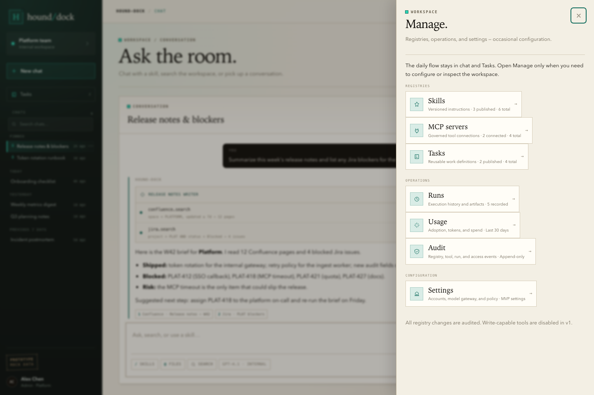
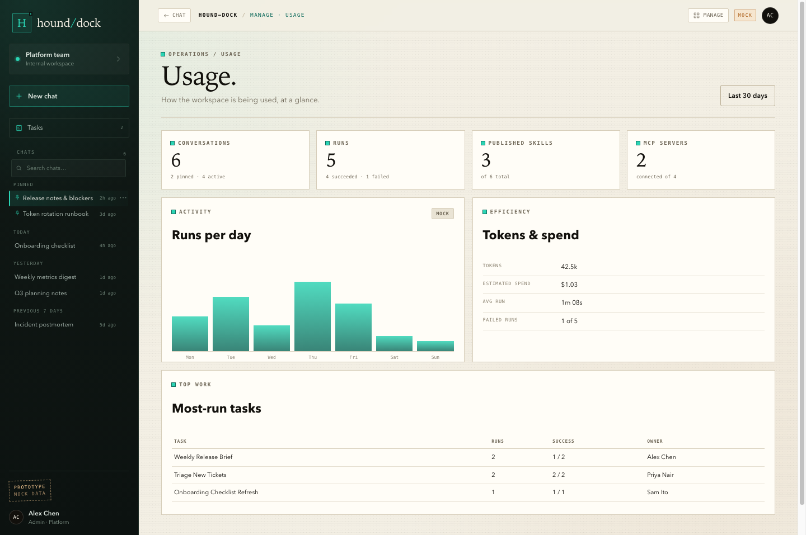

# Clickable UI prototype

Status: Draft
Purpose: validate the chat-first home, history actions, Tasks shortcut, and Manage surfaces of PRD v0.1 before revising it to v0.2.
Open: `docs/03_design/prototype/index.html` directly in a browser. No server, build step, or install is required.
Data: synthetic mock records only. No backend, no model calls, no MCP connections, no persistence, no secrets, no PII.
Lifetime: throwaway design artifact. It MUST NOT be treated as production code or copied into `frontend/` unchanged.

## Preview

## What to review

1. **Chat** — is chat + history + Tasks the right daily home, and is New chat obvious?
2. **Chat history** — are search, pin, rename, and delete discoverable through the `⋯` menu?
3. **Tasks** — does the daily shortcut earn its place in the sidebar?
4. **Manage** — is the topbar-only Manage entry discoverable, and are the three sections clear?
5. **Skills** — can an admin understand and register a skill from the manifest form?
6. **MCP** — can an admin add, test, and allowlist an MCP server without confusion?
7. **Tasks** — is the linear task builder understandable without a visual workflow engine?
8. **Runs** — is the run timeline and audit detail sufficient?
9. **Usage** — are the four metrics and activity chart the right first view?
10. **Audit** — are the columns and category filters sufficient for an internal audit?
11. **Settings** — is the local-account/model-provider scope clear for the MVP?

## Feedback questions

- Which screen would block you from using this at work?
- Is the `⋯` menu enough for history actions, or should pin/rename be one click?
- Is Manage too hidden in the topbar, or is that the right level of separation?
- Which Usage or Audit metric is missing?
- Which Manage row would you use weekly, and which only once?
- Is any "Must" requirement in the PRD unnecessary for the first version?

## Boundaries

- No scheduling, approval workflow, code execution, write-capable tools, or SSO in this mock.
- No real data; names, projects, runs, and servers are invented. Chat history and registry state reset on refresh.
- No framework, package manager, CDN, or external font. Icons are inline SVG.
- The visual design is directional, not final; it will be refined after the PRD is accepted.
