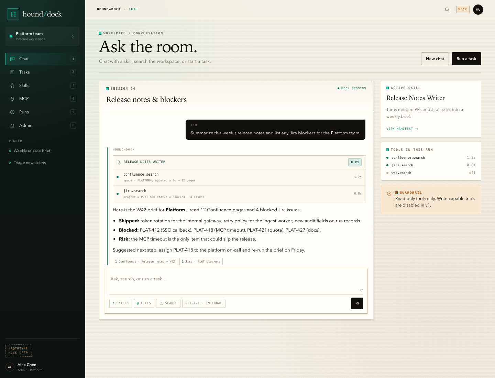
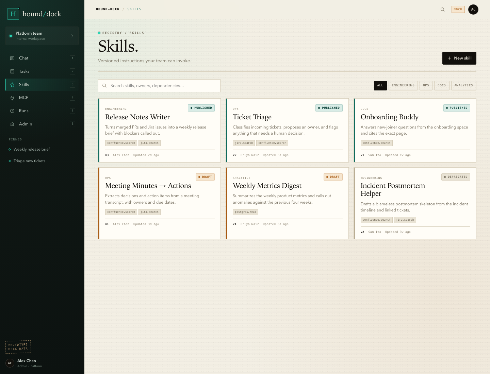

# Clickable UI prototype

Status: Draft
Purpose: validate the interaction model and MVP scope of PRD v0.1 before revising it to v0.2.
Open: `docs/03_design/prototype/index.html` directly in a browser. No server, build step, or install is required.
Data: synthetic mock records only. No backend, no model calls, no MCP connections, no persistence, no secrets, no PII.
Lifetime: throwaway design artifact. It MUST NOT be treated as production code or copied into `frontend/` unchanged.

## Preview

## What to review

1. **Chat** — does the chat + `/` skill + `@` file + search interaction feel like the right entry point?
2. **Skills** — can an admin understand and register a skill from the manifest form?
3. **MCP** — can an admin add, test, and allowlist an MCP server without confusion?
4. **Tasks** — is the linear task builder understandable without a visual workflow engine?
5. **Runs** — is the run timeline and audit detail sufficient?
6. **Admin** — is the local-account/model-provider scope clear for the MVP?

## Feedback questions

- Which screen would block you from using this at work?
- Which field in the skill/MCP/task forms is unclear or missing?
- Is any "Must" requirement in the PRD unnecessary for the first version?
- Is anything missing that the three reference screens made you expect?
- Would you rather run a task from chat, from the Tasks page, or both?

## Boundaries

- No scheduling, approval workflow, code execution, write-capable tools, or SSO in this mock.
- No real data; names, projects, runs, and servers are invented.
- No framework, package manager, CDN, or external font. Icons are inline SVG.
- The visual design is directional, not final; it will be refined after the PRD is accepted.
