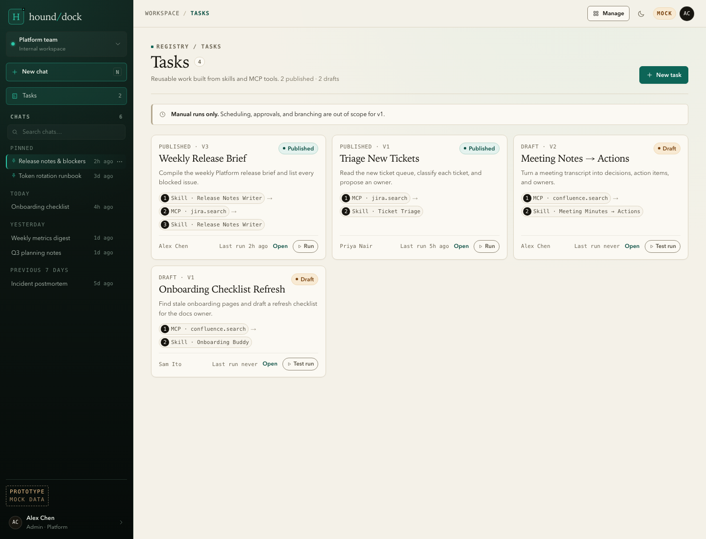
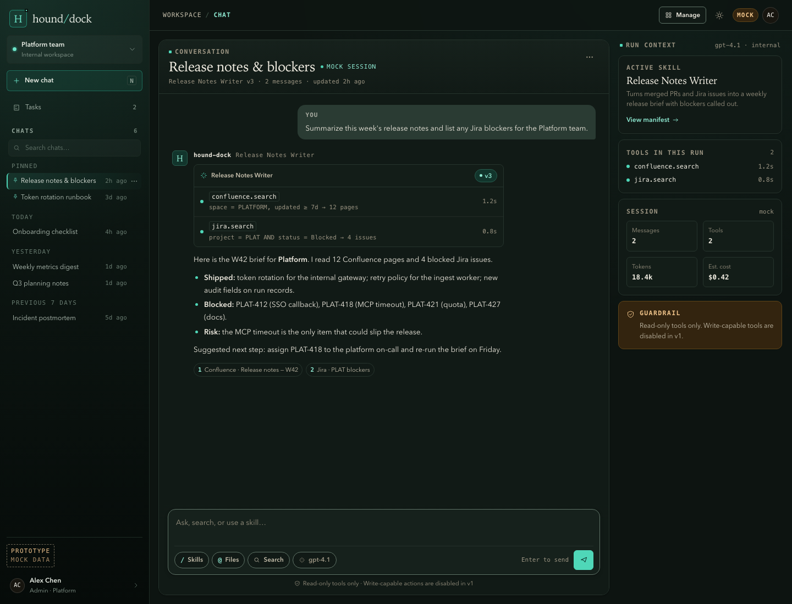

# Clickable UI prototype

Status: Draft
Purpose: validate the chat-first workspace, registry, and operations surfaces of PRD v0.1, and review the v2 "quiet console" layout and design-token system recorded in `../design_system.md`.
Open: `docs/03_design/prototype/index.html` directly in a browser. No server, build step, install, or network access is required.
Data: synthetic mock records only. No backend, model calls, MCP connections, persistence, secrets, or PII.
Lifetime: throwaway design artifact. It MUST NOT be treated as production code or copied into `frontend/` unchanged.

## Preview

## What to review

1. **Chat** — does the conversation now own the viewport, with a pinned composer and no document-style hero competing with it?
2. **Run context** — is the right-hand rail useful, and does the “Run context” drawer give the same information on narrow screens?
3. **Chat history** — are search, pin, rename, and delete still discoverable through `⋯` after the visual rewrite?
4. **Empty state** — do the prompt cards and published-task shortcuts make a new chat useful at a glance?
5. **Tasks** — does the daily sidebar shortcut earn its place, and is the linear step path understandable without a workflow builder?
6. **Manage** — is topbar-only Manage still discoverable, and are the three sections clear in the drawer?
7. **Skills** — can an admin scan status, owner, version, and dependencies, then register a skill from the form?
8. **MCP** — can an admin add, test, and allowlist a server, and is it clear that write-capable tools are blocked in v1?
9. **Runs** — are the status filters, table density, and run detail (actor, task version, start/end, steps, artifacts) sufficient?
10. **Usage** — are the four KPIs, activity chart, spend panel, and most-run tasks the right first view?
11. **Audit** — do the category chips, actor/action/target search, and All time / Today / Last 7 days filter cover the PRD requirement?
12. **Settings** — is the local-account/model-provider scope clear, with policy decisions left visibly proposed?
13. **Design tokens** — do the light and dark themes read as the same system, and does the hierarchy hold without relying on tiny uppercase text?
14. **Accessibility and mobile** — is the 390px layout usable, with 44px targets, no horizontal body overflow, and visible focus throughout?

## Feedback questions

- Which screen would block you from using this at work?
- Is the full-height chat better than the previous card-within-a-page layout?
- Is the run-context rail earning its width, or should it collapse into the conversation?
- Which registry card metadata is missing when you scan it?
- Is the 11–13.5px functional type scale comfortable, or does anything still read as too small?
- Does the dark theme feel intentional, or should the MVP stay light-only?
- Which Usage or Audit metric would you check weekly, and which only during an incident?
- Is any "Must" requirement in the PRD unnecessary for the first version?

## Boundaries

- No scheduling, approval workflow, code execution, write-capable tools, or SSO in this mock. Write tools are shown as `Blocked in v1`.
- No real data; names, projects, runs, and servers are invented. Chat history, registry state, and theme choice reset on refresh.
- No framework, package manager, dependency, CDN, or external font. Fonts are local OS stacks; icons are inline SVG.
- The dark theme is a token demonstration, not a confirmed product requirement.
- The visual design and tokens are directional; they do not select the frontend stack (TBD-INFRA-001).
- The design reference is `docs/03_design/design_system.md`; the change record is `docs/13_changes/CHG-005-prototype-visual-system.md`.
