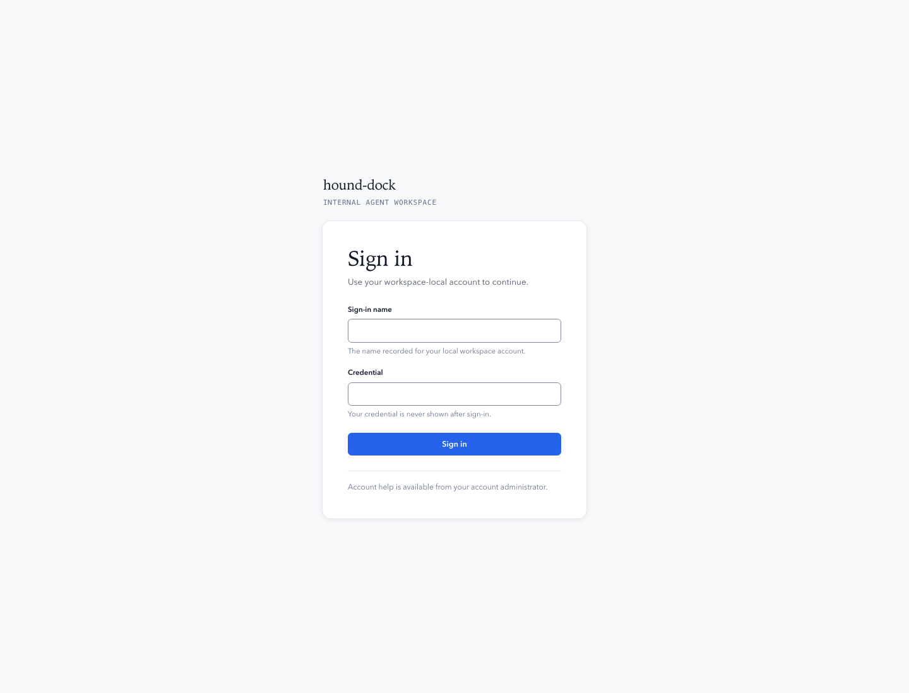
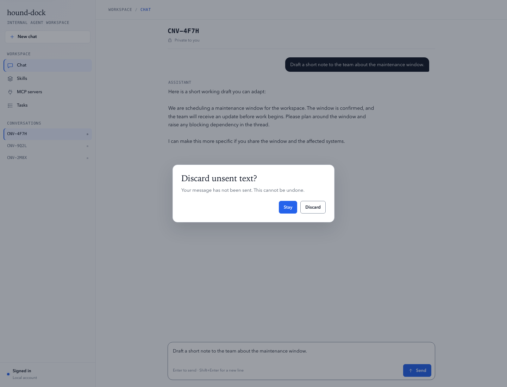
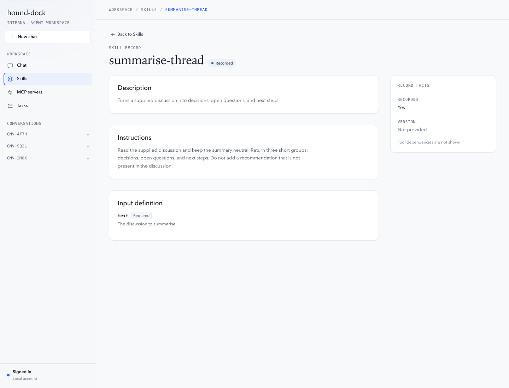
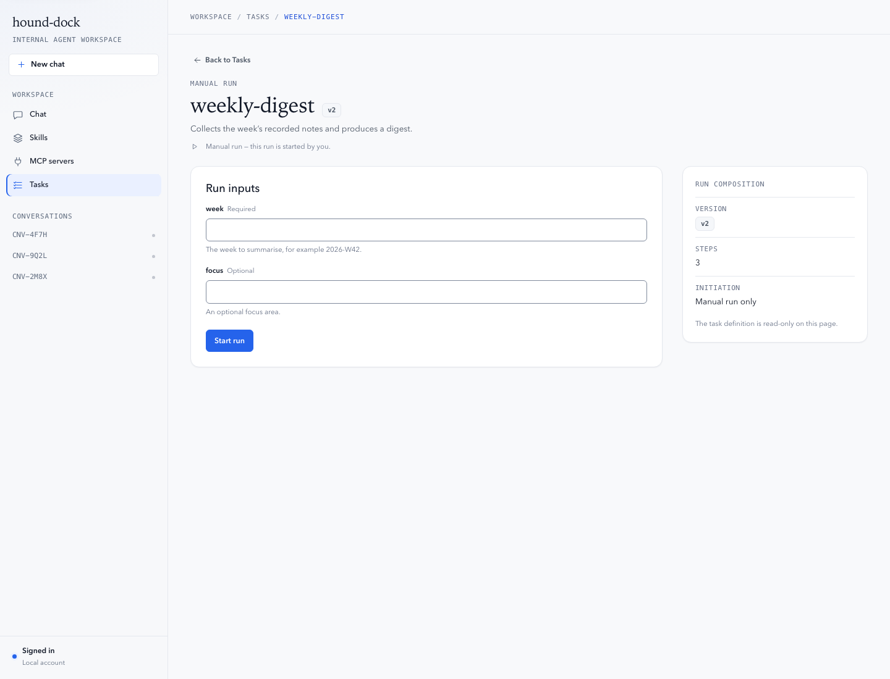
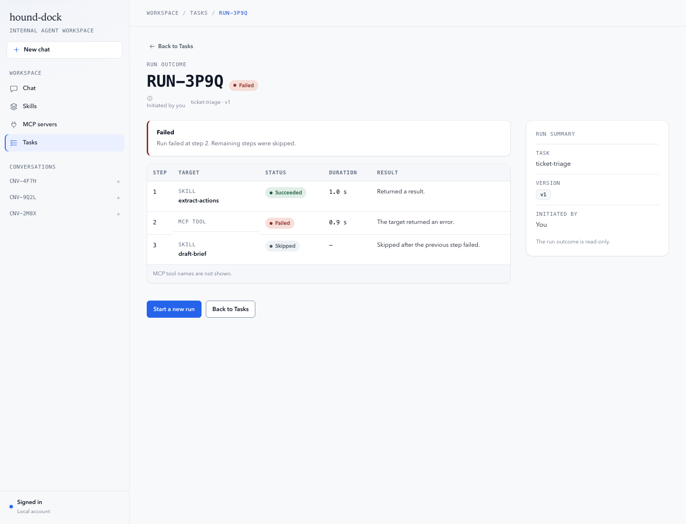
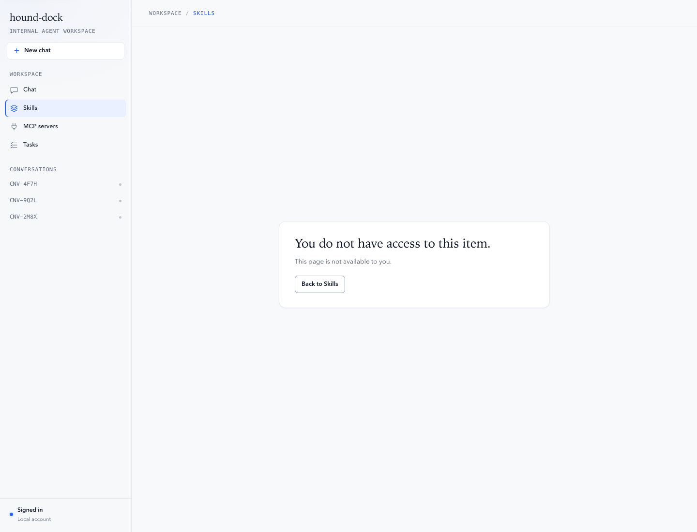
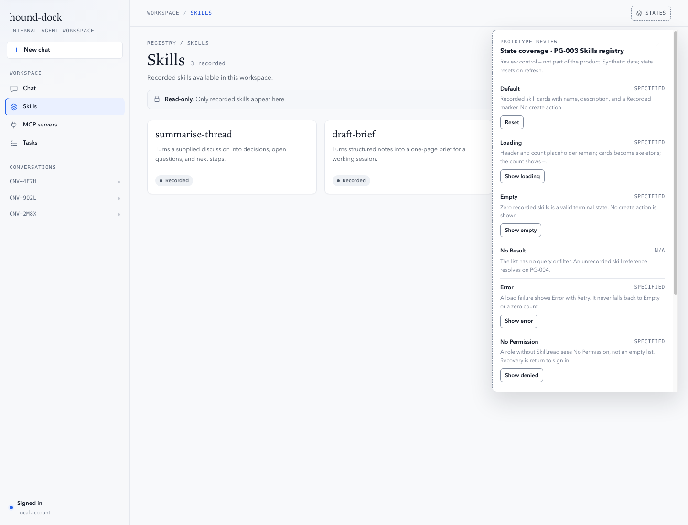
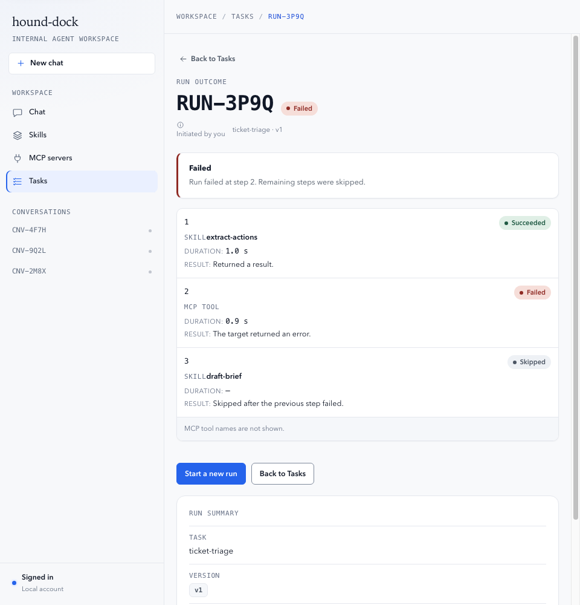

# hound-dock — clickable interaction prototype

Status: Draft
Purpose: turn the settled business model v0.2 and interaction design v0.1 into a clickable, demo-ready prototype of the effective MVP.
Open: `docs/03_design/prototype/index.html` directly in a browser. No server, build, install, dependency, or network access is required.
Data: synthetic fixtures only. No backend, model calls, MCP connections, persistence, secrets, or PII.
Visual: Porcelain Blue — near-white rail, cool porcelain surfaces, ink text, and a single blue action accent. Light theme only.
Lifetime: throwaway design artifact. It MUST NOT be treated as production code or copied into `frontend/` unchanged.

Inputs and precedence:

1. `docs/01_product/business_model.md` v0.2 — business rules.
2. `docs/03_design/interaction_design.md` v0.1 — IA, FLOW-001 to FLOW-003, nine-state matrix, 1440px layout.
3. `docs/03_design/design_system.md` — presentation-layer reference only.

Change records: `docs/13_changes/CHG-008-prototype-interaction-build.md` (build) and `docs/13_changes/CHG-009-prototype-porcelain-blue.md` (palette).

## What to try

### FLOW-001 — Local sign-in and session

1. Open `index.html`. The standalone sign-in page is PG-001.
2. Enter any non-empty sign-in name and credential, then activate **Sign in**. A submitting state appears, then the workspace opens on Chat.
3. The generic denial state is reachable from the **States** review control on PG-001 (`Error`). It does not reveal whether an account exists.

### FLOW-002 — Chat message and assistant response

1. On Chat, open a conversation or activate **New chat**.
2. Send an empty message: it is rejected at the composer with no turn created.
3. Type a non-empty message and press Enter or **Send**. The user turn is `Sending`, one assistant turn is `Assistant is responding`, and the composer locks.
4. On success, exactly one assistant message appears and the composer unlocks. The `Submitting` and `Success-Failure` inspection states are in the review panel.
5. Leaving Chat or the run form with unsent text opens the only dialog in the prototype: **Discard unsent text?** with Stay and Discard. There is no delete, publish, rename, pin, or sign-out action anywhere.

### FLOW-003 — Manual task run

1. Open **Tasks**, then activate **Run** on a recorded task.
2. Complete the declared inputs and activate **Start run**. The page locks while `Starting run…` is shown; it never claims the run succeeded.
3. The run outcome opens at PG-009. It shows `Initiated` and `Running` before the terminal state, with one row per step (ordinal, target kind, status, duration, result or error).
4. On the synthetic fixtures: `weekly-digest` succeeds, `ticket-triage` fails at step 2 with step 3 `Skipped`, and `health-check` is rejected before any step with no step results.
5. The run outcome offers **Start a new run** and **Back to Tasks**. There is no run index, artifact, cost, token, or audit surface.

## Pages and routes

| Page | Route | Status |
|---|---|---|
| PG-001 Sign in | `#/sign-in` | Confirmed |
| PG-002 Chat | `#/chat`, `#/chat/:conversationRef` | Confirmed |
| PG-003 Skills registry | `#/skills` | Confirmed read-only |
| PG-004 Skill record | `#/skills/:skillName` | Confirmed read-only |
| PG-005 MCP registry | `#/mcp` | Confirmed read-only |
| PG-006 MCP server record | `#/mcp/:serverName` | Confirmed read-only |
| PG-007 Tasks registry | `#/tasks` | Confirmed read-only + run entry |
| PG-008 Task run | `#/tasks/:taskName/run` | Confirmed |
| PG-009 Run outcome | `#/runs/:runReference` | Confirmed |
| PG-010 Skill editor | `#/skills/new`, `#/skills/:skillName/edit` | No Permission only; direct URL only |
| PG-011 MCP server editor | `#/mcp/new`, `#/mcp/:serverName/edit` | No Permission only; direct URL only |
| PG-012 Task definition editor | `#/tasks/new`, `#/tasks/:taskName/edit` | No Permission only; direct URL only |

PG-010 to PG-012 are not linked from navigation and render no form, draft, test, publish, or other write affordance. To inspect one, sign in first, then enter the hash route in the same tab. A reload resets the in-memory session, so the route then resolves to Sign in.

Useful synthetic run references (sign in, then set the hash):

- `#/runs/RUN-7K2M` — `Succeeded` with three steps.
- `#/runs/RUN-3P9Q` — `Failed` at step 2; step 3 `Skipped`.
- `#/runs/RUN-5C1R` — rejected before any step; no step results.
- `#/runs/RUN-9T6B` — `Running`; non-terminal.

Unknown skill, server, task, conversation, or run references resolve to their generic No Result panel. An unauthenticated visit to any authenticated route resolves to PG-001.

## State coverage

Every page has a **States** review control in the topbar (top-right on the sign-in page). It is a prototype-only inspection surface, not a product capability. It lists all nine states for the current page, states each N/A reason in place, and can render a specified state or run its inspection action for review. It does not link PG-010 to PG-012.

A ✓ marks a state specified by interaction design §6; N/A marks a state that cannot occur on that page.

| Page | Default | Loading | Empty | No Result | Error | No Permission | Editing | Submitting | Success-Failure |
|---|---|---|---|---|---|---|---|---|---|
| PG-001 | ✓ | N/A | N/A | N/A | ✓ | N/A | ✓ | ✓ | ✓ |
| PG-002 | ✓ | ✓ | ✓ | ✓ | ✓ | ✓ | ✓ | ✓ | ✓ |
| PG-003 | ✓ | ✓ | ✓ | N/A | ✓ | ✓ | N/A | N/A | N/A |
| PG-004 | ✓ | ✓ | N/A | ✓ | ✓ | ✓ | N/A | N/A | N/A |
| PG-005 | ✓ | ✓ | ✓ | N/A | ✓ | ✓ | N/A | N/A | N/A |
| PG-006 | ✓ | ✓ | N/A | ✓ | ✓ | ✓ | N/A | N/A | N/A |
| PG-007 | ✓ | ✓ | ✓ | N/A | ✓ | ✓ | N/A | N/A | N/A |
| PG-008 | ✓ | ✓ | N/A | ✓ | ✓ | ✓ | ✓ | ✓ | ✓ |
| PG-009 | ✓ | ✓ | N/A | ✓ | ✓ | ✓ | N/A | N/A | ✓ |
| PG-010 to PG-012 | ✓ (No Permission only) | N/A | N/A | N/A | N/A | ✓ | N/A | N/A | N/A |

N/A reasons:

| Page | N/A states | Reason |
|---|---|---|
| PG-001 | Loading, Empty, No Result, No Permission | The page is a static form. It retrieves no record, has no collection, has no record reference or search, and is the pre-session entry. A failed credential is Error, not a page permission. |
| PG-003, PG-005 | No Result, Editing, Submitting, Success-Failure | The list has no query or filter; an unrecorded reference resolves on the record page. There is no inline editing or mutating operation, and read success is Default while read failure is Error. |
| PG-004, PG-006 | Empty, Editing, Submitting, Success-Failure | A record either resolves or does not; a missing field is a field-level absence, not a page Empty state. The record is read-only and has no mutating action. |
| PG-007 | No Result, Editing, Submitting, Success-Failure | The list has no query or filter; an unrecorded task resolves on PG-008. There is no inline editing. Run navigates to PG-008, where submission is owned, and read success/failure are Default/Error. |
| PG-008 | Empty | A task with no declared inputs still renders a complete run form. No tasks is Empty on PG-007; an unrecorded task is No Result. |
| PG-009 | Empty, Editing, Submitting | A run has at least one step by invariant; a rejected run shows “No step results” as a field-level absence. The run is read-only, and Start a new run navigates to PG-008. |
| PG-010 to PG-012 | Loading, Empty, No Result, Error, Editing, Submitting, Success-Failure | Effective N/A: no authorized operation can start, no draft is created, no draft exists to resolve, and no validation or authoring operation can run. The only reachable effective state is No Permission. |

## Screens

## Boundaries

- **In scope:** PG-001 to PG-009 and FLOW-001 to FLOW-003. PG-010 to PG-012 are direct-URL-only No Permission panels.
- **Not present:** Manage drawer, Runs/Audit/Usage/Settings, conversation search/pin/rename/delete, account menu/avatar/sign-out, theme toggle, model picker, attach/`@`/`/`, search/citations, run-context rail, skill or MCP authoring, task authoring, publish, delete, import/export, notifications, sharing, and mobile.
- **Read-only:** Skills, MCP servers, tasks, and skill/MCP records show recorded content without edit, publish, test, allowlist, invoke, or delete controls. No owner name, avatar, lifecycle status, dependency list, individual MCP tool name, or secret value is rendered.
- **Only dialog:** `Discard unsent text?` with Stay and Discard. There is no destructive delete and no undo.
- **Layout:** desktop baseline at 1440px, adopting the design-system breakpoints at 1280, 1080, and 960. No mobile layout is designed; the page enforces a 960px minimum.
- **Theme:** light only; Porcelain Blue palette with a near-white rail and blue action. The design-system dark theme remains reference-only.
- **Session:** in memory only. Refresh resets the session, conversations, and runs; unsent text is never persisted.
- **Assets:** local OS font stacks and inline SVG only. No framework, package, manifest, lockfile, CDN, external font, image request, or network call.

## Verification

Executed 2026-10-18 with Node.js syntax checking, `lxml` HTML parsing, and headless Chrome over `file://` at 1440, 1280, 1080, and 960px (174 scenario checks and 67 edge/accessibility checks):

- FLOW-001, FLOW-002, and FLOW-003 pass from entry to completion, including submitting, success, chat model failure (inspection state), invalid input, no-run, unconfirmed run start, rejected run, and failed-step outcomes.
- Every page renders all nine states or an explicit N/A reason; the review panel reports nine rows on PG-001 to PG-012.
- No horizontal page overflow at 1440, 1280, 1080, or 960px. The registry grid is 3 columns at 1440, 2 columns at 1280 and 960; the record/run split becomes one column at 1080; the run-step table stacks duration and result at 960 while keeping status visible.
- No runtime exceptions, console errors, external resources, duplicate IDs, unlabelled form fields, buttons without `type`, or dangling `aria-describedby` references.
- The only dialog is the discard confirmation; PG-010 to PG-012 render No Permission only and are absent from navigation.
- Contrast checks pass: primary text 17.74:1, secondary 7.56:1, muted 4.97:1, accent text 6.70:1, white on the blue action 5.17:1, sidebar text 16.69:1, control border 3.31–3.49:1, and every status pair ≥6.27:1.
