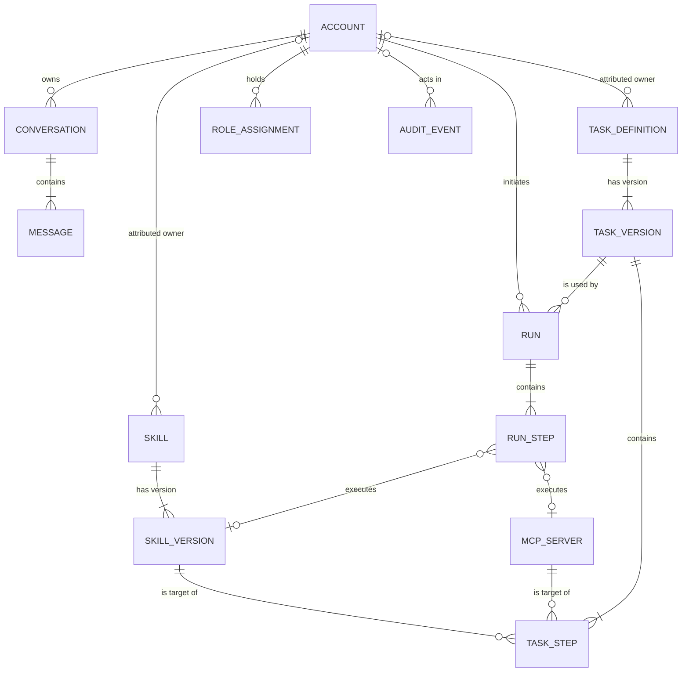
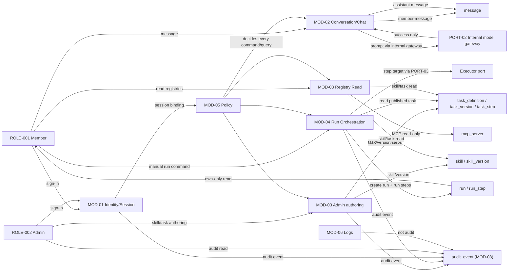

# Logical Data Model Specification — hound-dock

Status: Draft
Version: 0.3
As-of: 2026-10-19
Owner: Data architect (Docs Agent scope for `docs/04_data/**`)
Business authority: `docs/01_product/business_model.md` v0.3 Appendix B — enterprise-internal baseline
Architecture authority: `docs/02_architecture/architecture.md`, `01_domain_and_service_architecture.md`, and `05_enterprise_internal_baseline.md`
Interaction input: `docs/03_design/interaction_design.md` v0.1 — page fields are distinguished from persisted fields; `PG-010`/`PG-012` become effective under the baseline, `PG-011` remains denied
Registry: `docs/00_setup/open_items.md` — resolved entries are referenced, remaining open entries are not answered
Change record: `docs/13_changes/CHG-020-support-stores-signin-session-idempotency.md` (this revision); baseline `CHG-012`.

## 1. Document control, authority, and baseline

### 1.1 What this document is

This document defines the **logical** data model for the enterprise-internal hound-dock MVP: entities, logical tables, fields, keys, constraints, index candidates, state fields, lifecycle boundaries, classification, retention, audit, migration requirements, and open items.

It remains a logical model. PostgreSQL is selected as the store by the product-owner baseline, but this document contains **no DDL, no SQL, no migration code, no physical index creation, and no API schema**. Physical schema, indexes, and migrations are a separate authorized change.

### 1.2 Status vocabulary

| Tag | Meaning |
|---|---|
| `[E]` | Effective — required by a confirmed CAP, BR, FLOW, or effective state model |
| `[SR]` | Structurally required — minimal record required by an effective rule; no extra lifecycle |
| `[P]` | Proposed field — useful but not required; may be omitted without breaking an effective capability |
| `[RES]` | Reserved — no table, field, transition, or write path |
| `[TBD-BIZ-nnn]` | A remaining open decision; reference only, never a value |
| `[ARCH: ...]` | Architecture evidence, including the enterprise supplement |

### 1.3 Enterprise-internal baseline decisions (CHG-012)

The product owner selected the enterprise-internal baseline on 2026-10-18. The decisions are recorded in `business_model.md` Appendix B and `open_items.md`; this section applies them to the data model.

| Decision | Value | Data-model consequence |
|---|---|---|
| D-01 Deployment | Enterprise-internal daily work only; self-hosted; local accounts; internal OpenAI-compatible gateway; no external egress | No external provider table; no `Public` data |
| D-02 Classification | `Internal` structural metadata; `Sensitive` person-linked, content, topology, and behavioural data; `Highly Sensitive` prohibited; `Public` none | Field tables use `Internal`/`Sensitive`; no Highly Sensitive field |
| D-03 Retention | Conversations/messages 90 days; runs/run steps 180 days; audit 365 days; account while active; registry records while recorded | `created_at`/`occurred_at` required where retention applies; no `expires_at` column |
| D-04 Protection | TLS in transit; encryption at rest; no content or identifiers in logs; Admin-only audit read | Protection requirements; no algorithm or masking rule |
| D-05 Roles | `ROLE-002` Admin effective for skill and task publication and audit read; `ROLE-001` Member unchanged; `ROLE-003`/`004` denied | `role_assignment` effective; `ROLE-002` grants |
| D-06 Audit | `CAP-009` effective; append-only sign-in, skill/task registry, run, and audit-read events; Admin read; no export; 365 days | `audit_event` effective |
| D-07 States | `STATE-003` and `STATE-005` effective; `STATE-004` and `STATE-006` reserved; `STATE-001`/`STATE-002` unchanged | `skill_version.version_state`, `task_version.version_state` effective |
| D-08 Scope | Six CAPs: `CAP-001`–`005` + `CAP-009`; skill/task authoring; MCP registration, account administration, search, file, cost, history excluded | No MCP tool/registration table, account state, citation, artifact, or model-config table |
| D-09 Store | PostgreSQL selected; physical design separate | Logical model only in this document |
| D-10 Legal | Internal policy applies; policy reference pending; no compliance conclusion | `TBD-BIZ-014` remains open |

**Resolved entries:** `TBD-BIZ-003`, `TBD-BIZ-004`, `TBD-BIZ-009`, `TBD-BIZ-011`, `TBD-INFRA-003`, `TBD-INFRA-009`; `CONFLICT-001` resolved toward Admin audit read.

**Remaining open:** `TBD-BIZ-005`, `-006`, `-007`, `-008`, `-010`, `-012`, `-013`, `-014`, `-015`; `TBD-INFRA-004`, `-005`, `-006`, `-007`, `-010`, `-011`, `-012`, `-013`, `-014`; `CONFLICT-002`.

`TBD-INFRA-001`/`-002` are resolved for the stack (`CHG-019`) and have no data-model effect. `TBD-INFRA-012`–`-014` gate the proposed support stores in §2.5.

**Superseded task constraint.** The original data-model task required only `STATE-001`/`STATE-002` to be effective and no store selection. The product-owner decision in `CHG-012` supersedes that constraint: `STATE-003`/`STATE-005` are effective and PostgreSQL is selected. The document still does not write physical DDL or migration code.

### 1.4 Inputs and precedence

1. `business_model.md` v0.3 Appendix B — the enterprise-internal decisions and the amended business rules.
2. `02_architecture/05_enterprise_internal_baseline.md` — architecture impact of the baseline.
3. `interaction_design.md` v0.1 — page fields and page states only.
4. `open_items.md` — resolved and open entries; references only.

### 1.5 Non-goals

No physical schema, DDL, SQL, migration code, API schema, MCP runtime, account console, audit export, search, file context, cost, chat history, or compliance conclusion. No new entity, no new business rule, no new `TBD`/`CONFLICT` ID.

## 2. Model at a glance

### 2.1 Persistence classes

| Class | Definition | Tables |
|---|---|---|
| **P1 — Effective persisted** | Required by a confirmed capability, rule, flow, or effective state | `account`, `conversation`, `message`, `skill`, `skill_version`, `mcp_server`, `task_definition`, `task_version`, `task_step`, `run`, `run_step`, `role_assignment`, `audit_event` |
| **P2 — Structurally required minimal** | Minimal record required by an effective rule, without extra lifecycle | None remaining; `skill_version`, `task_version`, `task_step`, and `run_step` are now effective through D-05/D-07 |
| **P3 — Reserved, not persisted** | Excluded or not required | `citation`, `mcp_tool` (as a table), `secret_reference`, `artifact`, `model_configuration` |
| **S — Support store (proposed)** | Required by an effective contract but not a business entity; outside the 18-entity map | `account_credential`; `idempotency_key`; session is runtime state (no table) |

### 2.2 Logical table inventory (13 business tables)

| Logical table | ENT | Class | Row grain | Business key | State field |
|---|---|---|---|---|---|
| `account` | ENT-001 | P1 | One workspace identity | `sign_in_name` unique | None — `STATE-006` reserved |
| `conversation` | ENT-003 | P1 | One owned conversation | (`owner_account_id`, `conversation_ref`) unique | None |
| `message` | ENT-004 | P1 | One turn | (`conversation_id`, `position`) unique | None — append-only |
| `skill` | ENT-006 | P1 | One skill identity | `skill_name` unique | `registry_state` — draft/recorded membership |
| `skill_version` | ENT-007 | P1 | One version of a skill | (`skill_id`, `version_label`) unique | `version_state` — `STATE-003` effective |
| `mcp_server` | ENT-008 | P1 | One recorded MCP server | `server_name` unique | `recorded_health` — `STATE-004` transitions reserved |
| `task_definition` | ENT-011 | P1 | One task identity | `task_name` unique | `registry_state` — draft/recorded membership |
| `task_version` | ENT-012 | P1 | One version of a task | (`task_definition_id`, `version_label`) unique | `version_state` — `STATE-005` effective |
| `task_step` | ENT-013 | P1 | One ordered instruction | (`task_version_id`, `ordinal`) unique | None — frozen with version |
| `run` | ENT-014 | P1 | One manual execution | `run_reference` unique | `run_state` — `STATE-001` effective |
| `run_step` | ENT-015 | P1 | One execution record | (`run_id`, `ordinal`) unique | `run_step_state` — `STATE-002` effective |
| `role_assignment` | ENT-002 | P1 | One role held by an account | (`account_id`, `role_name`, `assigned_at`) unique | None — assignment record |
| `audit_event` | ENT-017 | P1 | One append-only event | `audit_event_id` unique | None — append-only |

### 2.3 Entity mapping — 18 of 18

| ENT | Business entity | Logical table or “not persisted” | Class | State |
|---|---|---|---|---|
| **ENT-001** | Account | `account` | P1 | `STATE-006` reserved |
| **ENT-002** | Role Assignment | `role_assignment` | P1 | None |
| **ENT-003** | Conversation | `conversation` | P1 | None |
| **ENT-004** | Message | `message` | P1 | None |
| **ENT-005** | Citation | **Not persisted** | P3 | None — search/citations excluded |
| **ENT-006** | Skill | `skill` | P1 | `STATE-003` via versions |
| **ENT-007** | Skill Version | `skill_version` | P1 | `STATE-003` effective |
| **ENT-008** | MCP Server | `mcp_server` | P1 | `STATE-004` reserved |
| **ENT-009** | MCP Tool | **Not persisted as a table** | P3 | None — tool-name reference only |
| **ENT-010** | Secret Reference | **Not persisted** | P3 | None — no credential value/reference |
| **ENT-011** | Task Definition | `task_definition` | P1 | `STATE-005` via versions |
| **ENT-012** | Task Version | `task_version` | P1 | `STATE-005` effective |
| **ENT-013** | Task Step | `task_step` | P1 | None — frozen |
| **ENT-014** | Run | `run` | P1 | `STATE-001` effective |
| **ENT-015** | Run Step | `run_step` | P1 | `STATE-002` effective |
| **ENT-016** | Artifact | **Not persisted** | P3 | None — `Artifact.read` denied |
| **ENT-017** | Audit Event | `audit_event` | P1 | None — append-only |
| **ENT-018** | Model Configuration | **Not persisted as a product record** | P3 | None — deployment configuration |

Count: 13 business tables plus 2 proposed support stores (§2.5); 5 entities are not persisted; 18 of 18 are adjudicated.

### 2.4 Deliberately not a table

| Concept | Why | Treatment |
|---|---|---|
| Session | Not an `ENT`; termination and cookie policy are `TBD-INFRA-013` | Runtime state; no table |
| Submitted run input values | No rule states retention; execution is `TBD-BIZ-007` | Command payload; no table |
| MCP tool metadata | MCP registration/allowlisting excluded; `McpTool.read` gap | Tool-name reference on a step only |
| Credential verifier | Security-owned; not a business table | Proposed support store `account_credential` (§2.5); `TBD-INFRA-012` |
| Idempotency key | Required by `api_interface_spec.md` §9; not an `ENT` | Proposed support store `idempotency_key` (§2.5); `TBD-INFRA-014` |
| Operational logs | Not audit | `MOD-06` only; no table |
| Provider calls, tokens, cost | Excluded | No table |
| Model configuration | Deployment configuration; `TBD-INFRA-009` resolved to internal gateway | No product table |

### 2.5 Support stores (proposed; not business tables)

Two persisted structures are required by an effective contract but are not business entities. They are not added to the 18-entity map and are not part of the 13-table business inventory. Both are `[P]` until their `TBD` closes; no DDL is authorized.

| Support store | ENT | Class | Row grain | Key | State | TBD |
|---|---|---|---|---|---|---|
| `account_credential` | None — security-owned | S | One verifier per account | `account_id` (1:1 with `account`) | None — rotation replaces the verifier | `TBD-INFRA-012` |
| `idempotency_key` | None — transport support | S | One accepted command per (actor, key) | (`actor_account_id`, `key`) | None — rows are purged by age | `TBD-INFRA-014` |

Rules:

- `account_credential` is security-owned. No credential value, password hash, verifier, or token is stored in any business table; `account` remains unchanged. The verifier is never returned, logged, or projected.
- `idempotency_key` stores a request fingerprint and a minimal replay payload, not the request body and not a second copy of `Sensitive` content. It is never projected by an API response.
- Session is **not** a table. It remains runtime state (§2.4, §6.5); its lifetime, cookie flags, and termination policy are `TBD-INFRA-013`.
- Neither support store creates a business entity, page, endpoint, field, permission, or error code. Physical design, indexes, and migrations remain a separate authorized change (§10.1).

## 3. ER diagram

**ER notes.**

1. `TASK_STEP` and `RUN_STEP` reference exactly one of a skill version or an MCP server. The optional edges do not permit both or neither; the check constraint is authoritative.
2. `AUDIT_EVENT.actor_account_id` is nullable for a system actor; the `|o` relationship expresses zero-or-one actor.
3. `ROLE_ASSIGNMENT` is an assignment record, not a lifecycle. A revoked assignment keeps `revoked_at`; active means `revoked_at` is null.
4. `RUN ||--|{ RUN_STEP` reflects the business-model invariant “a run has at least one run step.” The unresolved zero-step case for a run rejected before any step remains a recorded tension; this model does not decide it.
5. Reserved entities are not in the diagram: `CITATION`, `MCP_TOOL` as a table, `SECRET_REFERENCE`, `ARTIFACT`, `MODEL_CONFIGURATION`.
6. Support stores (§2.5) are not in the diagram because they are not business entities: `account_credential` is 1:1 with `ACCOUNT`, and `idempotency_key` references `ACCOUNT`. Session is runtime state and has no edge.

## 4. Field definitions

### 4.1 Conventions

- Logical types: `identifier`, `text`, `integer`, `enum`, `timestamp`, `document`.
- `PK` / `FK` / `UQ` / `CK` are logical constraints; physical enforcement is a later design.
- `Null = no` means required; `yes` means optional.
- Sensitivity uses the confirmed levels `Internal` or `Sensitive`; `Highly Sensitive` is prohibited and appears in no field. `Public` is not used.
- `[P]` marks a proposed temporal/metadata field; `[E]` marks a required effective field.
- No field is named after a page label. Page-only fields are in Appendix A.

### 4.2 `account` — ENT-001

| Field | Logical type | Null | Key | Status | Sensitivity | Basis |
|---|---|---|---|---|---|---|
| `account_id` | identifier | no | PK | `[E]` | `Sensitive` | Person-linked identifier |
| `sign_in_name` | text | no | UQ | `[E]` | `Sensitive` | `BR-001` |
| `created_at` | timestamp | yes | — | `[P]` | `Sensitive` | Account retention is while active; no period |

Not modelled: display name, credential verifier, account state, invitation, disabled flag, role field. `STATE-006` reserved.

### 4.3 `conversation` — ENT-003

| Field | Logical type | Null | Key | Status | Sensitivity | Basis |
|---|---|---|---|---|---|---|
| `conversation_id` | identifier | no | PK | `[E]` | `Internal` | Internal identifier |
| `owner_account_id` | identifier | no | FK → `account` | `[E]` | `Sensitive` | `BR-002`; own-only |
| `conversation_ref` | text | no | UQ (`owner_account_id`, `conversation_ref`) | `[E]` | `Sensitive` | Person-facing reference |
| `created_at` | timestamp | no | — | `[E]` | `Sensitive` | 90-day retention anchor |

Not modelled: title, pin, delete, search, sharing.

### 4.4 `message` — ENT-004

| Field | Logical type | Null | Key | Status | Sensitivity | Basis |
|---|---|---|---|---|---|---|
| `message_id` | identifier | no | PK | `[E]` | `Internal` | Internal identifier |
| `conversation_id` | identifier | no | FK → `conversation` | `[E]` | `Internal` | Message belongs to one conversation |
| `position` | integer | no | UQ (`conversation_id`, `position`); CK `>= 1` | `[E]` | `Internal` | Ordered append |
| `author_kind` | enum(`member`, `assistant`) | no | CK | `[E]` | `Internal` | `BR-002` |
| `content_text` | text | no | — | `[E]` | `Sensitive` | User/model content |
| `created_at` | timestamp | no | — | `[E]` | `Sensitive` | 90-day retention anchor |

Not modelled: pending status, token text, citations, tool receipts, edit/delete.

### 4.5 `skill` — ENT-006

| Field | Logical type | Null | Key | Status | Sensitivity | Basis |
|---|---|---|---|---|---|---|
| `skill_id` | identifier | no | PK | `[E]` | `Internal` | Internal identifier |
| `skill_name` | text | no | UQ | `[E]` | `Sensitive` | `BR-003` |
| `description` | text | yes | — | `[E]` | `Sensitive` | Admin-authored skill metadata |
| `registry_state` | enum(`draft`, `recorded`) | no | CK | `[E]` | `Internal` | Membership; `draft` is not listable; `recorded` after a published version |
| `owner_account_id` | identifier | yes | FK → `account` | `[E]` | `Sensitive` | Attribution; not exposed to Member |
| `created_at` | timestamp | yes | — | `[P]` | `Sensitive` | Registry retention is while recorded |
| `updated_at` | timestamp | yes | — | `[P]` | `Sensitive` | Admin update |

Not modelled: lifecycle state on the skill itself; versions carry `STATE-003`.

### 4.6 `skill_version` — ENT-007

| Field | Logical type | Null | Key | Status | Sensitivity | Basis |
|---|---|---|---|---|---|---|
| `skill_version_id` | identifier | no | PK | `[E]` | `Internal` | Internal identifier |
| `skill_id` | identifier | no | FK → `skill` | `[E]` | `Internal` | Version belongs to one skill |
| `version_label` | text | no | UQ (`skill_id`, `version_label`) | `[E]` | `Sensitive` | Version reference |
| `version_state` | enum(`draft`, `published`, `deprecated`, `superseded`, `discarded`) | no | CK | `[E]` | `Internal` | `STATE-003` effective |
| `instructions_text` | text | no | — | `[E]` | `Sensitive` | Admin-authored skill content |
| `input_definition` | document | yes | — | `[E]` | `Sensitive` | Declared inputs; null means none |
| `declared_tool_dependencies` | document | yes | — | `[E]` | `Sensitive` | FLOW-004 N2; references, not credentials |
| `created_at` | timestamp | yes | — | `[P]` | `Sensitive` | Draft creation |
| `published_at` | timestamp | yes | — | `[P]` | `Sensitive` | Publication time |

Not modelled: author display name, changelog, superseded-by link, draft test result. A correction creates a new version; a published version is never overwritten.

### 4.7 `mcp_server` — ENT-008

| Field | Logical type | Null | Key | Status | Sensitivity | Basis |
|---|---|---|---|---|---|---|
| `mcp_server_id` | identifier | no | PK | `[E]` | `Internal` | Internal identifier |
| `server_name` | text | no | UQ | `[E]` | `Sensitive` | `BR-004` |
| `endpoint_reference` | text | no | — | `[E]` | `Sensitive` | Internal topology |
| `recorded_health` | enum(`registered`, `connected`, `needs_authentication`, `error`, `retired`) | no | CK | `[E]` | `Internal` | Read-only value; `STATE-004` transitions reserved |
| `created_at` | timestamp | yes | — | `[P]` | `Sensitive` | Registry retention while recorded |
| `updated_at` | timestamp | yes | — | `[P]` | `Sensitive` | No effective update path |

Not modelled: credential value/reference, connection type, timeout, tool count, allowlist. MCP registration is out of the MVP.

### 4.8 `task_definition` — ENT-011

| Field | Logical type | Null | Key | Status | Sensitivity | Basis |
|---|---|---|---|---|---|---|
| `task_definition_id` | identifier | no | PK | `[E]` | `Internal` | Internal identifier |
| `task_name` | text | no | UQ | `[E]` | `Sensitive` | `BR-005` |
| `description` | text | yes | — | `[E]` | `Sensitive` | Admin-authored task metadata |
| `registry_state` | enum(`draft`, `recorded`) | no | CK | `[E]` | `Internal` | Membership; `draft` is not listable; `recorded` after a published version |
| `owner_account_id` | identifier | yes | FK → `account` | `[E]` | `Sensitive` | Attribution |
| `created_at` | timestamp | yes | — | `[P]` | `Sensitive` | Registry retention while recorded |
| `updated_at` | timestamp | yes | — | `[P]` | `Sensitive` | Admin update |

Not modelled: schedule, template, approval, lifecycle state on the definition itself.

### 4.9 `task_version` — ENT-012

| Field | Logical type | Null | Key | Status | Sensitivity | Basis |
|---|---|---|---|---|---|---|
| `task_version_id` | identifier | no | PK | `[E]` | `Internal` | Required by `BR-005` |
| `task_definition_id` | identifier | no | FK → `task_definition` | `[E]` | `Internal` | Version belongs to one definition |
| `version_label` | text | no | UQ (`task_definition_id`, `version_label`) | `[E]` | `Sensitive` | Version reference |
| `version_state` | enum(`draft`, `published`, `retired`, `superseded`, `discarded`) | no | CK | `[E]` | `Internal` | `STATE-005` effective |
| `input_definition` | document | yes | — | `[E]` | `Sensitive` | Required to evaluate `BR-005` `inputs.valid`; null means none |
| `created_at` | timestamp | yes | — | `[P]` | `Sensitive` | Draft creation |
| `published_at` | timestamp | yes | — | `[P]` | `Sensitive` | Publication time |

Not modelled: test-run result, branch/loop, schedule, approval.

### 4.10 `task_step` — ENT-013

| Field | Logical type | Null | Key | Status | Sensitivity | Basis |
|---|---|---|---|---|---|---|
| `task_version_id` | identifier | no | PK part; FK → `task_version` | `[E]` | `Internal` | Step belongs to one version |
| `ordinal` | integer | no | PK part; UQ (`task_version_id`, `ordinal`); CK `>= 1` | `[E]` | `Internal` | Ordered instruction |
| `target_kind` | enum(`skill_version`, `mcp_tool`) | no | CK | `[E]` | `Internal` | Exactly one target |
| `target_skill_version_id` | identifier | yes | FK → `skill_version`; xor check | `[E]` | `Internal` | Skill target |
| `target_mcp_server_id` | identifier | yes | FK → `mcp_server`; xor check | `[E]` | `Internal` | Tool target server |
| `target_tool_name` | text | yes | xor check | `[E]` | `Sensitive` | Tool reference; withheld from reads |
| `step_parameters` | document | yes | — | `[E]` | `Sensitive` | No credential values; format `TBD-BIZ-007` |

Exactly-one constraint: the expression in §5.3.

### 4.11 `run` — ENT-014

| Field | Logical type | Null | Key | Status | Sensitivity | Basis |
|---|---|---|---|---|---|---|
| `run_id` | identifier | no | PK | `[E]` | `Internal` | Internal identifier |
| `run_reference` | text | no | UQ | `[E]` | `Sensitive` | Person-facing reference |
| `task_version_id` | identifier | no | FK → `task_version` | `[E]` | `Internal` | One recorded version |
| `initiator_account_id` | identifier | no | FK → `account` | `[E]` | `Sensitive` | One initiator |
| `run_state` | enum(`Initiated`, `Running`, `Succeeded`, `Failed`) | no | CK | `[E]` | `Internal` | `STATE-001` |
| `trigger_type` | enum(`manual`) | no | CK | `[E]` | `Internal` | `BR-006` |
| `created_at` | timestamp | no | — | `[E]` | `Sensitive` | 180-day retention anchor |
| `updated_at` | timestamp | yes | — | `[P]` | `Sensitive` | State transition time |
| `terminal_at` | timestamp | yes | — | `[P]` | `Sensitive` | Terminal time |

Not modelled: submitted inputs, cost, token count, retry, cancel, schedule.

### 4.12 `run_step` — ENT-015

| Field | Logical type | Null | Key | Status | Sensitivity | Basis |
|---|---|---|---|---|---|---|
| `run_id` | identifier | no | PK part; FK → `run` | `[E]` | `Internal` | Step belongs to one run |
| `ordinal` | integer | no | PK part; UQ (`run_id`, `ordinal`); CK `>= 1` | `[E]` | `Internal` | Ordered execution |
| `run_step_state` | enum(`Pending`, `Running`, `Succeeded`, `Failed`, `Skipped`) | no | CK | `[E]` | `Internal` | `STATE-002` |
| `target_kind` | enum(`skill_version`, `mcp_tool`) | no | CK | `[E]` | `Internal` | Mirrors task step |
| `target_skill_version_id` | identifier | yes | FK → `skill_version`; xor check | `[E]` | `Internal` | Skill target |
| `target_mcp_server_id` | identifier | yes | FK → `mcp_server`; xor check | `[E]` | `Internal` | Tool target server |
| `target_tool_name` | text | yes | xor check | `[E]` | `Sensitive` | Tool reference |
| `result_summary` | text | yes | — | `[E]` | `Sensitive` | `STATE-002` action |
| `error_summary` | text | yes | — | `[E]` | `Sensitive` | `STATE-002` action |
| `duration_ms` | integer | yes | CK `>= 0` | `[E]` | `Sensitive` | `STATE-002` duration |
| `failed_predecessor_ordinal` | integer | yes | CK `>= 1` | `[E]` | `Internal` | `Skipped` predecessor |
| `started_at` | timestamp | yes | — | `[P]` | `Sensitive` | Supports duration |
| `ended_at` | timestamp | yes | — | `[P]` | `Sensitive` | Supports duration |
| `updated_at` | timestamp | yes | — | `[P]` | `Sensitive` | State transition time |

Not modelled: retry, attempt, approval, checkpoint, resume, cost, tool output blob.

### 4.13 `role_assignment` — ENT-002

| Field | Logical type | Null | Key | Status | Sensitivity | Basis |
|---|---|---|---|---|---|---|
| `role_assignment_id` | identifier | no | PK | `[E]` | `Internal` | Internal identifier |
| `account_id` | identifier | no | FK → `account` | `[E]` | `Sensitive` | Role holder |
| `role_name` | enum(`member`, `admin`) | no | CK | `[E]` | `Internal` | Effective roles only |
| `assigned_at` | timestamp | no | UQ (`account_id`, `role_name`, `assigned_at`) | `[E]` | `Sensitive` | Assignment time and uniqueness |
| `assigned_by_account_id` | identifier | yes | FK → `account` | `[P]` | `Sensitive` | Provisioning attribution; may be null for out-of-band setup |
| `revoked_at` | timestamp | yes | — | `[P]` | `Sensitive` | Revocation; null means active |

Active assignment = `revoked_at IS NULL`. The application ensures at most one active assignment per (`account_id`, `role_name`); this is an application invariant, not a partial unique index in this logical model. Role assignments are provisioned out of band; there is no account-administration UI in the MVP. An Admin account also holds a Member assignment; the application enforces the additive role model. Role-assignment changes are not in the selected audit catalog; they are out-of-band provisioning.

### 4.14 `audit_event` — ENT-017

| Field | Logical type | Null | Key | Status | Sensitivity | Basis |
|---|---|---|---|---|---|---|
| `audit_event_id` | identifier | no | PK | `[E]` | `Internal` | Append-only event identifier |
| `occurred_at` | timestamp | no | — | `[E]` | `Sensitive` | Event time; 365-day retention anchor |
| `actor_account_id` | identifier | yes | FK → `account` | `[E]` | `Sensitive` | Null only for a system actor |
| `actor_kind` | enum(`member`, `admin`, `system`) | no | CK | `[E]` | `Internal` | Actor class |
| `action` | enum(`sign_in_succeeded`, `sign_in_failed`, `skill_created`, `skill_published`, `skill_deprecated`, `skill_discarded`, `task_created`, `task_published`, `task_retired`, `task_discarded`, `run_initiated`, `run_succeeded`, `run_failed`, `audit_read`) | no | CK | `[E]` | `Internal` | Event catalog |
| `target_type` | enum(`account`, `skill`, `skill_version`, `task_definition`, `task_version`, `run`, `audit`) | no | CK | `[E]` | `Internal` | Target class |
| `target_id` | text | yes | — | `[E]` | `Sensitive` | Target reference; null for sign-in |
| `outcome` | enum(`success`, `failure`, `denied`) | no | CK | `[E]` | `Internal` | Event outcome |
| `correlation_id` | text | yes | — | `[P]` | `Sensitive` | Operational correlation; no PII |

Audit events are append-only: no update or delete path. No export field, no free-form details field.

### 4.15 `account_credential` — support store, not an ENT

| Field | Logical type | Null | Key | Status | Sensitivity | Basis |
|---|---|---|---|---|---|---|
| `account_id` | identifier | no | PK, FK → `account` | `[P]` | `Sensitive` | One verifier per account; `BR-001` |
| `verifier` | text | no | — | `[P]` | `Sensitive` / secret | Opaque, algorithm-specific encoding; never returned or logged |
| `algorithm` | text | no | CK | `[P]` | `Internal` | Permitted set is the security decision (`TBD-INFRA-012`) |
| `parameters` | document | no | — | `[P]` | `Internal` | Cost and format parameters for the algorithm; no secret |
| `created_at` | timestamp | no | — | `[P]` | `Sensitive` | Creation anchor |
| `updated_at` | timestamp | no | — | `[P]` | `Sensitive` | Last verifier change |
| `rotated_at` | timestamp | yes | — | `[P]` | `Sensitive` | Null until rotation |

Not modelled: plaintext credential, sign-in name (held by `account`), session, role. Rotation replaces `verifier`, updates `parameters` if needed, and stamps `rotated_at`; the old verifier is not retained. The permitted `algorithm` values are not selected here.

### 4.16 `idempotency_key` — support store, not an ENT

| Field | Logical type | Null | Key | Status | Sensitivity | Basis |
|---|---|---|---|---|---|---|
| `actor_account_id` | identifier | no | PK, FK → `account` | `[P]` | `Sensitive` | The `(actor, key)` scope from `api_interface_spec.md` §9.1 |
| `key` | text | no | PK; CK 1–128 printable ASCII | `[P]` | `Internal` | Client-supplied opaque key; no account, content, or secret data |
| `request_fingerprint` | text | no | — | `[P]` | `Internal` | Hash over actor, method, path, and canonical body; never the body |
| `method` | text | no | CK `POST` | `[P]` | `Internal` | Only the four keyed commands are `POST` |
| `path` | text | no | — | `[P]` | `Sensitive` | May contain a `conversation_ref`; not returned |
| `response_status` | integer | no | CK `IN (200,201,202)` | `[P]` | `Internal` | The replayed status |
| `response_reference` | text | yes | — | `[P]` | `Sensitive` | `conversation_ref` or `run_reference`; null when the replay carries only a position |
| `response_position` | integer | yes | CK `>= 1` | `[P]` | `Internal` | Message position; null when not applicable |
| `created_at` | timestamp | no | — | `[P]` | `Sensitive` | Purge anchor; the 24-hour window is proposed (`TBD-BIZ-008`) |

Not modelled: request body, response body, message text, task name, error text, and any second copy of a `Sensitive` field. A replay reconstructs the documented response from the stored status and reference/position; an absent row is treated as a new command. Purge is by `created_at` age; no `expires_at` column is added.

## 5. Keys, constraints, and index candidates

### 5.1 Primary and foreign keys

| Table | Primary key | Foreign keys |
|---|---|---|
| `account` | `account_id` | — |
| `conversation` | `conversation_id` | `owner_account_id` → `account` |
| `message` | `message_id` | `conversation_id` → `conversation` |
| `skill` | `skill_id` | `owner_account_id` → `account` (nullable) |
| `skill_version` | `skill_version_id` | `skill_id` → `skill` |
| `mcp_server` | `mcp_server_id` | — |
| `task_definition` | `task_definition_id` | `owner_account_id` → `account` (nullable) |
| `task_version` | `task_version_id` | `task_definition_id` → `task_definition` |
| `task_step` | (`task_version_id`, `ordinal`) | `task_version_id` → `task_version`; `target_skill_version_id` → `skill_version`; `target_mcp_server_id` → `mcp_server` |
| `run` | `run_id` | `task_version_id` → `task_version`; `initiator_account_id` → `account` |
| `run_step` | (`run_id`, `ordinal`) | `run_id` → `run`; `target_skill_version_id` → `skill_version`; `target_mcp_server_id` → `mcp_server` |
| `role_assignment` | `role_assignment_id` | `account_id` → `account`; `assigned_by_account_id` → `account` |
| `audit_event` | `audit_event_id` | `actor_account_id` → `account` (nullable) |

No delete or update action is specified. Retention deletion is a later operational job; no cascade is designed.

### 5.2 Unique constraints

| Table | Unique constraint |
|---|---|
| `account` | `sign_in_name` |
| `conversation` | (`owner_account_id`, `conversation_ref`) |
| `message` | (`conversation_id`, `position`) |
| `skill` | `skill_name` |
| `skill_version` | (`skill_id`, `version_label`) |
| `mcp_server` | `server_name` |
| `task_definition` | `task_name` |
| `task_version` | (`task_definition_id`, `version_label`) |
| `task_step` | (`task_version_id`, `ordinal`) |
| `run` | `run_reference` |
| `run_step` | (`run_id`, `ordinal`) |
| `role_assignment` | (`account_id`, `role_name`, `assigned_at`) |
| `audit_event` | `audit_event_id` |

### 5.3 Check constraints and invariants

| Constraint | Expression | Enforcement |
|---|---|---|
| CK-01 | `message.position >= 1` | Data layer candidate |
| CK-02 | `author_kind IN ('member','assistant')` | Data layer candidate |
| CK-03 | `skill.registry_state IN ('draft','recorded')`; Member reads `recorded` only | Membership; `draft` is not listable |
| CK-04 | `task_definition.registry_state IN ('draft','recorded')`; Member reads `recorded` only | Membership; `draft` is not listable |
| CK-05 | `mcp_server.recorded_health` in its five values | Value domain; transitions reserved |
| CK-06 | `skill_version.version_state` in its five values | `STATE-003` |
| CK-07 | `task_version.version_state` in its five values | `STATE-005` |
| CK-08 | `step.target_kind` and exactly one target reference | Data layer + application |
| CK-09 | `task_step.ordinal >= 1`, contiguous from 1 | Cross-row; application |
| CK-10 | `run_step.ordinal >= 1`, contiguous from 1 | Cross-row; application |
| CK-11 | `run.run_state` in its four values | `STATE-001` |
| CK-12 | `run.trigger_type = 'manual'` | `BR-006` |
| CK-13 | `run_step.run_step_state` in its five values | `STATE-002` |
| CK-14 | `duration_ms >= 0` when present | Data layer candidate |
| CK-15 | `failed_predecessor_ordinal >= 1` when present | Data layer candidate |
| CK-16 | A terminal run or run step has no outgoing transition | Application `MOD-04` |
| CK-17 | A failed step is visible; remaining steps are `Skipped` | `BR-008` |
| CK-18 | `role_name IN ('member','admin')` | Data layer candidate |
| CK-19 | `actor_kind IN ('member','admin','system')`; `action`, `target_type`, `outcome` in their domains | Data layer candidate |
| CK-20 | `audit_event` has no update/delete path | Application/database privilege |
| CK-21 | `skill_version`/`task_version` published content is immutable | Application; a correction creates a new version |

The model does not prescribe whether a constraint is enforced by the data layer or the application; that split is part of the physical design. Every constraint must have exactly one enforcement owner.

### 5.4 Index candidates

| Table | Candidate access path | Type | Supports |
|---|---|---|---|
| `account` | `sign_in_name` | Unique | Sign-in lookup |
| `conversation` | (`owner_account_id`, `conversation_ref`) | Unique | Own-only read |
| `conversation` | (`owner_account_id`, `created_at`) | Non-unique | Own conversation list |
| `message` | (`conversation_id`, `position`) | Unique | Ordered read/append |
| `skill` | `skill_name` | Unique | Registry read |
| `skill_version` | (`skill_id`, `version_label`) | Unique | Version resolution |
| `skill_version` | (`skill_id`, `version_state`) | Non-unique | Published/draft filtering |
| `mcp_server` | `server_name` | Unique | Registry read |
| `task_definition` | `task_name` | Unique | Registry read |
| `task_version` | (`task_definition_id`, `version_label`) | Unique | Run attribution |
| `task_version` | (`task_definition_id`, `version_state`) | Non-unique | Published/draft filtering |
| `task_step` | (`task_version_id`, `ordinal`) | Unique | Ordered composition |
| `task_step` | `target_skill_version_id` | Non-unique | FK/reference checks |
| `task_step` | `target_mcp_server_id` | Non-unique | FK/reference checks |
| `run` | `run_reference` | Unique | Own-run read |
| `run` | `task_version_id` | Non-unique | Attribution |
| `run` | `initiator_account_id` | Non-unique | Own-only scoping |
| `run` | `run_state` | Non-unique | Operational monitoring |
| `run_step` | (`run_id`, `ordinal`) | Unique | Ordered read |
| `run_step` | (`run_id`, `run_step_state`) | Non-unique | Progress checks |
| `role_assignment` | (`account_id`, `role_name`, `revoked_at`) | Non-unique | Active role lookup |
| `audit_event` | (`occurred_at`) | Non-unique | Time-range read |
| `audit_event` | (`actor_account_id`, `occurred_at`) | Non-unique | Actor read |
| `audit_event` | (`action`, `occurred_at`) | Non-unique | Action read |
| `audit_event` | (`target_type`, `target_id`, `occurred_at`) | Non-unique | Target read |

Physical index creation is part of the PostgreSQL physical design, not this document. Index count and storage layout are not fixed here.

### 5.5 State fields and state models

| Table | Field | Values | Status |
|---|---|---|---|
| `run` | `run_state` | `Initiated`, `Running`, `Succeeded`, `Failed` | **Effective — STATE-001** |
| `run_step` | `run_step_state` | `Pending`, `Running`, `Succeeded`, `Failed`, `Skipped` | **Effective — STATE-002** |
| `skill_version` | `version_state` | `draft`, `published`, `deprecated`, `superseded`, `discarded` | **Effective — STATE-003** |
| `task_version` | `version_state` | `draft`, `published`, `retired`, `superseded`, `discarded` | **Effective — STATE-005** |
| `mcp_server` | `recorded_health` | `registered`, `connected`, `needs_authentication`, `error`, `retired` | Read-only value; **STATE-004 reserved** |
| `skill` | `registry_state` | `draft`, `recorded` | Membership only; `STATE-003` is on versions |
| `task_definition` | `registry_state` | `draft`, `recorded` | Membership only; `STATE-005` is on versions |
| `account` | — | — | **STATE-006 reserved**; no state field |

**STATE-003 transitions.** `Draft → Published` (Admin publishes a valid draft); `Draft → Discarded` (Admin); `Published → Deprecated` (Admin); `Published → Superseded` (a newer version is published); terminals `Deprecated`, `Superseded`, `Discarded`. Only Admin or the system supersede path writes this field.

**STATE-005 transitions.** `Draft → Published` (Admin publishes a valid draft with at least one step); `Draft → Discarded` (Admin); `Published → Retired` (Admin); `Published → Superseded` (a newer version is published); terminals `Retired`, `Superseded`, `Discarded`.

**STATE-001/002** are unchanged from the business model; only `MOD-04` writes them. A terminal run or step is immutable; a failed step is visible; remaining steps are `Skipped`; there is no automatic retry.

`skill.registry_state` and `task_definition.registry_state` are membership markers, not lifecycle states. A skill or task is listable by a Member only when `registry_state = 'recorded'`; a draft identity with only draft versions is not listable. `draft` is the pre-publication membership value that makes admin authoring possible without inventing a new entity or a second lifecycle.

### 5.6 Support-store keys and constraints

| Store | Constraint | Enforcement |
|---|---|---|
| `account_credential` | PK `account_id`; FK → `account`; one row per account; `verifier` non-empty; `algorithm` in the permitted set (`TBD-INFRA-012`); `parameters` non-empty | Application for the algorithm set; data layer for PK/FK and non-empty |
| `account_credential` | No plaintext credential, no credential in any business table | Application and review; AGENTS.md §6 |
| `idempotency_key` | PK (`actor_account_id`, `key`); FK → `account`; `key` 1–128 printable ASCII; `request_fingerprint` non-empty; `method = 'POST'`; `response_status IN (200,201,202)` | Data layer candidate; application for the fingerprint input |
| `idempotency_key` | No request or response body; no message text, task name, or error text; `response_reference`/`response_position` are the only replay payload | Application and review |
| `idempotency_key` | An absent or purged row is a new command; a row with a different fingerprint is `40901` | Application, `api_interface_spec.md` §9.2 |

Support-store constraints are not added to CK-01–CK-21, which remain the business-table constraints. Physical enforcement is part of the physical design (§10.1).

## 6. Data lifecycle

### 6.1 Creation

| Record | Creation path | What is created | Must not be created |
|---|---|---|---|
| Account | Provisioned out of band | One identity; a session is runtime state | Self-sign-up, invitation, account deletion |
| Conversation | `CMD-02` by the owner | One conversation with zero messages | Shared/titled/pinned conversation |
| Message | `CMD-03` | Member message; assistant message only on success | Pending row, fabricated assistant message, citation |
| Skill + skill version | Admin authoring (`PG-010`) | Skill identity and a `draft` version | Member-authored skill; published version without validation |
| Task + task version + steps | Admin authoring (`PG-012`) | Task identity, `draft` version, ordered steps | Branching/looping/scheduled task |
| MCP server | No effective write; prepared out of band | At most one read-only record per name | Registration/test/allowlist via the product |
| Run + run steps | `CMD-04` by a Member; manual only | One `Initiated` run, one initiator, one task version, ordered run steps | Scheduled/webhook/event run; run with no initiator |
| Role assignment | Provisioned out of band | One `member` or `admin` assignment | Account-administration UI |
| Audit event | System on each selected event | One append-only row | Update, delete, export, free-form details |
| Credential verifier | Provisioning out of band | One `account_credential` row per account | Self-service registration, plaintext credential, verifier in `account` |
| Idempotency key | First acceptance of a keyed command | One `idempotency_key` row with fingerprint and replay status | Body copy, a second row for the same (actor, key), key reuse with a different body |

### 6.2 Change

| Record | Allowed change | Prohibited change |
|---|---|---|
| Account | None effective | Disable, delete, role field |
| Conversation | New messages | Rename, pin, delete, share |
| Message | None after append | Edit, delete, reorder, redact in place |
| Skill / task identity | Metadata by Admin | Member write; identity delete |
| Skill version | `STATE-003` transitions | Edit a published version; overwrite |
| Task version | `STATE-005` transitions | Edit a published version; overwrite |
| MCP server | None effective | Register, test, allowlist, retire |
| Run / run step | `STATE-001`/`STATE-002` transitions | Edit fields, reverse a terminal, retry in place |
| Role assignment | `revoked_at` by provisioning | Self-service role change |
| Audit event | None | Update, delete, export |
| Credential verifier | Verifier replacement on rotation; `updated_at` and `rotated_at` | Plaintext, verifier history, self-service change |
| Idempotency key | None after creation; the replay record is immutable | Change the fingerprint or response; reuse a key with a different body |

### 6.3 Terminal

| Record | Terminal condition | Behaviour |
|---|---|---|
| Run | `Succeeded`, `Failed` | Immutable; a new run is the only compensation |
| Run step | `Succeeded`, `Failed`, `Skipped` | Immutable; `Skipped` is never executed |
| Skill version | `Deprecated`, `Superseded`, `Discarded` | Immutable; a correction creates a new version |
| Task version | `Retired`, `Superseded`, `Discarded` | Immutable; a correction creates a new version |
| Message | Appended | No later state |
| Audit event | Appended | Append-only until retention |

### 6.4 Retention, deletion, and end-of-life

| Data | Retention | Deletion boundary |
|---|---|---|
| Conversation, message | 90 days from creation | Retention job later; no hard-delete UI |
| Run, run step | 180 days from creation | Completed-run readability within the period |
| Audit event | 365 days from occurrence | Append-only; no early deletion; no export |
| Account | While active | Offboarding/deletion `TBD-BIZ-013` |
| Skill/task identity and versions | While recorded | Retirement/deprecation `TBD-BIZ-004`; deletion `TBD-BIZ-013` |
| Role assignment | While active plus audit period | Revocation is `revoked_at`; no hard delete |
| MCP server | While recorded | Read-only; retirement out of MVP |
| Citation, artifact, secret, model config | Not persisted | No retention |
| Credential verifier | While the account is active; replaced on rotation | Security-owned; no verifier history |
| Idempotency key | 24 hours from creation (proposed, `TBD-BIZ-008`); purge by age | No body stored; not audit |

- No `expires_at`, `delete_after`, `archived_at`, or `retention_class` column. Retention is enforced from the required creation/occurrence timestamp by a later job.
- Support stores (§2.5) are not business records; the no-`expires_at` rule above applies to the 13 business tables. `idempotency_key` is purged from `created_at`; `account_credential` is kept while the account is active.
- No hard delete, cascade, or purge job is designed here. A future deletion rule must preserve terminal run/run-step readability within the 180-day period, audit append-only semantics within 365 days, and referential integrity.
- Account offboarding, ownership transfer, and registry retirement remain `TBD-BIZ-013`/`TBD-BIZ-004`; no cascade is invented.
- No retention period is applied to a non-persisted entity.

### 6.5 Session and non-persisted runtime state

- Session is runtime state, not an `ENT`; no session table. Lifetime, cookie flags, and termination are `TBD-INFRA-013`; `AGAP-01` remains the gap record.
- The session store is a runtime port. The recommended adapter is in-memory (no table), which ends sessions on restart (`40102`) and requires a single process; a durable or external store is the alternative under `TBD-INFRA-013`.
- Pending chat input, pending assistant turns, unsaved admin drafts, and status text are page state, not rows.
- Submitted run inputs are a command payload; retention is not stated (`[to be registered]`).

## 7. Data classification and protection

### 7.1 Confirmed classification

`TBD-BIZ-003` is resolved by the enterprise baseline. The confirmed levels are:

| Level | Data | Handling |
|---|---|---|
| `Public` | None | No product data is Public |
| `Internal` | Internal identifiers, ordinals, state/kind enums, action/outcome, membership markers | Internal-only access |
| `Sensitive` | Account identifiers and sign-in names; owner/initiator/actor references; conversation/message content; skill/task names, descriptions, instructions, input definitions, dependencies, step parameters; MCP server names/endpoints; version labels; tool names; run references; result/error summaries; timestamps/durations; audit target/correlation | Access only as the matrix allows; no content/identifiers in logs; no external egress |
| `Highly Sensitive` | Prohibited in the MVP | No field; credentials and secret values are never stored in a business record |

No field is classified `Highly Sensitive`; `Public` is unused. If Highly Sensitive data must enter, a new security decision and controls are required.

### 7.2 Field register

| Category | Fields | Level |
|---|---|---|
| Person identity/attribution | `account.account_id`, `sign_in_name`; `conversation.owner_account_id`; `skill.owner_account_id`; `task_definition.owner_account_id`; `run.initiator_account_id`; `role_assignment.account_id`, `assigned_by_account_id`; `audit_event.actor_account_id` | `Sensitive` |
| Person-facing references | `conversation.conversation_ref`; `run.run_reference` | `Sensitive` |
| User/model/admin content | `message.content_text`; `skill.description`; `skill_version.instructions_text`, `input_definition`, `declared_tool_dependencies`; `task_definition.description`; `task_version.input_definition`; `task_step.step_parameters`; `run_step.result_summary`, `error_summary` | `Sensitive` |
| Registry/topology | `skill.skill_name`; `skill_version.version_label`; `mcp_server.server_name`, `endpoint_reference`; `task_definition.task_name`; `task_version.version_label`; `task_step.target_tool_name`; `run_step.target_tool_name` | `Sensitive` |
| Behavioural metadata | `created_at`, `updated_at`, `published_at`, `started_at`, `ended_at`, `terminal_at`, `duration_ms`, `occurred_at`, `assigned_at`, `revoked_at`, `rotated_at`; `audit_event.target_id`, `correlation_id` | `Sensitive` |
| Structural metadata | Internal IDs, ordinals, `author_kind`, `registry_state`, `version_state`, `recorded_health`, `run_state`, `run_step_state`, `target_kind`, `trigger_type`, `role_name`, `actor_kind`, `action`, `target_type`, `outcome` | `Internal` |
| Security and replay support | `account_credential.verifier` (secret); `account_credential.algorithm`, `parameters`; `idempotency_key.key`, `request_fingerprint`, `method`, `response_status`, `response_position` | `Sensitive` for the verifier; `Internal` for the rest |
| Security and replay references | `idempotency_key.path`; `idempotency_key.response_reference` | `Sensitive` |

Every field meeting the sensitive test carries `Sensitive`; no field is unlabelled.

### 7.3 Encryption, masking, and logging

- TLS in transit; encryption at rest. Algorithm, key management, and rotation remain security design under `TBD-INFRA-004` and the security folder.
- No message content, sign-in names, endpoint references, tool names, or credentials in operational logs. Logs may carry correlation id, run reference, internal actor id, outcome, and error class.
- Admin-only audit read; no audit export.
- No masking rule is specified for UI display; the interface's non-disclosure rules are UI behaviour, not a data-masking policy.
- No credential value or secret is stored in any business table. `ENT-010` remains not persisted; MCP registration is out of the MVP.
- A local verifier may exist only in the security-owned support store `account_credential` (§2.5), and only after `TBD-INFRA-012` is resolved. It is never projected, logged, or copied into `account`.

## 8. Audit and temporal fields

### 8.1 Audit event record

`audit_event` is effective. It is append-only and Admin-readable. The event catalog is in §4.14. No free-form details, secret, message content, or credential value is stored in an audit event. `target_id` is a reference, not a copy of the target.

### 8.2 Audit read boundary

- `ROLE-002` Admin: `Audit.read = allowed`.
- `ROLE-001` Member: `Audit.read = denied`.
- `ROLE-003`/`ROLE-004`: denied; `CONFLICT-001` is resolved toward Admin audit read.
- No export, no filter contract, no audit page in `interaction_design.md` v0.1. The audit read surface is a required design addition; `[to be registered]` for the page/interaction contract.
- Reading audit appends an `audit_read` event.

### 8.3 Temporal fields

| Field | Tables | Status | Use |
|---|---|---|---|
| `created_at` | `conversation`, `message`, `run` | `[E]` | Retention anchor |
| `created_at` | `account`, `skill`, `skill_version`, `task_definition`, `task_version`, `mcp_server` | `[P]` | Metadata |
| `updated_at` | `skill`, `task_definition`, `mcp_server`, `run`, `run_step` | `[P]` | Last change/transition |
| `published_at` | `skill_version`, `task_version` | `[P]` | Publication time |
| `started_at`, `ended_at` | `run_step` | `[P]` | Duration support |
| `terminal_at` | `run` | `[P]` | Terminal time |
| `occurred_at` | `audit_event` | `[E]` | Event time and 365-day anchor |
| `assigned_at`, `revoked_at` | `role_assignment` | `[E]` / `[P]` | Assignment history |
| `created_at`, `updated_at` | `account_credential` | `[P]` | Verifier creation and change |
| `rotated_at` | `account_credential` | `[P]` | Rotation time |
| `created_at` | `idempotency_key` | `[P]` | Purge anchor |

`created_at`/`updated_at` and similar fields are not an audit trail. The audit trail is `audit_event`. Operational logs are not audit and cannot substitute. `TBD-BIZ-009` is resolved; the obligation is recorded in `business_model.md` B.4.

## 9. Data flows and boundaries

### 9.1 Flow diagram

### 9.2 Flows

| Flow | Data | Persisted | Boundary |
|---|---|---|---|
| Sign-in | Sign-in name, credential | Account only; session runtime | Internal gateway, local accounts; no external IdP |
| Chat | Conversation, member message, prompt, assistant message | Conversation/message | Prompt only through internal gateway; no external egress |
| Registry read | Skill/task/MCP records | Read-only | Member sees published/recorded; MCP withheld tool names |
| Admin skill authoring | Skill, draft version, publish/deprecate/discard | Skill/version | Admin only; published version immutable |
| Admin task authoring | Task, draft version, steps, publish/retire | Task/version/steps | Admin only; at least one step; published version immutable |
| Manual run | Run, steps, terminal outcome | Run/run step | Manual only; one initiator; no retry |
| Audit read | Audit events | Append-only | Admin only; no export; reading appends an event |
| MCP read | Server name, endpoint, health | Read-only | No registration/test/allowlist/invoke |

### 9.3 Boundaries and ownership

| Boundary | Owner | Data | Control |
|---|---|---|---|
| Browser → workspace | `MOD-01` | Sign-in, session | Local auth; generic denial |
| Workspace → internal model gateway | `MOD-02`/`MOD-07` | Prompt context | Internal gateway; no external egress |
| Workspace → PostgreSQL | `PORT-01` | All persisted rows | Store selected; schema/migrations separate |
| Workspace → MCP server | None | None | No runtime, registration, or invocation |
| Workspace → search provider | None | None | Excluded |
| Operator → deployment | Deployment | Configuration | Self-hosted; no vendor control plane |
| Audit reader → audit | `MOD-08` | Audit events | Admin only; no export |

**Module ownership.** `MOD-01` owns `account` and session; `MOD-02` owns `conversation`/`message`; `MOD-03` reads all registries and writes skills/tasks; `MOD-04` owns `run`/`run_step`; `MOD-05` owns no business row; `MOD-06` owns logs; `MOD-07` owns ports; `MOD-08` owns `audit_event`.

## 10. Migration requirements

### 10.1 Preconditions

1. PostgreSQL is selected (`TBD-INFRA-003` resolved); the physical type mapping and migration tooling are part of the separate physical-design change.
2. `TBD-BIZ-014` remains open; no production-like data is handled until the internal-policy reference is recorded.
3. The environment baseline and verified commands (`TBD-INFRA-004`, `TBD-INFRA-007`) must exist before any command is run.
4. Backup/restore is not assumed; `CAP-034` remains excluded.

### 10.2 Order

1. `account`
2. `skill` → `skill_version`
3. `mcp_server`
4. `task_definition` → `task_version` → `task_step` (after `skill_version` and `mcp_server`)
5. `conversation` → `message`
6. `run` → `run_step`
7. `role_assignment`
8. `audit_event`

Support stores (§2.5) follow `account`: `account_credential` and `idempotency_key`. Neither is a business table, and neither precedes `account`.

No table precedes a table its foreign keys reference. This is a logical dependency order, not a migration script.

### 10.3 Constraints

- Preserve PK/FK/unique/check constraints in §5.
- Exactly-one target for `task_step` and `run_step`.
- Ordinals contiguous from 1 within a task version or run.
- State values within the effective domains; no reserved `STATE-004`/`STATE-006` transition values.
- Published `skill_version`/`task_version` rows are immutable; corrections create new rows.
- Terminal `run`/`run_step` rows are immutable.
- `role_assignment` active rows: at most one active (`account_id`, `role_name`).
- `audit_event` is append-only; no update/delete privilege.
- No credential value, secret, or real PII in migration data.
- No citation, artifact, secret-reference, MCP-tool, or model-config table.
- Support stores are limited to `account_credential` and `idempotency_key`; no session, secret-reference, or MCP-tool table is created.
- `account_credential` holds no plaintext credential; `idempotency_key` holds no request or response body.
- No page-only field becomes a column without a confirmed requirement.

### 10.4 Rollback

- Reverse the dependency order; dependent tables before referenced tables.
- Do not delete terminal `run`/`run_step` records or audit events within their retention periods.
- A destructive down-migration is not specified; restore-from-backup cannot be assumed because backup is excluded.
- A failed migration leaves the prior state readable, with no partial rows or orphan foreign keys.
- Rollback code and commands are not written here.

### 10.5 Validation

1. Row counts per table match the source/initial state.
2. No duplicate business key for any unique constraint.
3. No orphan foreign key.
4. No invalid run/step/version/role/audit state.
5. No terminal run/step mutation.
6. Exactly one target per task step and run step.
7. Contiguous ordinals.
8. At most one active role per (`account_id`, `role_name`).
9. Audit append-only; no update/delete path.
10. No reserved table and no page-only column.
11. No credential value or real PII; synthetic validation only.
12. Completed run and steps readable after restart (NFR-012) once PostgreSQL physical design exists.
13. Retention anchors (`created_at`, `occurred_at`) present and non-null.
14. `account_credential` has one row per account, no plaintext credential, and no reference from any business projection.
15. `idempotency_key` stores no body and no `Sensitive` content beyond `path` and `response_reference`; a purged row is absent.
16. No support store is exposed by an API response.

Validation queries, scripts, and migration code belong to the physical-design change, not this document.

### 10.6 Explicitly not specified

Physical types/lengths/collations/timezone, index implementation, partitioning, migration tool and commands, encryption/key management, backup/restore, retention job, capacity, availability, and performance thresholds.

## 11. Traceability

### 11.1 Entity and state

| ENT | Table | State | CAP/BR |
|---|---|---|---|
| ENT-001 | `account` | `STATE-006` reserved | `BR-001`; `CAP-005` |
| ENT-002 | `role_assignment` | None | `TBD-BIZ-004` resolved; `ROLE-002` |
| ENT-003 | `conversation` | None | `BR-002`; `CAP-001` |
| ENT-004 | `message` | None | `BR-002`; `CAP-001` |
| ENT-005 | Not persisted | None | `CAP-008` excluded |
| ENT-006 | `skill` | `STATE-003` via versions | `BR-003`; `CAP-002` |
| ENT-007 | `skill_version` | `STATE-003` effective | `BR-003`; `CAP-002` |
| ENT-008 | `mcp_server` | `STATE-004` reserved | `BR-004`; `CAP-003` |
| ENT-009 | Not persisted as a table | None | `BR-004`; `AGAP-07` |
| ENT-010 | Not persisted | None | `TBD-INFRA-009` resolved; no secret |
| ENT-011 | `task_definition` | `STATE-005` via versions | `BR-005`; `CAP-004` |
| ENT-012 | `task_version` | `STATE-005` effective | `BR-005`; `CAP-004` |
| ENT-013 | `task_step` | None | `BR-005`; `FLOW-003` |
| ENT-014 | `run` | `STATE-001` | `BR-005/006/008`; `CAP-004` |
| ENT-015 | `run_step` | `STATE-002` | `BR-008`; `CAP-004` |
| ENT-016 | Not persisted | None | `Artifact.read` denied |
| ENT-017 | `audit_event` | Append-only | `CAP-009` |
| ENT-018 | Not persisted as a product record | None | `TBD-INFRA-009` resolved |

### 11.2 Rules and capabilities

| Item | Data effect | Carrier |
|---|---|---|
| `CAP-001` Chat | Conversation/message; assistant only on success | `conversation`, `message` |
| `CAP-002` Skill registry + admin authoring | Skill/version; published versions listed | `skill`, `skill_version` |
| `CAP-003` MCP registry read-only | Recorded server/health | `mcp_server` |
| `CAP-004` Tasks and manual runs + admin authoring | Task/version/steps; run lifecycle | `task_definition`, `task_version`, `task_step`, `run`, `run_step` |
| `CAP-005` Local accounts | Account identity; runtime session | `account` |
| `CAP-009` Audit | Append-only events | `audit_event` |
| `BR-001` | Local account only | `account`; `MOD-01` |
| `BR-002` | Signed-in chat integrity | `message` |
| `BR-003` | Recorded skill only | `skill`, `skill_version` |
| `BR-004` | Recorded MCP server only | `mcp_server` |
| `BR-005` | Recorded task/version, one initiator | `run`, `task_version` |
| `BR-006` | Manual trigger only | `run.trigger_type` |
| `BR-007` | Self-hosted deployment | Deployment boundary |
| `BR-008` | Failed step visible; skipped rest | `run`, `run_step` |
| `STATE-001`/`002` | Run/step lifecycle | `run`, `run_step` |
| `STATE-003`/`005` | Skill/task version lifecycle | `skill_version`, `task_version` |
| `NFR-009` | 90/180/365 retention | Temporal anchors |
| `NFR-012` | Completed runs readable | `run`, `run_step` |
| `NFR-010` | Logs not audit | `MOD-06` |

### 11.3 Non-data rules

| Rule | Carried by |
|---|---|
| Permission matrix / default deny | `MOD-05`; `role_assignment` only supplies roles |
| API error classes | `docs/05_api/` |
| UI nine states, page layouts | `docs/03_design/` |
| Model gateway/egress | `MOD-07`; internal gateway |
| Audit read surface | `MOD-08`; UI page not yet designed (`[to be registered]`) |
| MCP runtime/registration | Not implemented; `mcp_server` read-only |
| HITL/approvals | Not implemented |
| Cost/usage | Not implemented |
| Backup/restore | Not implemented |

## 12. Open items and unclassifiable gaps

### 12.1 Resolved references

`TBD-BIZ-003`, `TBD-BIZ-004`, `TBD-BIZ-009`, `TBD-BIZ-011`, `TBD-INFRA-003`, `TBD-INFRA-009` are resolved in `open_items.md` and business model Appendix B. `CONFLICT-001` is resolved toward Admin audit read. This document applies them; it does not redefine them.

### 12.2 Remaining open

| Entry | Effect on this model |
|---|---|
| `TBD-BIZ-005` | No seed task/integration; registry may be empty |
| `TBD-BIZ-006` | No objective threshold; no data effect |
| `TBD-BIZ-007` | Step execution/parameter format/retry; run execution remains a port |
| `TBD-BIZ-008` | No NFR threshold; index candidates not commitments |
| `TBD-BIZ-010` | No cost/token field |
| `TBD-BIZ-012` | Gate 1 scope boundary accepted (`CHG-021`); document remains Draft |
| `TBD-BIZ-013` | Offboarding/deletion; no cascade |
| `TBD-BIZ-014` | Internal policy reference missing; no compliance conclusion |
| `TBD-BIZ-015` | State coverage interpretation; only state-bearing fields modelled |
| `TBD-INFRA-004/005/006/007/010/011/012/013/014` | Baseline, tooling, CI, SSO, search; `012`–`014` gate the proposed support stores; no change to the 18-entity map |
| `CONFLICT-002` | Stage metadata; no data-model effect |

### 12.3 `[to be registered]`

| Gap | Interim position |
|---|---|
| Submitted run input retention | No run-input table |
| Audit read page/interaction contract | No page in `interaction_design.md` v0.1 |
| Interaction design authoring surfaces | `PG-010`/`PG-012` still show No Permission in v0.1; a design update is required before UI implementation |
| Audit export | Out of MVP; no export field |
| Account/role administration UI | Role assignments out of band |
| Role-assignment audit event | Not in the selected audit catalog; out-of-band provisioning |
| MCP registration/allowlisting/read (`AGAP-07`) | MCP read-only; no tool table |
| Orphaned `Running` run (`AGAP-04`) | No recovery field/job |
| Registry paging (`AGAP-08`) | No pager/cursor |
| `input_definition`/`step_parameters` format | Logical document only; `TBD-BIZ-007` |
| Zero run-step rows for a rejected run | Recorded tension; not decided |
| Highly Sensitive data controls | Prohibited by baseline; enforcement not designed |

No new `TBD`/`CONFLICT` ID is defined here; the three support-store IDs below are registered in `open_items.md`.

### 12.4 Registered support-store decisions

These three gaps are now registered and modeled; none is resolved.

| Gap | Registration | Model | Status |
|---|---|---|---|
| Credential verifier storage | `TBD-INFRA-012` | Security-owned support store `account_credential` (§2.5, §4.15) | Proposed; algorithm open |
| Session termination/expiry (`AGAP-01`) | `TBD-INFRA-013` | Runtime state, no table (§6.5); in-memory adapter recommended | Proposed; durability/lifetime open |
| Duplicate run/unconfirmed start (`AGAP-02/03`) | `TBD-INFRA-014` | Support store `idempotency_key` (§2.5, §4.16) | Proposed; window `TBD-BIZ-008` |

## 13. Self-check

| # | Check | Verdict | Evidence |
|---|---|---|---|
| 1 | 18/18 entities mapped or explained | **Pass** | §2.3; 13 business tables plus 2 support stores, 5 entities not persisted |
| 2 | Sensitive fields classified | **Pass** | §4 field tables; §7.2; every sensitive field `Sensitive`, no unlabelled sensitive field |
| 3 | No new business entity | **Pass** | 18/18 ENTs unchanged; 2 support stores (§2.5) are outside the entity map; no citation/artifact/secret/tool/model-config table |
| 4 | Store decision recorded; no DDL | **Pass** | PostgreSQL selected by CHG-012; support stores proposed; §10 requirements only |
| 5 | No migration code/API schema | **Pass** | Logical types; no SQL/DDL/endpoint |
| 6 | STATE-001/002 unchanged; STATE-003/005 effective; STATE-004/006 reserved | **Pass** | §5.5 |
| 7 | Admin authoring bounded to skills/tasks | **Pass** | §4.5–4.10; MCP read-only |
| 8 | Audit effective; logs not audit | **Pass** | §8; `audit_event`; `MOD-06` separate |
| 9 | Retention 90/180/365 | **Pass** | §6.4; anchors required |
| 10 | Classification levels confirmed; no Highly Sensitive field | **Pass** | §7.1–7.2 |
| 11 | Page fields not automatically columns | **Pass** | Appendix A; PG-010/PG-012 effective, PG-011 denied |
| 12 | No new `TBD`/`CONFLICT` defined here | **Pass** | §12; the three support-store IDs are registered in `open_items.md`, not defined here |
| 13 | Remaining TBDs referenced, not answered | **Pass** | §12.2; no TBD as a value |
| 14 | Mermaid statically valid | **Partial — static only** | Two diagrams (ER + flow), no renderer installed |

**Verdict:** Pass 13 / Partial 1 / Fail 0. The document remains `Draft`; `TBD-BIZ-014` remains open, `TBD-BIZ-012` is resolved (Gate 1 scope boundary, `CHG-021`), and independent review is pending.

**Residual limits:** PostgreSQL physical design is not in this document; the two support stores are proposed and not physically designed; no performance/retention-job/audit-page validation; `TBD-BIZ-007` leaves execution semantics open; Mermaid not rendered; no independent review.

## Appendix A — Page fields and persistence disposition

| Page | Page field/state | Persisted? | Disposition |
|---|---|---|---|
| PG-001 | Sign-in name | Yes | `account.sign_in_name` |
| PG-001 | Credential | No | Security-owned; no value/verifier field |
| PG-002 | Conversation title, pin, search, citations | No | Excluded |
| PG-002 | Pending “Sending”/assistant turn | No | Page state; no pending row |
| PG-003 | Recorded count, description, lifecycle badge | Count derived; description `skill.description`; badge from version state | No owner display |
| PG-004 | Skill name, description, instructions, input definition, dependencies, version label | Yes | `skill`, `skill_version` |
| PG-005 | Recorded count, credential indicator | Count derived; indicator not persisted | No credential reference |
| PG-006 | Server name, endpoint, recorded health | Yes | `mcp_server` |
| PG-006 | Connection type, timeout, tool count, tool names | No | MCP registration out; tool name withheld |
| PG-007 | Task name, description, version label, step count | Yes / derived | `task_definition`, `task_version`, `task_step` count |
| PG-008 | Declared inputs | Yes | `task_version.input_definition` |
| PG-008 | Entered input values | No | Command payload; retention `[to be registered]` |
| PG-009 | Run reference, state, step status, duration, result/error | Yes | `run`, `run_step` |
| PG-009 | “Initiated by you”, task name/version | Derived | FK projections; no owner display |
| PG-010 | Skill editor fields | **Yes, effective** | `skill`, `skill_version`; Admin only |
| PG-011 | MCP editor fields | No | Denied; MCP registration out |
| PG-012 | Task editor fields | **Yes, effective** | `task_definition`, `task_version`, `task_step`; Admin only |
| Audit read | Audit event list | **Yes, effective** | `audit_event`; Admin only; page not yet designed |
| Global shell | Account name/avatar/menu | No | `Account.read` denied for Member; Admin read not granted |
| Registry pages | Search/filter/pager | No | Excluded/`AGAP-08` |
| Any page | Theme/hover/motion | No | UI state |
